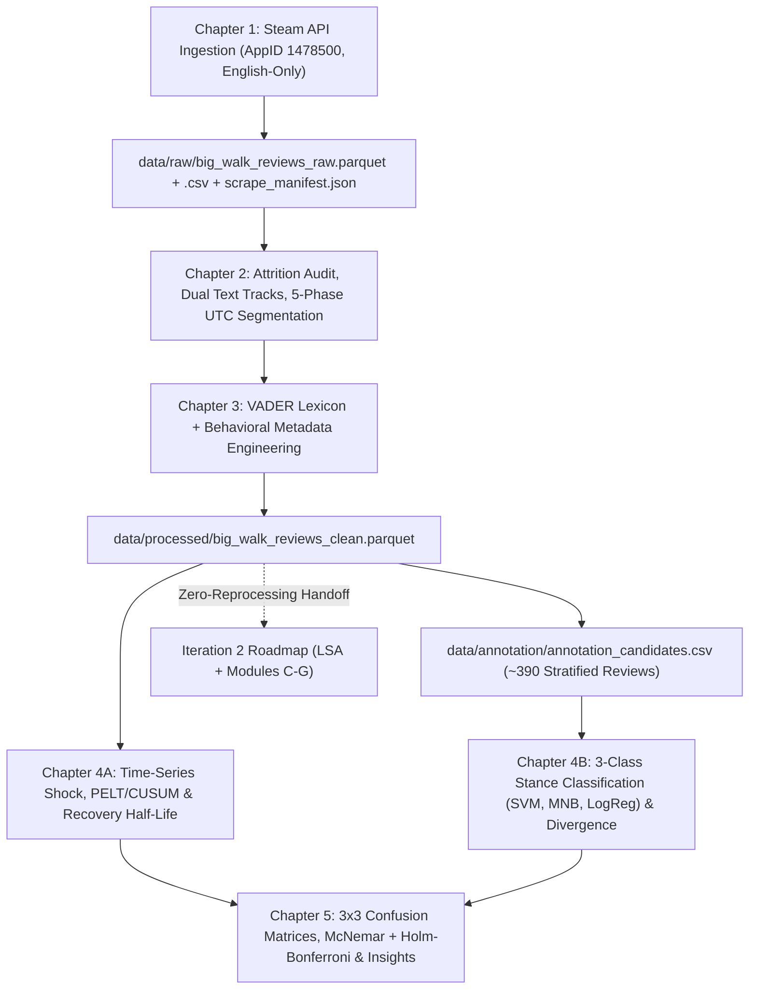

# Iteration 1 Architecture Plan: Steam Review Crisis Mining & Stance Classification (Modules 4A & 4B)

## 1. Project Scope & Classical Data Mining Constraints

This document defines the scoped **Iteration 1** Knowledge Discovery in Databases (KDD) pipeline for **Big Walk** (Steam AppID `1478500`). The pipeline investigates the temporal shock, stance polarization, and sentiment-rating divergence triggered by the November 2026 generative-AI controversy surrounding the game.

### Hard Methodological Boundaries
1. **100% Classical / Non-Neural Data Mining**: Zero Large Language Models (LLMs) and zero neural networks are used anywhere in the pipeline. Packages such as `torch`, `transformers`, `sentence-transformers`, `bertopic`, RoBERTa, and DeBERTa are strictly excluded.
2. **Dense Vectors Deferred**: `TruncatedSVD` (Latent Semantic Analysis, LSA) is deferred to Iteration 2 (`plans/roadmap_iteration_2_modules_c_to_g.md`). Iteration 1 operates purely on sparse sublinear TF-IDF n-grams, VADER lexicon scores, and engineered behavioral metadata.
3. **Minimal-Dependency Native Numerics**: Structural break detection (PELT and CUSUM) and pairwise statistical hypothesis testing (Exact Binomial / Continuity-Corrected Chi-Square McNemar's tests with step-down Holm-Bonferroni correction) are implemented natively in NumPy and SciPy, removing external dependencies on `ruptures`, `statsmodels`, and `vaderSentiment`.
4. **Reproducibility & Environment Portability**: The self-contained notebook `notebooks/big_walk_kdd_pipeline.ipynb` uses `RANDOM_SEED = 42`, auto-detects Google Colab vs. local workspace paths, and guards NLTK corpus downloads (`vader_lexicon`, `wordnet`, `omw-1.4`) for offline or cloud execution.

---

## 2. End-to-End KDD Pipeline Architecture

---

## 3. Chapter 1: Data Selection & Steam API Ingestion

- **Source Endpoint**: `https://api.steampowered.com/IUserReviewsService/GetAppReviews/v1/` (migrated from the retired `store.steampowered.com/appreviews/<appid>` endpoint, which now returns HTTP 302 HTML redirects).
- **Query Parameters** (`input_json` JSON payload):
  - `appid=1478500`
  - `filter=1` and `day_range=150` (numeric sort/range required by `IUserReviewsService/GetAppReviews/v1/` to traverse the full review history sorted newest-first back to launch day, rather than the default 30-day window)
  - `language='english'` (English-only scope)
  - `purchase_type='all'` (includes direct Steam purchases and key activations)
  - `filter_offtopic_activity=False` (crucial so Steam's off-topic review-bomb filter does not hide crisis reviews)
  - `num_per_page=100` iterated with cursor pagination until cursor exhaustion (HTTP 200 payload missing `reviews` after `pages_fetched > 0`, or empty cursor), with retry/backoff handling for HTTP 429/5xx and transient `JSONDecodeError`.
- **Schema Flattening & Deduplication**: Nested `author` dictionary attributes (`author_steamid`, `author_playtime_at_review`, `author_playtime_forever`, `author_num_games_owned`, `author_num_reviews`, etc.) are flattened to top-level columns alongside service-provided review attributes (`refunded`, `primarily_steam_deck`) and deduplicated on `recommendationid` (with `seen_ids` cursor-stall protection).
- **Checkpointing**: Controlled by `FORCE_RESCRAPE=False` in the notebook so subsequent runs load the persisted checkpoint cleanly:
  - `data/raw/big_walk_reviews_raw.parquet`
  - `data/raw/big_walk_reviews_raw.csv`
  - `data/raw/scrape_manifest.json` (total row count, UTC min/max timestamps, and SHA-256 checksums for raw CSV and Parquet).

---

## 4. Chapter 2: Preprocessing, Attrition Audit & 5-Phase Event Segmentation

### 4.1 Attrition Audit Table
Every filtering rule logs exact retained and dropped row counts into an explicit Attrition Audit table:
1. **Duplicate Removal**: Exact deduplication on `recommendationid`.
2. **Empty / Non-Lexical Art Removal**: Drops whitespace-only text and ASCII/box-drawing art containing `< 2` alphabetic tokens.
3. **Secondary Non-English Noise Check**: Applies an ASCII/Latin character-ratio heuristic **exclusively** to reviews with `>= 5` words, ensuring short valid English reviews (e.g., `"Great co-op game"`) are preserved while misclassified non-English paragraphs are removed.

### 4.2 Dual Text Track Preprocessing
Two specialized text representations are generated from `review` to serve fundamentally different downstream algorithms without destructive normalization:

| Text Track | Target Consumers | Transformations Applied | Preserved Signals |
| :--- | :--- | :--- | :--- |
| `text_vader` | `SentimentIntensityAnalyzer` (VADER), surface style stats | Strips Steam BBCode tags and URLs | Capitalization (`CAPS`), `!`, `?`, emoticons, punctuation intensity |
| `text_clean` | `TfidfVectorizer` (Module 4B), Iteration 2 LSA/PPMI/N-grams | Lowercasing, domain canonicalization, negation join (`not_` prefix on immediate next token), `WordNetLemmatizer` | Canonicalized controversy entities and negated predicates |

**Domain Canonicalization Rules (`text_clean`)**:
- `'gen ai'` -> `'genai'`
- `'ai slop'` -> `'ai_slop'`
- `'review bomb'` / `'review bombing'` -> `'review_bomb'`
- `'0.1%'` -> `'0_1_percent'`
- `'10 lines'` -> `'10_lines'`
- `'shadow caster'` / `'shadow casters'` -> `'shadow_caster'`

### 4.3 Five-Phase UTC Event Segmentation (`phase`)
Reviews are partitioned chronologically using `created_utc` into five controversy windows anchored around the November 9 IGF trigger and the November 10 developer FAQ backlash peak:

| Phase Label | UTC Start | UTC End | Event Context |
| :--- | :--- | :--- | :--- |
| `P0_Pre_Controversy` | `2026-08-04 00:00:00` | `2026-11-08 23:59:59` | Baseline organic reception prior to controversy |
| `P1_IGF_Trigger` | `2026-11-09 00:00:00` | `2026-11-10 05:59:59` | Initial Nov 9 IGF nomination/AI accusation trigger |
| `P2_FAQ_Backlash_Peak` | `2026-11-10 06:00:00` | `2026-11-11 23:59:59` | Post-FAQ backlash surge (Nov 10 peak volume & hostility) |
| `P3_CounterWave_Debate` | `2026-11-12 00:00:00` | `2026-11-15 23:59:59` | Counter-wave clarifications and community debate |
| `P4_PostCrisis_Recovery` | `2026-11-16 00:00:00` | Onward | Stabilization and return toward gameplay-focused reviews |

---

## 5. Chapter 3: Feature Transformation & Behavioral Metadata

### 5.1 VADER Lexicon Sentiment
Computed on `text_vader` via `nltk.sentiment.vader.SentimentIntensityAnalyzer` with light gaming/controversy lexicon tuning, yielding:
- `vader_neg`, `vader_neu`, `vader_pos`, `vader_compound` ($\in [-1, 1]$), and discrete `vader_label`.

### 5.2 Behavioral & Temporal Metadata Engineering
1. **Playtime & Refund-Window Signals**:
   - `playtime_at_review_hrs`, `post_review_playtime_hrs`
   - `playtime_bucket`: `<0.5h_Instant`, `0.5-2h_RefundWindow`, `2-10h_Standard`, `>10h_Veteran`
   - `is_refund_window`: `playtime_at_review_hrs < 2.0`
   - `stopped_after_review`: `post_review_playtime_hrs == 0` AND `is_refund_window`
   - `refunded` & `primarily_steam_deck`: Native boolean flags preserved from `IUserReviewsService/GetAppReviews/v1/` alongside `stopped_after_review` for direct refund-behavior corroboration and hardware platform stratification.
2. **Edit & Community Signals**:
   - `was_edited`: `timestamp_updated > timestamp_created + 300` (5-minute grace window)
   - `funny_ratio`: $\frac{\text{votes\_funny}}{\text{votes\_up} + \text{votes\_funny} + 1.0}$
   - `hourly_velocity`: Rolling $\pm 3$-hour total review count centered on `timestamp_created`
3. **Surface Stylometric Signals**:
   - `word_count`, `char_count`, `caps_ratio`, `exclamation_count`, `question_count`

### 5.3 Persisted Clean Parquet Schema
Saved to `data/processed/big_walk_reviews_clean.parquet` containing the core standardized columns (plus `refunded` and `primarily_steam_deck` when present from the API):
`recommendationid`, `review`, `text_vader`, `text_clean`, `timestamp_created`, `timestamp_updated`, `created_utc`, `phase`, `voted_up`, `votes_up`, `votes_funny`, `weighted_vote_score`, `steam_purchase`, `received_for_free`, `refunded`, `primarily_steam_deck`, `playtime_at_review_hrs`, `post_review_playtime_hrs`, `playtime_bucket`, `is_refund_window`, `stopped_after_review`, `was_edited`, `funny_ratio`, `hourly_velocity`, `word_count`, `char_count`, `caps_ratio`, `exclamation_count`, `question_count`, `vader_neg`, `vader_neu`, `vader_pos`, `vader_compound`, `vader_label`.

### 5.4 Ablation Feature Regimes (Text-Only vs. Multimodal)
- **Regime 1 (Text-Only)**: `TfidfVectorizer(ngram_range=(1, 2), min_df=2, max_df=0.90, sublinear_tf=True, max_features=5000)` on `text_clean`.
- **Regime 2 (Multimodal)**: `ColumnTransformer` joining TF-IDF n-grams with behavioral metadata (`playtime_at_review_hrs`, `is_refund_window`, `stopped_after_review`, `was_edited`, `funny_ratio`, `hourly_velocity`, `word_count`, `caps_ratio`, `exclamation_count`, `vader_compound`, etc.).
  - Scaled with `StandardScaler` for `LinearSVC` and `LogisticRegression`.
  - Scaled with `MinMaxScaler(feature_range=(0, 1), clip=True)` (plus shifted `vader_compound`) for `MultinomialNB`, strictly enforcing $\min(X_{\text{train}}) \ge 0$.

---

## 6. Chapter 4A: Time-Series Shock, PELT/CUSUM & Recovery Half-Life

Module 4A quantifies the temporal dynamics of the review shock without relying on neural models or `ruptures`:

1. **Dual Aggregation Windows**:
   - Daily series (`2026-08-04` onward) for baseline vs. crisis comparison.
   - 6-hour high-resolution crisis zoom (`2026-11-07` to `2026-11-18` UTC) capturing rapid onset and post-FAQ reaction.
2. **Uncertainty Quantification**:
   - Wilson Score 95% Confidence Intervals on negative review proportion $\hat{p} = 1 - \text{mean}(\text{voted\_up})$ per bin, avoiding normal-approximation clipping at low counts or extreme proportions.
3. **Pure-NumPy Structural Change-Point Detection**:
   - **Exact PELT** (Pruned Exact Linear Time with L2/RBF segment cost dynamic programming) identifying optimal structural breaks in the negative review rate and volume series.
   - **CUSUM** (Cumulative Sum control chart) validating mean-shift onset against ground-truth timestamps `T1` (`2026-11-09` IGF Trigger) and `T2` (`2026-11-10` Developer FAQ).
4. **Quantitative Shock Summary Metrics**:
   - **Baseline Negative Rate** (mean negative rate in `P0_Pre_Controversy`)
   - **Peak Negative Rate**
   - **Shock Magnitude**: $\Delta \text{NegRate}_{\max} = \text{Peak} - \text{Baseline}$ and cumulative excess negative reviews above baseline
   - **Onset Velocity**: Elapsed hours from `T1` trigger to peak negative intensity
   - **Recovery Half-Life**: $t_{1/2} = \ln(2) / \lambda$ estimated via `scipy.optimize.curve_fit` fitting $p(t) = p_{\text{base}} + A e^{-\lambda t}$ on the post-peak negative rate (with an explicit fallback guard if the post-peak recovery horizon is too short for stable exponential convergence).
5. **Visualizations**: Dual-panel daily volume and negative rate figure (Wilson 95% CI, `T1`/`T2` markers, PELT break lines) and 6-hour crisis zoom with fitted exponential decay overlay.

---

## 7. Chapter 4B: Gold Labeling, 3-Class Stance Classification & Sentiment Divergence

### 7.1 Semi-Manual Gold Labeling Checkpoint
- **Stratified Sampling**: ~390 candidate reviews stratified across `phase x voted_up` exported to `data/annotation/annotation_candidates.csv` with a heuristic `suggested_label` column and a blank `gold_label` column, paired with coding guidelines in `data/annotation/ANNOTATION_GUIDE.md`.
- **Target Classes**:
  1. `Gameplay_Genuine`: Organic evaluation of game mechanics, co-op experience, visuals, or performance unrelated to the AI controversy.
  2. `Anti_AI_Backlash`: Criticism, protest, boycott, or negative commentary targeting alleged generative AI usage, disclosure, or IGF eligibility.
  3. `Pro_Dev_Clarification`: Defense of the developers, citation of the technical clarification (`0_1_percent`, `10_lines`, `shadow_caster`), or explicit condemnation of review-bombing.
- **Execution Modes**:
  - `GOLD_VERIFIED`: Loads human-verified `data/annotation/gold_labels.csv`.
  - `ALLOW_PRELABEL_DRYRUN=True`: Falls back to `suggested_label` in `annotation_candidates.csv` when `gold_labels.csv` is absent, printing a prominent dry-run warning banner.

### 7.2 Leak-Free Evaluation & Classical Model Suite
- **Data Split**: `StratifiedShuffleSplit(n_splits=1, test_size=0.30, random_state=42)` creates a locked **30% Held-Out Test Set**.
- **Hyperparameter Tuning**: `GridSearchCV(..., cv=StratifiedKFold(5, shuffle=True, random_state=42), scoring='f1_macro')` fitted **exclusively** on the 70% Train Set (TF-IDF vocabulary, scalers, and grid search never touch the test set).
- **Model Comparison (Text-Only vs. Multimodal Ablation)**:
  1. **SVM**: `CalibratedClassifierCV(LinearSVC(class_weight='balanced', random_state=42, max_iter=5000), cv=3)`
  2. **Multinomial Naive Bayes**: `MultinomialNB()` (with strict non-negativity assertion `X_train_nb.min() >= 0`)
  3. **Logistic Regression**: `LogisticRegression(class_weight='balanced', max_iter=2000, random_state=42)`

### 7.3 Full-Corpus Stance Inference & Divergence Analysis
- **Stacked Stance Time-Series**: The best Multimodal model infers stances across the entire cleaned corpus, plotting daily/phase composition to connect Module 4B directly back to the Module 4A shock curve.
- **VADER vs. `voted_up` Divergence**: Cross-tabulation and visualization quantifying lexical-polarity vs. Steam recommendation divergence—specifically isolating `Pro_Dev_Clarification` reviews that express strong lexical anger (`vader_compound < -0.05` targeting review-bombers) while casting `voted_up = True`.
- **Behavioral Validation**: Non-parametric Kruskal-Wallis H-test and pairwise Mann-Whitney U tests comparing `playtime_at_review_hrs` across the 3 predicted stances.

---

## 8. Chapter 5: Statistical Model Comparison & Actionable Synthesis

1. **Side-by-Side 3x3 Confusion Matrices**: Raw counts and row-normalized recall percentages across `Gameplay_Genuine`, `Anti_AI_Backlash`, and `Pro_Dev_Clarification` for SVM, MultinomialNB, and LogisticRegression on the locked Held-Out Test Set.
2. **Comprehensive Classification Metrics**: Accuracy, Macro-Precision, Macro-Recall, Macro-F1, Weighted-F1, Cohen's $\kappa$, and Matthews Correlation Coefficient (MCC).
3. **Pairwise McNemar's Tests + Holm-Bonferroni Correction**:
   - Evaluated across all 3 model pairs (`SVM vs MultinomialNB`, `SVM vs LogisticRegression`, `LogisticRegression vs MultinomialNB`) on the identical Held-Out Test Set.
   - Contingency breakdown: `(n11, b, c, n00)`.
   - Adaptive exact/asymptotic rule: **Exact Binomial** (`scipy.stats.binomtest(min(b, c), n=b+c, p=0.5, alternative='two-sided')`) when discordant count `b + c < 25`; **Continuity-Corrected Chi-Square** $\chi^2 = \frac{(|b - c| - 1)^2}{b + c}$ (`scipy.stats.chi2.sf(chi2_stat, df=1)`) when `b + c >= 25`.
   - Step-down **Holm-Bonferroni** adjusted p-values (`holm_p`) controlling family-wise error rate at $\alpha = 0.05$.
4. **Domain Actionability Tables**: Structured synthesis translating empirical findings into operational playbooks for **Indie Studio Crisis Communication** (e.g., FAQ timing vs. half-life) and **Platform Moderator Review-Bomb Detection** (e.g., separating low-playtime `Anti_AI_Backlash` bursts from `Pro_Dev_Clarification` counter-waves).

---

## 9. Exact Impact of Scoping Out Modules C-G and LSA from Iteration 1

Deferring `TruncatedSVD` (LSA) and Modules C through G to Iteration 2 produces a deliberate, verifiable engineering trade-off:

| Dimension | Retained in Iteration 1 | Deferred to Iteration 2 | Concrete Impact on Iteration 1 |
| :--- | :--- | :--- | :--- |
| **Feature Space** | Sparse TF-IDF (1-2 n-grams) + VADER + Behavioral Metadata | `TruncatedSVD` ($k=100$ LSA) + L2 Normalization | Preserves exact lexical interpretability and `MultinomialNB` non-negativity; sacrifices latent synonym compression for rare-word rumor matching (deferred to Module D). |
| **Temporal Modeling** | Volume, Negative Rate, Wilson CI, PELT/CUSUM, Exponential Half-Life (Module 4A) | Kleinberg Burst Automaton, Fightin' Words Dirichlet Log-Odds, Delta TF-IDF (Module C) | Quantifies *when* and *how hard* the shock hit and decayed, without per-token burst onset/offset intervals across phases. |
| **Rumor Tracking** | 3-class stance classification (`Anti_AI_Backlash` aggregate) | Fine-grained IGF Disqualification, AI Art, and Steam Disclosure decay curves (Module D) | Measures total anti-AI volume accurately, while sub-claim rumor extinction rates after the Nov 10 FAQ await Module D. |
| **Semantic Structure** | Domain canonicalization + negation join | PPMI co-occurrence ego-networks around `'ai'`/`'code'` (Module E) | Captures direct n-gram predictors in linear models without graph topology shifts (centrality/clustering) between `P1+P2` and `P3+P4`. |
| **Brigading & Personas** | Playtime buckets, `stopped_after_review`, `funny_ratio`, `hourly_velocity`, `was_edited` | Copy-paste Char 4-gram cosine $\ge 0.80$, IsolationForest, LOF, Spherical K-Means, FP-Growth (Modules F & G) | Surfaces individual behavioral signals inside supervised stance models; unsupervised duplicate campaigns, anomaly scores, and association rules are cleanly decoupled into Modules F and G. |
| **Reliability & Velocity** | Zero neural deps, pure NumPy PELT/McNemar, < 60s end-to-end execution | Multi-module unsupervised discovery | Guarantees a clean, leak-free supervised benchmark and frozen Parquet/CSV schema (`big_walk_reviews_clean.parquet`, `gold_labels.csv`) that Iteration 2 consumes with zero reprocessing. |
