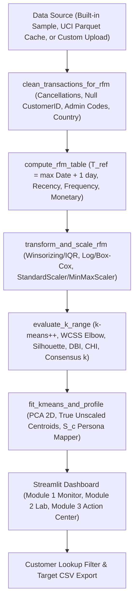
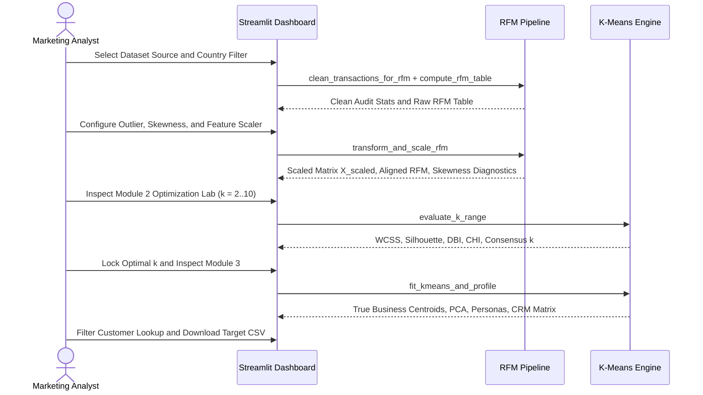

# Execution Plan: Kandidat 2 - Customer Segmentation Using RFM & K-Means Clustering

**Project:** Customer Segmentation Using RFM (Recency, Frequency, Monetary) and K-Means Clustering on Online Retail Transaction Data  
**Target Directory:** `d:\05-Dev\Colab\Data Mining-Project\app-kandidat-2-rfm\`  
**Source Proposal:** [kandidat-2-rfm-kmeans-segmentation.md](file:///d:/05-Dev/Colab/Data%20Mining-Project/project/kandidat-2-rfm-kmeans-segmentation.md)  
**Runtime Environment:** Python 3.13 (`C:\Users\acer\AppData\Local\Programs\Python\Python313\python.exe`)

---

## 1. Review of Proposal & Technical Gap Analysis

### 1.1 Proposal Strengths
1. **Strong Literature Grounding:** Synthesizes five directly relevant peer-reviewed studies—Chen, Sain, & Guo (2012), Suoth, Almalik, & Ramadhani (2026), Ramadhansyah et al. (2026), Triantara et al. (2025), and Nikmah et al. (2023)—justifying why K-Means outperforms DBSCAN and Hierarchical Clustering on skewed RFM distributions when paired with Log Transformation ($\ln(1+x)$), Winsorizing ($3 \times \text{IQR}$), and StandardScaler.
2. **Clear CRISP-DM & KDD Alignment:** Maps all 6 CRISP-DM phases to the 5 KDD stages cleanly, from raw transaction audit (`InvoiceNo` cancellations `'C'`, missing `CustomerID`, non-positive `Quantity`/`UnitPrice`, administrative codes) through feature engineering, clustering, evaluation, and CRM deployment.
3. **Actionable 3-Module Dashboard Architecture:** Separates preprocessing verification (Module 1), multi-metric $k$ selection (Module 2), and business segment profiling / CRM lookup export (Module 3) in a coherent 3-week student/team execution window.

### 1.2 Technical Risks Identified & Engineered Mitigations

| Risk ID | Identified Gap / Failure Mode in Raw Proposal | Root Cause | Engineered Mitigation |
| :--- | :--- | :--- | :--- |
| **R1** | **Lossy Inverse Transformation of Business Centroids** | Proposal Sections 4.4 and 5.2 suggest inverse-transforming K-Means centroids back to days/orders/GBP. When Winsorizing (`3 x IQR` / `P99`), `log1p`, or `Box-Cox` is applied, inverse transformation of the mean centroid computes a capped geometric mean rather than true arithmetic customer spend—understating wholesale `Champions` revenue and skewing Revenue Share %. | Compute **true unscaled business centroids** (Mean, Median, Total Revenue, Customer Count, Customer Share %, Revenue Share %) directly by aggregating `rfm_raw_df` grouped by fitted cluster assignments. Keep transformed/scaled centroids strictly for geometric visualizations (Snake Plot, Radar Chart, PCA projection). |
| **R2** | **Non-Deterministic Cluster Labeling Across Seeds & Values of `k`** | K-Means assigns arbitrary numeric indices (`0..k-1`) that permute across `k` values or random seeds, breaking hardcoded persona names (`Cluster 0 = Champions`). | Implement a **Deterministic RFM Persona Mapper** computing composite health score $S_c = z(F_c) + z(M_c) - z(R_c)$ across cluster centroids, sorting clusters descending by $S_c$ (with deterministic tie-breakers) and assigning strictly unique, business-readable labels for every $k \in [2, 10]$. |
| **R3** | **Row Misalignment Under `iqr_1.5` Outlier Dropping** | Removing outlier rows from the feature matrix without propagating the row mask back to the customer RFM metadata table causes index misalignment when joining cluster labels and `CustomerID`. | `transform_and_scale_rfm` returns `(X_scaled, rfm_filtered_df, diagnostics)` with reset aligned indices so `len(X_scaled) == len(rfm_filtered_df)` is an invariant across all outlier modes (`none`, `iqr_1.5`, `winsorize_3iqr`, `winsorize_p99`). |
| **R4** | **Zero-Variance / Box-Cox Collapse on Filtered Country Subsets** | On smaller country subsets (or after `iqr_1.5` filtering), `Frequency` can have `Q1 == Q3 == 1` (`IQR == 0`), causing naive Winsorizing or Box-Cox (`scipy.stats.boxcox`) to collapse variance to zero or raise `ValueError: Data must not be constant`. | Guard `IQR == 0` in both `iqr_1.5` and `winsorize_3iqr` (skipping or falling back cleanly without collapsing constant features), clamp Box-Cox inputs strictly $> 0$, and bypass Box-Cox safely when `ptp == 0`. |
| **R5** | **Slow Cold-Start & Offline Fragility on UCI 541,909-Row Excel File** | Downloading and parsing the 22 MB `.xlsx` file via `openpyxl` takes 30-60s and fails without internet access. | Cache normalized UCI transactions to `data/online_retail.parquet` via `pyarrow`, wrap UI steps with `@st.cache_data`, and provide an authentic multi-segment built-in benchmark sample (`generate_rfm_retail_sample_data`) plus automatic graceful fallback on network errors. |
| **R6** | **Pandas 3.0 & Schema Alias Compatibility** | UCI Online Retail I (`InvoiceNo`, `UnitPrice`, `CustomerID`) and Online Retail II (`Invoice`, `Price`, `Customer ID`) have slightly different column names, and Pandas 3.0 enforces Copy-on-Write and stricter string/NA semantics. | Normalize column aliases on ingestion, explicitly avoid in-place chained assignments, check `.notna()` before string casting, and strip `.0` artifacts from float-parsed `CustomerID` values. |

---

## 2. Mathematical & Methodological Specification

### 2.1 RFM Aggregation Formulas
Given cleaned transaction log $\mathcal{D}_{\text{clean}}$ with reference snapshot timestamp:
$$T_{\text{ref}} = \max(\text{InvoiceDate}) + 1\text{ day}$$
For each unique customer $i$:
- **Recency ($R_i$):** $\lfloor (T_{\text{ref}} - \max(\text{InvoiceDate}_i))_{\text{days}} \rfloor \ge 1$
- **Frequency ($F_i$):** $|\{\text{InvoiceNo}_{i}\}|$ (unique invoice count)
- **Monetary ($M_i$):** $\sum_{t \in \mathcal{T}_i} (\text{Quantity}_t \times \text{UnitPrice}_t)$
- **Primary Country:** Revenue-weighted mode of `Country` per `CustomerID`.

### 2.2 Preprocessing Pipeline Options
1. **Outlier Handling:**
   - `none`: Raw RFM values preserved.
   - `iqr_1.5`: Drops customers outside $[Q_1 - 1.5\cdot\text{IQR}, Q_3 + 1.5\cdot\text{IQR}]$ on any RFM feature with $\text{IQR} > 0$.
   - `winsorize_3iqr` *(default)*: Caps values at $[Q_1 - 3\cdot\text{IQR}, Q_3 + 3\cdot\text{IQR}]$, preserving VIP wholesalers without letting extreme points pull centroids away from the core population.
   - `winsorize_p99`: Caps values to $[P_{01}, P_{99}]$.
2. **Skewness Transformation:**
   - `none`: No nonlinear transform.
   - `log1p` *(default)*: $x' = \ln(1 + \max(x, 0))$.
   - `boxcox`: Parametric Box-Cox power transformation optimizing $\lambda$ on strictly positive inputs.
3. **Feature Scaling:**
   - `standard` *(default)*: $z = \frac{x' - \mu}{\sigma}$ (`StandardScaler`).
   - `minmax`: $x'' = \frac{x' - x'_{\min}}{x'_{\max} - x'_{\min}}$ (`MinMaxScaler`).

### 2.3 Clustering, Multi-Metric Evaluation, and Consensus `k`
K-Means runs with `init="k-means++"`, `n_init=10`, `max_iter=300`, `random_state=42` across $k \in [k_{\min}, k_{\max}]$:
- **WCSS (Inertia):** $\sum_{j=1}^{k} \sum_{x_i \in C_j} \|x_i - \mu_j\|_2^2$ (discrete geometric elbow point detected via maximum perpendicular chord distance).
- **Silhouette Score:** $\frac{1}{N}\sum_{i=1}^N \frac{b(i)-a(i)}{\max(a(i),b(i))} \in [-1, 1]$ (maximize).
- **Davies-Bouldin Index (DBI):** $\frac{1}{k}\sum_{i=1}^k \max_{j \neq i} \frac{\sigma_i + \sigma_j}{d(\mu_i, \mu_j)} \ge 0$ (minimize).
- **Calinski-Harabasz Index (CHI):** Ratio of between-cluster to within-cluster dispersion (maximize).
- **Consensus `k` Score:** Weighted normalized combination of Silhouette (0.35), inverted DBI (0.30), Elbow proximity (0.20), and CHI (0.15) to avoid degenerate $k=2$ overfitting while respecting separation quality.

### 2.4 Deterministic Persona Mapping & CRM Action Matrix
For each fitted cluster $c \in \{0, \dots, k-1\}$, standardize cluster mean RFM coordinates across clusters to $z(R_c), z(F_c), z(M_c)$ and compute composite health score:
$$S_c = z(F_c) + z(M_c) - z(R_c)$$
Clusters are sorted descending by $S_c$ and deterministically mapped to unique tier labels for any $k \in [2, 10]$ (e.g., for $k=4$: `Champions / Loyal Customers`, `Potential Loyalists`, `At-Risk Customers`, `Hibernating / Lost Customers`; for $k=5$: `Champions / VIP`, `Loyal Customers`, `Potential Loyalists`, `At-Risk Customers`, `Hibernating / Lost Customers`), each paired with a structured CRM action matrix row (`Primary Objective`, `Recommended Actions`, `Incentive Type`, `Priority Channel`, `Budget Allocation`).

---

## 3. File Architecture & Module Responsibilities

```text
app-kandidat-2-rfm/
├── app.py                     # 3-Module Streamlit + Plotly Interactive Dashboard
├── requirements.txt           # Pinned dependency list
├── README.md                  # Architecture overview & Python 3.13 run instructions
├── data/                      # Cached UCI Online Retail .parquet storage (auto-created)
├── src/
│   ├── __init__.py            # Package exports
│   ├── data_loader.py         # UCI loader/Parquet cache + 12-month multi-segment sample generator
│   ├── rfm_pipeline.py        # Transaction cleaning audit, RFM aggregation, outlier/skew/scaling
│   └── kmeans_engine.py       # k-range evaluation, consensus k, PCA, true centroids, persona & CRM mapper
└── tests/
    └── test_kandidat_2.py     # Unit, edge-case, integration, and AppTest smoke tests
```

### System Architecture Flow



### Interactive Analysis Sequence



---

## 4. CRISP-DM (6 Phases) & KDD (5 Stages) Mapping

| CRISP-DM Phase | KDD Stage | Implemented Artifact / Function | Key Output |
| :--- | :--- | :--- | :--- |
| 1. Business Understanding | Pre-KDD Goal Definition | Plan & CRM Action Matrix (`build_crm_marketing_matrix`) | Retention, expansion, and win-back segment objectives |
| 2. Data Understanding | 1. Data Selection | `load_or_download_retail_data`, `generate_rfm_retail_sample_data` | 8-column transaction DataFrame & Parquet cache |
| 3a. Data Preparation (Cleaning) | 2. Preprocessing | `clean_transactions_for_rfm` | Valid line-item transactions & removal audit dictionary |
| 3b. Data Preparation (Features) | 3. Transformation | `compute_rfm_table`, `transform_and_scale_rfm` | Customer RFM table, Winsorized/Log-transformed `X_scaled` |
| 4. Modeling | 4. Data Mining | `evaluate_k_range`, `fit_kmeans_and_profile` | `k-means++` models, cluster labels, PCA projections |
| 5. Evaluation | 5. Interpretation / Evaluation | Consensus `k` scorer, true unscaled centroids, $S_c$ Persona Mapper | Multi-metric curves, Revenue Share %, Persona labels |
| 6. Deployment | Knowledge Integration | `app.py` (3-Module Dashboard + CSV Customer Lookup Export) | Self-service interactive segmentation dashboard |

---

## 5. 3-Week Execution Roadmap

1. **Week 1 - Data Ingestion, Cleaning Audit, & RFM Pipeline:**
   - Implement `src/data_loader.py` with Parquet caching, graceful UCI fallback, and realistic 12-month multi-segment synthetic generator (`Champions`, `Loyal`, `Regular`, `At-Risk`, `Hibernating`, plus UCI anomalies).
   - Implement `src/rfm_pipeline.py` with schema normalization, cancellation/admin filtering, `T_ref` RFM aggregation, outlier methods (`none`, `iqr_1.5`, `winsorize_3iqr`, `winsorize_p99`), skewness transforms (`none`, `log1p`, `boxcox`), and scalers (`standard`, `minmax`).
2. **Week 2 - K-Means Engine, Multi-Metric Validation, & Persona Mapping:**
   - Implement `src/kmeans_engine.py` with `evaluate_k_range` (`k-means++`, WCSS, Silhouette, DBI, CHI, consensus `k`), 2D PCA coordinates + centroids, true unscaled aggregation centroids, composite health score $S_c = z(F_c) + z(M_c) - z(R_c)$ mapper for `k=2..10`, and CRM strategy matrix.
3. **Week 3 - Streamlit Dashboard, Automated Testing, & Verification:**
   - Build `app.py` with Sidebar Control Center, Module 1 (Distribution & Preprocessing Monitor), Module 2 (Cluster Optimization Lab), and Module 3 (Segment Profiling, 3D RFM/2D PCA, Snake/Radar, CRM Matrix, and Customer Lookup CSV Export).
   - Run full `pytest` suite including `streamlit.testing.v1.AppTest` smoke validation and strict zero-emoji verification.

---

## 6. Verification & Quality Assurance Strategy

1. **Unit & Edge-Case Testing (`tests/test_kandidat_2.py`):**
   - Validate sample generator schema, 12-month timeframe, and presence of UCI anomalies (`C` cancellations, null `CustomerID`, negative quantities, `POST`/`M` codes).
   - Validate `clean_transactions_for_rfm` audit counts and Country filtering.
   - Validate `compute_rfm_table` reference date (`max + 1 day`), Recency `>= 1`, unique invoice Frequency, and exact Monetary summation.
   - Validate all combinations of outlier handling (`iqr_1.5` row alignment), skewness transforms (`log1p`, `boxcox` + constant-column guard), and scalers (`standard`, `minmax`).
   - Validate `evaluate_k_range` metric columns, monotonic WCSS decrease, valid consensus `k`, and `fit_kmeans_and_profile` across `k` in `2..10` (unique persona labels, `Revenue Share (%)` summing to 100%, unscaled mean accuracy).
2. **UI Smoke Testing:**
   - Execute `streamlit.testing.v1.AppTest.from_file("app.py")` verifying zero uncaught exceptions, clean rendering of all 3 modules, and interactive parameter updates.
3. **Rule Compliance Checks:**
   - Automated regex scan confirming zero emoji characters across all `.py` files.
   - Manual and automated verification that all standard English Data Mining technical terms remain intact without forced translations.
