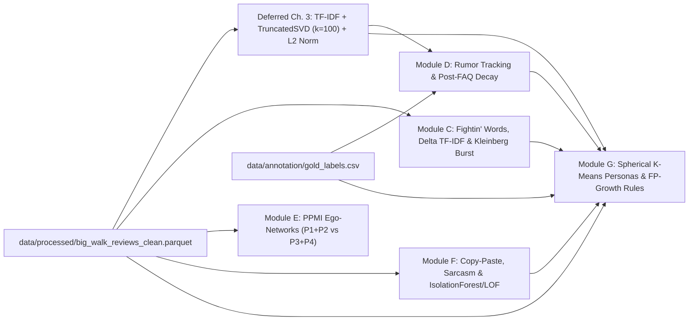

# Iteration 2 Technical Roadmap: LSA & Analytical Modules C through G

## 1. Purpose & Zero-Reprocessing Data Contract

This roadmap specifies the exact mathematical formulations, algorithms, validation criteria, and schema integration blueprint for **Iteration 2** of the *Big Walk* (Steam AppID `1478500`) KDD project. Like Iteration 1, Iteration 2 enforces **100% Classical / Non-Neural Data Mining** (zero LLMs, zero neural networks, zero transformer embeddings).

### Direct Consumption of Iteration 1 Artifacts (Zero Reprocessing)
Iteration 2 **must not** re-scrape the Steam API, re-run attrition filtering, re-lemmatize text, or re-segment event phases. Every module in Iteration 2 loads the frozen outputs produced by Iteration 1 directly as immutable inputs:

1. **Primary Corpus Table**: `data/processed/big_walk_reviews_clean.parquet`
   - Primary key: `recommendationid`
   - Text tracks: `text_vader` (punctuation/case preserved), `text_clean` (canonicalized, `not_`-joined, lemmatized)
   - Temporal & Phase columns: `timestamp_created`, `timestamp_updated`, `created_utc`, `phase` (`P0_Pre_Controversy`, `P1_IGF_Trigger`, `P2_FAQ_Backlash_Peak`, `P3_CounterWave_Debate`, `P4_PostCrisis_Recovery`)
   - Ground-truth Steam & community signals: `voted_up`, `votes_up`, `votes_funny`, `weighted_vote_score`, `steam_purchase`, `received_for_free`, `refunded`, `primarily_steam_deck`
   - Behavioral & VADER features: `playtime_at_review_hrs`, `post_review_playtime_hrs`, `playtime_bucket`, `is_refund_window`, `stopped_after_review`, `was_edited`, `funny_ratio`, `hourly_velocity`, `word_count`, `char_count`, `caps_ratio`, `exclamation_count`, `question_count`, `vader_neg`, `vader_neu`, `vader_pos`, `vader_compound`, `vader_label`
2. **Gold Stance Labels**: `data/annotation/gold_labels.csv`
   - Joined onto `big_walk_reviews_clean.parquet` via `recommendationid` to supply human-verified 3-class stance labels (`Gameplay_Genuine`, `Anti_AI_Backlash`, `Pro_Dev_Clarification`) for supervised threshold calibration (Module D) and transaction rule mining (Module G).

---

## 2. Deferred Chapter 3 Feature: Dense Semantic Vectors via LSA (`TruncatedSVD` + L2 Norm)

### 2.1 Mathematical Specification
1. **Sparse Term-Document Matrix**: Construct $X_{\text{tfidf}} \in \mathbb{R}^{N \times V}$ on `text_clean` using `TfidfVectorizer(ngram_range=(1, 2), min_df=2, max_df=0.90, sublinear_tf=True)`.
2. **Latent Semantic Analysis (`TruncatedSVD`)**: Compute the rank-$k$ ($k = 100$, `random_state=42`) singular value decomposition directly on the sparse TF-IDF matrix without mean centering:
   $$X_{\text{tfidf}} \approx U_k \Sigma_k V_k^\top, \quad Z = U_k \Sigma_k \in \mathbb{R}^{N \times 100}$$
3. **Row-Wise L2 Normalization**: Apply `sklearn.preprocessing.Normalizer(norm='l2', copy=False)` to $Z$:
   $$\hat{\mathbf{z}}_i = \frac{\mathbf{z}_i}{\max(\|\mathbf{z}_i\|_2, \epsilon)}$$
   so that every review lies on the unit hypersphere $S^{99}$ and inner products equal exact cosine similarity: $\cos(\mathbf{z}_i, \mathbf{z}_j) = \hat{\mathbf{z}}_i^\top \hat{\mathbf{z}}_j$.

### 2.2 Integration Constraints
- **Module Compatibility**: $\hat{Z}$ is consumed by Module D (rumor centroid cosine similarity) and Module G (Spherical K-Means). If tested in supervised classifiers, $\hat{Z}$ is compatible with `LinearSVC` and `LogisticRegression` only (never `MultinomialNB`, as SVD projections contain negative entries).
- **Leakage Rule**: Whenever LSA is used inside a supervised train/test split, `TfidfVectorizer` and `TruncatedSVD` must be fitted strictly on the 70% Train Set and `.transform()` applied to the Held-Out Test Set.

---

## 3. Module C: Keyword Burst & Narrative Shift

Module C quantifies how the crisis vocabulary emerges, peaks, and rotates across `P0` through `P4`.

### 3.1 Fightin' Words (Informative Dirichlet Prior Log-Odds Ratio)
Following Monroe, Colaresi, & Quinn (2008), compare unigram/bigram frequencies between two phase groups $i$ and $j$ (e.g., `P1+P2` Backlash vs. `P0` Baseline; `P3+P4` Counter-Wave vs. `P1+P2` Backlash) regularized by an informative background prior $\alpha_w$ scaled from total corpus word counts ($\alpha_0 = \sum_w \alpha_w$):

$$\hat{\delta}_w^{(i-j)} = \log \left( \frac{y_w^{(i)} + \alpha_w}{n^{(i)} + \alpha_0 - (y_w^{(i)} + \alpha_w)} \right) - \log \left( \frac{y_w^{(j)} + \alpha_w}{n^{(j)} + \alpha_0 - (y_w^{(j)} + \alpha_w)} \right)$$

$$\sigma^2\left(\hat{\delta}_w^{(i-j)}\right) \approx \frac{1}{y_w^{(i)} + \alpha_w} + \frac{1}{y_w^{(j)} + \alpha_w}, \qquad z_w^{(i-j)} = \frac{\hat{\delta}_w^{(i-j)}}{\sqrt{\sigma^2\left(\hat{\delta}_w^{(i-j)}\right)}}$$

Tokens with $|z_w| \ge 1.96$ identify statistically significant narrative shifts free from low-count frequency distortion.

### 3.2 Delta TF-IDF Across Phases
Compute smoothed phase-contrastive weights for term $t$ between target phase $P$ and reference phase $Q$:

$$\Delta\text{IDF}_t(P, Q) = \log_2 \left( \frac{(df_{t, P} + 1) / (N_P + 1)}{(df_{t, Q} + 1) / (N_Q + 1)} \right)$$

Rank top positive and negative $\Delta\text{TF-IDF}$ n-grams per transition (`P0 -> P1`, `P1 -> P2`, `P2 -> P3`, `P3 -> P4`).

### 3.3 Kleinberg's Burst Detection (Viterbi Infinite-State Automaton)
For key narrative tokens (e.g., `igf`, `genai`, `ai_slop`, `review_bomb`, `0_1_percent`, `10_lines`, `shadow_caster`), model binned occurrence counts $r_t$ out of $d_t$ total reviews per interval $t \in \{1, \dots, T\}$ (6-hour bins across the crisis window):
- **Emission States**: Base probability $p_0 = \sum_t r_t / \sum_t d_t$; elevated states $p_q = \min(s^q p_0, 1 - \epsilon)$ for state index $q \in \{0, 1, \dots, K\}$ with scaling factor $s = 2.0$. Binomial emission cost:
  $$\sigma(q, r_t, d_t) = -\ln \left[ \binom{d_t}{r_t} p_q^{r_t} (1 - p_q)^{d_t - r_t} \right]$$
- **Transition Cost**: Asymmetrical upward-jump penalty controlled by $\gamma = 1.0$:
  $$\tau(q_{t-1} \to q_t) = \begin{cases} \gamma (q_t - q_{t-1}) \ln T & \text{if } q_t > q_{t-1} \\ 0 & \text{if } q_t \le q_{t-1} \end{cases}$$
- **Decoding**: Solve $\arg\min_{q_1,\dots,q_T} \sum_t \sigma(q_t, r_t, d_t) + \sum_{t=2}^T \tau(q_{t-1} \to q_t)$ via exact **Viterbi dynamic programming** in NumPy, extracting burst start/end timestamps and total burst weight $\sum_{t \in \text{burst}} [\sigma(0, r_t, d_t) - \sigma(q_t, r_t, d_t)]$.

---

## 4. Module D: Misinformation & Rumor Decay Tracking

Module D decomposes `Anti_AI_Backlash` into specific falsifiable claims and measures whether the November 10 Developer FAQ (`T2`) extinguished each rumor.

### 4.1 Target Rumor Taxonomy
1. **`rumor_igf_disqualification`**: Claims that *Big Walk* should be or was disqualified/stripped of IGF awards or nominations due to generative AI.
2. **`rumor_ai_art_assets`**: Claims that visual art, textures, 3D models, animations, or dialogue were AI-generated (contrary to the developer clarification of ~10 lines of shader/shadow-caster code).
3. **`rumor_steam_disclosure`**: Claims that the studio violated Steam's mandatory Generative AI disclosure policy.

### 4.2 Hybrid Classical Rumor Detector (Proximity Regex + LSA Cosine Similarity)
1. **High-Precision Proximity Regex**: Token-distance patterns matching co-occurring rumor anchors within a bounded character/token gap (e.g., `\b(igf|indie_game_festival|award|nomination)\b.{0,50}\b(disqualif|ban|strip|fraud|ineligib)\b` on normalized text).
2. **LSA Cosine Similarity Expansion**:
   - Construct unit-norm prototype centroid $\mathbf{c}_r \in S^{99}$ for each rumor $r$ by averaging the L2-normalized LSA vectors $\hat{\mathbf{z}}_i$ of regex-matched seed reviews (and/or curated anchor phrases) and re-normalizing $\mathbf{c}_r \leftarrow \mathbf{c}_r / \|\mathbf{c}_r\|_2$.
   - Flag review $i$ for rumor $r$ if `(regex_match_r(i) == True)` OR `(\hat{z}_i^\top c_r >= \tau_r)`, where $\tau_r$ is calibrated against a small precision-audit subset of `gold_labels.csv` (`Anti_AI_Backlash` rows).

### 4.3 Post-FAQ Decay Curves
Aggregate binary rumor flags into 6-hour prevalence rates $p_r(t)$ before and after `T2` (`2026-11-10 06:00 UTC`). Fit exponential decay via `scipy.optimize.curve_fit` over $t \ge T_2$:

$$p_r(t) = A_r e^{-\lambda_r (t - t_{\text{peak}, r})} + p_{r, \infty}, \qquad t_{1/2}^{(r)} = \frac{\ln 2}{\lambda_r}$$

Compare $t_{1/2}^{(r)}$ across the three rumor classes alongside counter-claim adoption (`0_1_percent`, `10_lines`, `shadow_caster`) to evaluate which narratives persisted despite factual clarification.

---

## 5. Module E: Semantic Co-occurrence Ego-Networks

Module E uses `networkx` and Positive Pointwise Mutual Information (PPMI) to contrast community mental framing around `'ai'` (and `'genai'`) and `'code'` during peak backlash vs. counter-wave recovery.

### 5.1 PPMI Windowed Co-occurrence Formulation
Over `text_clean` token sequences within a symmetric sliding window of radius $W = 5$ tokens:
1. Count single-token occurrences $c(w)$ and unordered/ordered co-occurrences $c(w, u)$ within each phase pool:
   - **Backlash Pool**: `P1_IGF_Trigger` + `P2_FAQ_Backlash_Peak`
   - **Recovery Pool**: `P3_CounterWave_Debate` + `P4_PostCrisis_Recovery`
2. Filter vocabulary to tokens with $c(w) \ge 5$ in the pool, applying context distribution smoothing ($\alpha = 0.75$) on denominator marginals $P_\alpha(u) = \frac{c(u)^{0.75}}{\sum_v c(v)^{0.75}}$:
   $$\text{PPMI}(w, u) = \max\left(0,\; \log_2 \frac{P(w, u)}{P(w) P_\alpha(u)}\right)$$

### 5.2 Ego-Network Construction & Differential Metrics
- Extract 1-hop and filtered 2-hop `networkx.Graph` ego-networks centered on `'ai'`/`'genai'` and `'code'` with edges weighted by $\text{PPMI}(w, u) > 0$.
- Compute node-level weighted degree centrality, betweenness centrality, and local weighted clustering coefficient.
- Compute edge-weight framing shift $\Delta \text{PPMI}(w, u) = \text{PPMI}_{\text{P3+P4}}(w, u) - \text{PPMI}_{\text{P1+P2}}(w, u)$ to quantify the structural transition from accusation neighbors (`slop`, `steal`, `art`, `disqualify`) toward technical clarification neighbors (`10_lines`, `shadow_caster`, `shader`, `0_1_percent`, `review_bomb`).

---

## 6. Module F: Deep Behavioral Anomaly & Brigading Detection

Module F detects coordinated copy-paste campaigns, sarcastic award abuse, and multi-feature anomalous review bursts.

### 6.1 Copy-Paste & Templated Brigading Detection
1. **Character 4-gram TF-IDF Cosine Similarity**: Vectorize `text_clean` (filtered to `word_count >= 5` to exclude trivial `"good game"` collisions) using `TfidfVectorizer(analyzer='char_wb', ngram_range=(4, 4), min_df=2)` with L2 normalization. Compute sparse cosine matrix $S = X_{\text{char4}} X_{\text{char4}}^\top$ and flag review pairs $(i, j)$ with $i \neq j$ and $S_{ij} \ge 0.80$.
2. **Word $k$-Shingle Jaccard Verification**: For candidate pairs with $S_{ij} \ge 0.80$, compute word 3-shingle Jaccard similarity:
   $$J_3(i, j) = \frac{|Sh_3(i) \cap Sh_3(j)|}{|Sh_3(i) \cup Sh_3(j)|}$$
   and extract connected components (campaign clusters) via `networkx.connected_components` to measure brigade size, temporal synchronization, and shared `voted_up` polarity.

### 6.2 Funny-Award Sarcasm & Troll Mining
Analyze joint distributions of `votes_funny`, `funny_ratio`, `vader_compound`, and `voted_up` to flag sarcastic or bait reviews:
- Positive-rating sarcasm candidates: `voted_up == True` with extreme `funny_ratio` and negative or copypasta VADER profiles.
- Negative-rating meme/troll candidates: `voted_up == False` with high `votes_funny`, low `playtime_at_review_hrs`, and elevated `caps_ratio`.

### 6.3 Multivariate Unsupervised Anomaly Scoring
Standardize behavioral and lexical features (`playtime_at_review_hrs`, `post_review_playtime_hrs`, `hourly_velocity`, `was_edited`, `funny_ratio`, `word_count`, `caps_ratio`, `exclamation_count`, `vader_compound`, `max_char4_cos_sim`) and fit two complementary classical detectors from `scikit-learn`:
- **`IsolationForest(contamination=0.05, random_state=42)`** (global tree-partition isolation depth).
- **`LocalOutlierFactor(n_neighbors=20, contamination=0.05)`** (local density-ratio anomaly).

Cross-tabulate the consensus anomaly flag (`IF_outlier & LOF_outlier`) across `phase` (`P0`–`P4`) and `is_refund_window` to test whether anomalous activity concentrates disproportionately inside `P1` and `P2`.

---

## 7. Module G: Classic KDD Clustering & Association Rules

### 7.1 Spherical K-Means Reviewer Personas
Cluster reviews on the unit hypersphere combining L2-normalized LSA vectors $\hat{\mathbf{z}}_i$ (weighted by $\beta_{\text{text}}$) and L2-normalized standardized behavioral features $\hat{\mathbf{b}}_i$ (weighted by $\beta_{\text{beh}}$), re-normalized onto $S^{d-1}$:
$$\mathbf{x}_i = \frac{[\beta_{\text{text}} \hat{\mathbf{z}}_i \;;\; \beta_{\text{beh}} \hat{\mathbf{b}}_i]}{\left\|[\beta_{\text{text}} \hat{\mathbf{z}}_i \;;\; \beta_{\text{beh}} \hat{\mathbf{b}}_i]\right\|_2}$$
- **Algorithm**: Spherical K-Means alternating between cosine assignment $c_i = \arg\max_k \mathbf{x}_i^\top \boldsymbol{\mu}_k$ and unit-norm centroid update $\boldsymbol{\mu}_k \leftarrow \frac{\sum_{i \in C_k} \mathbf{x}_i}{\|\sum_{i \in C_k} \mathbf{x}_i\|_2}$.
- **Cluster Selection Sweep**: Evaluate $k \in \{3, 4, \dots, 10\}$ using **Silhouette Score** (`metric='cosine'`) and **Davies-Bouldin Index** to choose the parsimonious $k^*$ maximizing cluster separation and interpretability.
- **Persona Profiling**: Summarize each cluster by dominant `phase`, `playtime_bucket`, `voted_up` rate, top TF-IDF terms, and alignment with Iteration 1 stance labels.

### 7.2 Frequent Pattern & Association Rule Mining (FP-Growth via `mlxtend`)
1. **Transaction Discretization**: Encode each review as a binary itemset combining categorical and discretized attributes:
   - `phase` (`P0`–`P4`)
   - `playtime_bucket` (`<0.5h_Instant`, `0.5-2h_RefundWindow`, `2-10h_Standard`, `>10h_Veteran`)
   - Boolean behavioral flags (`is_refund_window`, `stopped_after_review`, `was_edited`, `voted_up=True/False`)
   - Discretized sentiment (`vader_label`), stance (`gold_label` or predicted stance), top Module C burst keywords, Module D rumor flags, and Module F consensus anomaly flag.
2. **Mining & Rule Filtering**:
   - Run `mlxtend.frequent_patterns.fpgrowth(df_ohe, min_support=0.02, use_colnames=True)`.
   - Extract rules via `mlxtend.frequent_patterns.association_rules(..., metric='confidence', min_threshold=0.60)`.
   - Rank and prune redundant rules by **Lift** ($\text{Lift} > 1.2$), **Confidence**, **Support**, **Leverage**, and **Conviction** to surface high-confidence behavioral-narrative patterns (e.g., `{phase=P2_FAQ_Backlash_Peak, is_refund_window=True, Anti_AI_Backlash} -> {voted_up=False, stopped_after_review=True}`).

---

## 8. Iteration 2 Artifact & Dependency Summary

| Component | Primary Library / Implementation | Input from Iteration 1 | Output Artifact |
| :--- | :--- | :--- | :--- |
| LSA (`k=100`) | `scikit-learn` (`TruncatedSVD`, `Normalizer`) | `text_clean` | `data/processed/big_walk_lsa_100.npy` |
| Module C | `numpy`, `scipy` (Dirichlet log-odds, Delta TF-IDF, Viterbi) | `text_clean`, `phase`, `created_utc` | Keyword burst & shift tables / plots |
| Module D | `re`, `numpy`, `scipy` (`curve_fit`) + LSA cosine | `text_clean`, `gold_labels.csv`, LSA | Rumor flags & half-life decay curves |
| Module E | `networkx`, `numpy` (PPMI) | `text_clean`, `phase` | Ego-network graphs & $\Delta\text{PPMI}$ tables |
| Module F | `scikit-learn` (`IsolationForest`, `LocalOutlierFactor`), `networkx` | `text_clean`, behavioral features | Anomaly scores & brigade clusters |
| Module G | `numpy` / `scikit-learn` (Spherical K-Means), `mlxtend` (`fpgrowth`) | `big_walk_reviews_clean.parquet`, `gold_labels.csv`, LSA, C/D/F flags | Persona profiles & FP-Growth rule tables |
