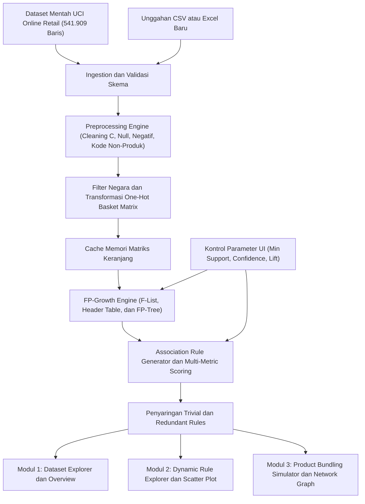
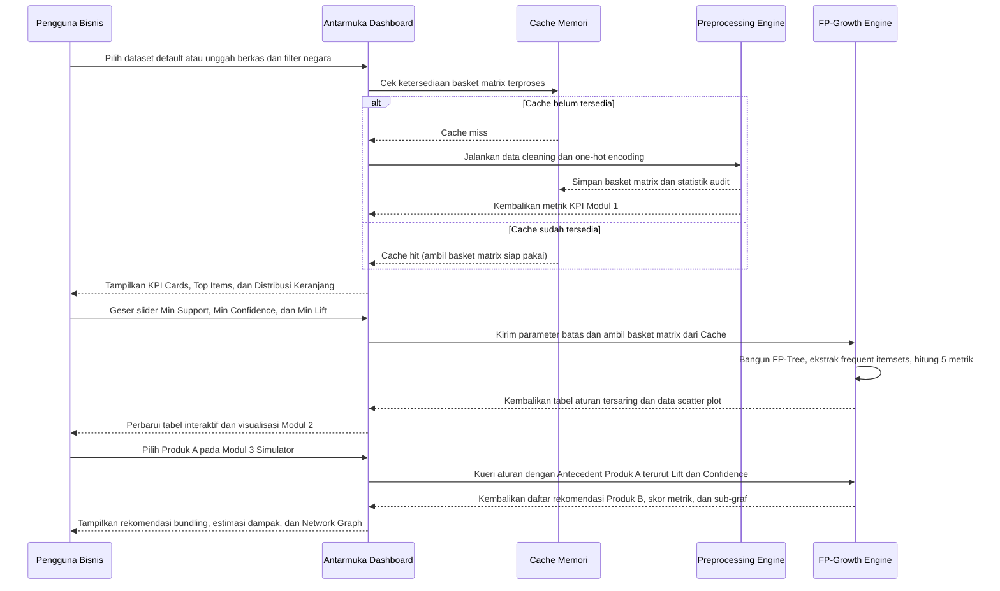

# Kajian Mendalam Kandidat 1: Market Basket Analysis Menggunakan Algoritma FP-Growth pada Dataset UCI Online Retail

Dokumen ini disusun sebagai landasan riset literatur, kerangka metodologis, formulasi matematis, serta rancangan arsitektur aplikasi dashboard interaktif untuk proyek Data Mining **Kandidat 1**, yaitu implementasi **Market Basket Analysis (MBA)** berbasis algoritma **Frequent Pattern Growth (FP-Growth)** pada dataset **UCI Online Retail**.

---

## 1. Identifikasi Masalah dan Konteks Bisnis

### 1.1 Latar Belakang Transaksi Ritel Skala Besar (UCI Online Retail)
Perkembangan perdagangan elektronik (*e-commerce*) menghasilkan volume catatan transaksi (*transaction logs*) dalam skala masif yang terus bertumbuh setiap hari. Dataset acuan yang digunakan dalam proyek ini adalah **Online Retail** dari **UCI Machine Learning Repository** (didonasikan oleh Dr. Daqing Chen, London South Bank University, berbasis studi kasus transaksi 2010–2011 dan dipublikasikan pada repositori UCI pada November 2015). Dataset ini merekam transaksi aktual sebuah perusahaan ritel daring non-toko (*non-store online retail*) yang berbasis di Inggris (*United Kingdom*) dalam rentang waktu **1 Desember 2010 hingga 9 Desember 2011**. Perusahaan tersebut menjual beragam barang hadiah (*all-occasion gifts*) dan perlengkapan rumah tangga, dengan porsi pelanggan yang signifikan berasal dari kalangan pedagang grosir (*wholesalers*) lintas 38 negara.

Secara struktural, berkas mentah dataset UCI Online Retail terdiri atas **541.909 baris transaksi** dengan **8 atribut asli** (`InvoiceNo`, `StockCode`, `Description`, `Quantity`, `InvoiceDate`, `UnitPrice`, `CustomerID`, dan `Country`). Dalam beberapa ringkasan metadata maupun catatan ringkas proyek (seperti pada `readme.md`), atribut tersebut kerap dirujuk sebagai **6 atribut utama** apabila disaring khusus untuk kebutuhan pemodelan transaksi/keranjang belanja atau ringkasan metadata dasar, namun secara fisik tabel sumber tetap memuat 8 kolom lengkap.

Meskipun catatan faktur tersimpan rapi secara historis, data mentah tersebut bersifat *transactional-level* per baris item (*line-item*) dan belum terstruktur menjadi wawasan strategis mengenai produk mana yang cenderung dibeli secara bersamaan dalam satu sesi belanja (*single basket*).

### 1.2 Kebutuhan Bisnis: Cross-Selling, Product Bundling, dan Tata Letak Katalog
Tanpa teknik *pattern mining* yang tepat, pengelola ritel daring menghadapi sejumlah tantangan operasional dan strategis:
1. **Kehilangan Peluang *Cross-Selling*:** Pada saat konsumen memasukkan suatu produk ke dalam keranjang belanja (*shopping cart*) atau menuju halaman *checkout*, sistem tidak memiliki rekomendasi otomatis berbasis bukti historis mengenai produk komplementer yang sangat mungkin dibutuhkan secara bersamaan. Akibatnya, rata-rata nilai pesanan (*Average Order Value* / AOV) sulit ditingkatkan secara organik.
2. **Perancangan *Product Bundling* yang Tidak Berbasis Data:** Strategi paket promo atau diskon *bundling* sering kali dibuat hanya berdasarkan intuisi tim pemasaran atau upaya menghabiskan stok lambat (*slow-moving stock*), tanpa mengetahui produk mana yang secara alami memiliki korelasi pembelian positif (*positive correlation*).
3. **Suboptimalitas Tata Letak Katalog Digital dan Manajemen Inventori:** Pada toko daring dengan ribuan jenis SKU (*Stock Keeping Unit*), penempatan produk yang saling berkaitan pada posisi katalog yang terpisah meningkatkan friksi pencarian bagi pembeli. Selain itu, ketidaktahuan mengenai ketergantungan antar-item berisiko menyebabkan *stock-out* tidak sinkron, yakni ketika satu produk utama sedang dipromosikan tetapi produk pendampingnya kehabisan stok.

### 1.3 Mengapa FP-Growth pada Skala 541.909 Baris?
Pada dataset dengan ratusan ribu baris dan ribuan variasi produk unik, algoritma pencarian pola klasik seperti **Apriori** memerlukan proses *candidate generation* secara berulang dan pemindaian basis data berkali-kali untuk setiap panjang *itemset*. Pendekatan tersebut rentan menyebabkan lonjakan konsumsi memori (*out-of-memory*) dan waktu eksekusi yang sangat lambat ketika ambang *minimum support* diturunkan untuk menjaring pola pembelian produk yang spesifik.

Algoritma **Frequent Pattern Growth (FP-Growth)** yang diperkenalkan oleh Han, Pei, dan Yin (2000) mengatasi hambatan tersebut dengan memadatkan seluruh basis data transaksi ke dalam struktur pohon prefiks bernama **FP-Tree** hanya melalui **dua kali pemindaian basis data** tanpa membangkitkan kandidat *itemset* secara eksplisit. Karakteristik ini menjadikan FP-Growth jauh lebih skalabel, cepat, dan realistis untuk diimplementasikan menjadi prototipe aplikasi web interaktif dalam rentang waktu pengerjaan **2 hingga 3 minggu**, sekaligus menjaga interpretabilitas hasil bagi pengguna bisnis.

Perlu pula dicatat sejak awal batasan domain (*domain constraint*) yang wajib dipahami oleh tim proyek: dataset UCI Online Retail merepresentasikan transaksi ritel/grosir di Inggris pada tahun 2010–2011, bukan transaksi ritel lokal Indonesia masa kini, serta tidak seluruh *association rules* yang dihasilkan secara otomatis bernilai komersial tanpa proses penyaringan statistik dan validasi bisnis.

---

## 2. Bedah Paper Utama dan Paper Pendukung

Untuk memastikan landasan ilmiah yang kuat serta melampaui sekadar asumsi metodologis, dilakukan penelusuran dan verifikasi literatur terhadap dua paper referensi utama beserta empat paper pendukung riil terkini terkait penerapan **Market Basket Analysis** dan algoritma **FP-Growth** pada skenario *online retail* dan *e-commerce*.

### 2.1 Bedah Paper Utama 1: Chen, Sain, dan Guo (2012) & Dataset UCI Online Retail
* **Sitasi Lengkap:** Chen, D., Sain, S. L., & Guo, K. (2012). *Data mining for the online retail industry: A case study of RFM model-based customer segmentation using data mining*. Journal of Database Marketing & Customer Strategy Management, Vol. 19, No. 3, pp. 197–208. DOI: 10.1057/dbm.2012.17. (Dataset *Online Retail* didonasikan secara publik ke UCI Machine Learning Repository oleh Dr. Daqing Chen pada November 2015).
* **Klarifikasi Faktual Fokus Paper:** Berdasarkan penelusuran literatur, penting untuk melaporkan secara akurat bahwa paper Chen, Sain, dan Guo (2012) tidak menerapkan algoritma FP-Growth ataupun Market Basket Analysis secara langsung. Studi kasus asli dalam paper tersebut memfokuskan pemodelan pada **segmentasi pelanggan berbasis model RFM (*Recency, Frequency, Monetary*)** menggunakan algoritma **K-Means clustering** dan **Decision Tree induction** (yang dijalankan menggunakan perangkat lunak SAS Enterprise Guide dan SAS Enterprise Miner).
* **Konteks Masalah dan Dataset:** Paper ini mengangkat persoalan bisnis nyata dari sebuah perusahaan ritel daring berbasis di Inggris (*non-store online retailer*) yang berdiri sejak 1981 dan bertransformasi ke penjualan daring untuk produk hadiah unik segala acara. Banyak pelanggan perusahaan tersebut merupakan *wholesalers* yang melakukan pembelian berulang dalam jumlah besar. Dataset transaksi periode 01/12/2010 hingga 09/12/2011 yang menyertai penelitian ini kemudian menjadi tolok ukur (*benchmark*) global pada UCI Machine Learning Repository dengan total **541.909 baris transaksi** dan **8 atribut asli**.
* **Relevansi bagi Kandidat 1:** Paper ini merupakan sumber otoritatif pertama yang mendefinisikan struktur skema transaksi UCI Online Retail, makna kode pembatalan (`InvoiceNo` diawali karakter `'C'`), fenomena *missing values* pada `CustomerID`, serta karakteristik domain *wholesaler* yang memengaruhi distribusi *Quantity* dan ukuran keranjang belanja pada implementasi FP-Growth.

### 2.2 Bedah Paper Utama 2: Karimah dan Udayanti (2026)
* **Sitasi Lengkap:** Karimah, S. R., & Udayanti, E. D. (2026). *Comparison of Apriori and FP-Growth Algorithms in Market Basket Analysis for Online Book Sales*. Journal of Applied Informatics and Computing (JAIC), Vol. 10, No. 1, Februari 2026, pp. 566–574. DOI: 10.30871/jaic.v10i1.11921 (Universitas Dian Nuswantoro; diterbitkan oleh Politeknik Negeri Batam).
* **Masalah:** Toko buku daring memiliki puluhan ribu catatan pesanan dengan katalog judul yang sangat beragam, sehingga diperlukan metode *Market Basket Analysis* untuk menggali pola keterkaitan pembelian buku sekaligus mengevaluasi algoritma mana yang paling efisien secara komputasional untuk skala transaksi daring.
* **Dataset:** Sebanyak **74.090 transaksi bersih** (*cleaned transactions*) penjualan toko buku daring pada rentang waktu Januari hingga Juni 2025.
* **Metode dan Preprocessing:** Peneliti melakukan tahap *data cleaning* (penghapusan anomali serta penanganan *missing values*) dan transformasi ke format matriks transaksi (*one-hot encoding*) sebelum menjalankan pengujian komparatif antara algoritma **Apriori** dan **FP-Growth** pada berbagai variasi nilai *minimum support* dan *minimum confidence*. *(Catatan faktual: ringkasan publikasi yang terindeks pada penelusuran web memfokuskan perbandingan pola efisiensi parameter secara kualitatif dan tidak merinci angka eksak seluruh variasi ambang support atau catatan waktu dalam satuan detik pada bagian abstrak publik)*.
* **Temuan Utama:**
  1. **Konsistensi Pengetahuan:** Pada setiap variasi parameter yang identik, algoritma Apriori dan FP-Growth menghasilkan jumlah serta isi *association rules* yang **persis sama**. Artinya, pemilihan di antara kedua algoritma memengaruhi efisiensi komputasi sistem, bukan akurasi aturan bisnis yang ditemukan.
  2. **Perbandingan Efisiensi Komputasi:** Apriori tercatat mampu berjalan lebih cepat pada subset data yang lebih kecil dan berstruktur sederhana karena tidak menanggung *overhead* awal pembentukan struktur pohon. Sebaliknya, **FP-Growth** unggul dalam kestabilan penggunaan memori dan efisiensi waktu pemrosesan ketika diuji pada volume data serta konfigurasi parameter yang lebih besar dan padat.
  3. **Wawasan Bisnis:** Teridentifikasi aturan keterkaitan kuat antar-judul buku yang memiliki kesamaan penulis atau tema, antara lain asosiasi judul *"Rumah Kaca"* dan *"Jejak Langkah"* dengan nilai *Confidence* mencapai **0,903** (90,3%) dan nilai *Lift* sebesar **183,306**, serta hubungan antara *"Namaku Alam"* dan *"Pulang"* untuk mendorong strategi *cross-selling* dan sistem rekomendasi toko buku daring.

### 2.3 Bedah Paper Pendukung 1: Fairuzindah et al. (2025)
* **Sitasi Lengkap:** Fairuzindah, A., Islami, I. R. A., Rexa, N., Anggraini, S., & Sunandi, E. (2025). *Implementasi Market Basket Analysis dengan Algoritma Frequent Pattern Growth pada Data Transaksional di Electronic Commerce*. JDMIS: Journal of Data Mining and Information Systems, Vol. 3, No. 2, Agustus 2025. DOI: 10.54259/jdmis.v3i2.4593 (Universitas Bengkulu).
* **Masalah:** Pertumbuhan masif transaksi pada platform *e-commerce* menciptakan timbunan log penjualan yang belum diolah menjadi wawasan pemasaran, sementara algoritma pembangkitan kandidat berulang rentan terhambat pada dataset berskala setengah juta baris.
* **Dataset:** Dataset transaksi *e-commerce* dari toko ritel daring di Inggris yang memuat **541.909 catatan transaksi** (merujuk pada korpus UCI Online Retail).
* **Metode dan Preprocessing:** Data mentah melalui proses pembersihan dan transformasi keranjang transaksi, lalu dimodelkan langsung menggunakan algoritma **FP-Growth** dengan parameter **minimum support 1% (0,01)** dan **minimum confidence 80% (0,80)**. *(Catatan faktual: jumlah baris pasca-cleaning tidak tertera secara eksplisit pada ringkasan terindeks)*.
* **Temuan Utama:** Pada ambang *confidence* yang ketat (80%), algoritma FP-Growth berhasil mengekstrak **13 association rules** yang sangat reliabel untuk mengidentifikasi relasi antar-produk yang sering dibeli bersamaan. Penelitian ini menegaskan kelayakan FP-Growth dalam mendukung fitur rekomendasi produk *e-commerce* tanpa hambatan *candidate generation*.

### 2.4 Bedah Paper Pendukung 2: Abadi et al. (2026)
* **Sitasi Lengkap:** Abadi, L. P., Sulistiono, H., Saputra, S., & Ariyani, L. (2026). *Analisis Association Rule Menggunakan Algoritma FP-Growth pada Dataset Online Retail*. Jejak Digital: Jurnal Ilmiah Multidisiplin, Vol. 2, No. 5, Agustus–September 2026, hal. 9422–9431. DOI: 10.63822/5ap2mr81 (Universitas Indraprasta PGRI).
* **Masalah:** Pengelola ritel daring kesulitan memetakan relasi produk secara akurat untuk mendukung keputusan *cross-selling*, *product bundling*, penataan produk, serta manajemen persediaan pada data transaksi skala besar.
* **Dataset:** Dataset **UCI Online Retail** dengan **541.909 baris mentah** dan 8 atribut asli; setelah tahapan pembersihan data, tersisa sekitar **392.692 transaksi/baris valid** yang siap ditransformasikan menjadi format keranjang.
* **Metode dan Preprocessing:** Melakukan *data cleaning* (menghapus *missing values*, data duplikat, transaksi pembatalan, dan nilai tidak valid), dilanjutkan dengan transformasi biner menggunakan teknik *one-hot encoding*. Pemodelan FP-Growth dijalankan dengan **minimum support 1% (0,01)** dan **minimum confidence 50% (0,50)**, serta dievaluasi menggunakan *Support*, *Confidence*, dan *Lift Ratio*.
* **Temuan Utama:** Pada ambang *support* 1%, algoritma FP-Growth menghasilkan **973 frequent itemsets**. Aturan asosiasi terkuat ditemukan pada pasangan produk **`REGENCY TEA PLATE PINK` -> `REGENCY TEA PLATE GREEN`** dengan nilai *Support* sebesar **0,0109 (1,09%)**, *Confidence* sebesar **90,18%**, dan *Lift Ratio* sebesar **61,90**. Temuan ini menunjukkan bahwa pola pembelian paling dominan pada dataset UCI Online Retail banyak muncul pada varian seri produk perlengkapan rumah tangga/meja makan yang dikoleksi dalam satu pembelian.

### 2.5 Bedah Paper Pendukung 3: Nursasongka et al. (2024)
* **Sitasi Lengkap:** Nursasongka, R. M. T., Fahrurrozi, I., Oktiawati, U. Y., Taufiq, U., Farooq, U., & Alfian, G. (2024). *Utilizing association rule mining for enhancing sales performance in web-based dashboard application*. Indonesian Journal of Electrical Engineering and Computer Science (IJEECS), Vol. 36, No. 2, November 2024, pp. 1105–1113. DOI: 10.11591/ijeecs.v36.i2.pp1105-1113.
* **Masalah:** Dashboard analitik ritel pada umumnya bersifat deskriptif historis (hanya melaporkan total penjualan dan tren masa lalu) dan belum terintegrasi dengan modul penambangan pola pembelian (*prescriptive analytics*) yang mudah digunakan oleh pemilik bisnis non-teknis.
* **Dataset & Metode:** Penelitian ini menguji dataset transaksi penjualan ritel dengan membandingkan algoritma **FP-Growth** dan **Apriori** pada batasan parameter kendala yang identik, kemudian mengintegrasikan model FP-Growth ke dalam aplikasi dashboard web interaktif berbasis **Streamlit**. *(Catatan faktual: ukuran jumlah baris dataset uji dan angka ambang support/confidence spesifik tidak tercantum dalam ringkasan terindeks)*.
* **Temuan Utama:** Pada batasan parameter yang sama, kedua algoritma menghasilkan jumlah *frequent itemsets* yang persis identik, namun **FP-Growth unggul jauh dalam kecepatan eksekusi**, menyelesaikan proses dalam waktu **2,89 detik** dibandingkan **Apriori selama 5,29 detik**. Integrasi hasil ke antarmuka Streamlit terbukti mempermudah pemilik usaha dalam memvisualisasikan keterkaitan antar-produk dan mengambil keputusan peningkatan penjualan.

### 2.6 Bedah Paper Pendukung 4 (Benchmark Komputasi Tambahan): Noviana, Hermawan, dan Avianto (2023)
* **Sitasi Lengkap:** Noviana, R., Hermawan, A., & Avianto, D. (2023). *Market Basket Analysis Menggunakan Algoritma Apriori dan FP Growth untuk Menentukan Pola Pembelian Konsumen*. Jurnal Media Informatika Budidarma, Vol. 7, No. 3, Juli 2023, hal. 1474–1482. DOI: 10.30865/mib.v7i3.6304 (Universitas Teknologi Yogyakarta).
* **Masalah & Dataset:** Memanfaatkan arsip transaksi penjualan *Groceries* untuk membandingkan kinerja kecepatan komputasi serta kualitas aturan pembelian antara Apriori dan FP-Growth.
* **Temuan Utama:** Studi ini mencatat perbedaan kecepatan komputasi yang sangat signifikan, di mana **FP-Growth** membutuhkan waktu **0,15892 detik** sedangkan **Apriori** membutuhkan **3,1765 detik** (sekitar 20 kali lebih lambat). Dari sisi pola, ditemukan kombinasi aturan seperti `{yogurt, sausage} -> {whole milk}` (*Support* `0,00147`, *Confidence* `25,58%`, *Lift* `1,61986`) dan `{sausage, rolls/buns} -> {whole milk}` (*Support* `0,001136`, *Confidence* `21,25%`, *Lift* `1,34559`).

---

### 2.7 Tabel Matriks Komparasi Paper

| Sitasi | Masalah | Dataset & Ukuran | Tahapan Preprocessing | Parameter Min Support & Min Confidence | Metrik Evaluasi | Temuan / Benchmark Utama |
| :--- | :--- | :--- | :--- | :--- | :--- | :--- |
| **Chen, Sain, & Guo (2012)**, *J. Database Mark. Cust. Strategy Manag.*, 19(3), 197–208. DOI: 10.1057/dbm.2012.17 | Memahami nilai pelanggan dan menyusun segmentasi pelanggan berbasis RFM pada industri ritel daring Inggris (non-MBA). | **UCI Online Retail** (01/12/2010–09/12/2011): **541.909 baris mentah**, 8 atribut asli (`InvoiceNo`, `StockCode`, `Description`, `Quantity`, `InvoiceDate`, `UnitPrice`, `CustomerID`, `Country`). | Pembersihan *missing `CustomerID`* (~135.080 baris), eliminasi transaksi pembatalan (`InvoiceNo` awalan `'C'`), agregasi metrik RFM per pelanggan. | Tidak berlaku (menggunakan *K-Means clustering* dan *Decision Tree*, bukan *association rule mining*). | Profil klaster RFM, evaluasi struktur pohon keputusan (*SAS Enterprise Miner*). | Menjadi sumber baku konteks bisnis ritel/grosir hadiah UK dan mendokumentasikan anomali data mentah pada dataset 541.909 baris yang dipakai ulang oleh riset MBA selanjutnya. |
| **Karimah & Udayanti (2026)**, *JAIC*, 10(1), 566–574. DOI: 10.30871/jaic.v10i1.11921 | Evaluasi perbandingan efisiensi komputasi dan kualitas aturan asosiasi antara Apriori dan FP-Growth pada transaksi buku daring. | Data penjualan toko buku daring (Januari–Juni 2025): **74.090 transaksi bersih**. | *Data cleaning* (penghapusan anomali dan *missing values*) serta transformasi ke matriks transaksi (*one-hot encoding*). | Pengujian multi-variasi parameter *min support* dan *min confidence* (angka ambang batas spesifik seluruh skenario tidak dirinci pada ringkasan terindeks). | *Support*, *Confidence*, *Lift*, waktu eksekusi, penggunaan memori. | Kedua algoritma menghasilkan aturan yang **identik** (contoh: *Rumah Kaca* -> *Jejak Langkah*, *Confidence* `0,903`, *Lift* `183,306`). Apriori cepat pada subset kecil sederhana; **FP-Growth** unggul stabilitas memori dan efisiensi pada skala besar. |
| **Fairuzindah et al. (2025)**, *JDMIS*, 3(2). DOI: 10.54259/jdmis.v3i2.4593 | Ekstraksi pola pembelian konsumen secara efisien pada data transaksi *e-commerce* berskala ratusan ribu baris untuk rekomendasi produk. | Dataset transaksi ritel daring Inggris (**UCI Online Retail**): **541.909 catatan transaksi**. | *Data cleaning* dan pemformatan data ke struktur keranjang belanja (*basket format*). | `min_support` = **1% (0,01)**; `min_confidence` = **80% (0,80)**. | *Support*, *Confidence*, jumlah *association rules*. | FP-Growth mengekstrak **13 association rules** yang kuat tanpa hambatan *candidate generation* pada skala 541.909 baris, relevan untuk sistem rekomendasi *e-commerce*. |
| **Abadi et al. (2026)**, *Jejak Digital*, 2(5), 9422–9431. DOI: 10.63822/5ap2mr81 | Menggali kombinasi produk yang dibeli bersamaan untuk strategi *cross-selling*, *bundling*, penataan produk, dan manajemen stok. | **UCI Online Retail**: **541.909 baris awal** (8 atribut) menjadi **~392.692 baris valid** pasca-cleaning. | Penghapusan *missing values*, duplikat, transaksi dibatalkan, nilai tidak valid, serta transformasi *one-hot encoding*. | `min_support` = **1% (0,01)**; `min_confidence` = **50% (0,50)**. | *Support*, *Confidence*, *Lift Ratio*. | Menghasilkan **973 frequent itemsets**. Aturan terkuat: `REGENCY TEA PLATE PINK` -> `REGENCY TEA PLATE GREEN` (*Support* `0,0109`, *Confidence* `90,18%`, *Lift* `61,90`). |
| **Nursasongka et al. (2024)**, *IJEECS*, 36(2), 1105–1113. DOI: 10.11591/ijeecs.v36.i2.pp1105-1113 | Mengatasi keterbatasan dashboard deskriptif dengan mengintegrasikan *association rule mining* ke dashboard web interaktif. | Dataset transaksi penjualan ritel (ukuran baris spesifik tidak dirinci dalam ringkasan terindeks). | Pembersihan log transaksi dan transformasi matriks keranjang belanja. | Parameter uji konsisten antara Apriori dan FP-Growth (nilai numerik spesifik tidak tertera di ringkasan terindeks). | *Support*, *Confidence*, waktu eksekusi komputasi, kesesuaian *frequent itemsets*. | *Frequent itemsets* identik, namun **FP-Growth hampir 2x lebih cepat** (**2,89 detik** vs **Apriori 5,29 detik**) dan berhasil di-deploy ke **Streamlit web dashboard**. |
| **Noviana, Hermawan, & Avianto (2023)**, *J. Media Inform. Budidarma*, 7(3), 1474–1482. DOI: 10.30865/mib.v7i3.6304 | Mengidentifikasi pola pembelian konsumen ritel bahan pangan sekaligus membandingkan kecepatan Apriori dan FP-Growth. | Dataset transaksi ritel **Groceries**. | Pembersihan dan pemetaan transaksi ke format keranjang belanja. | Evaluasi kombinasi aturan pada nilai *support* rendah (tercatat hingga `0,001136`–`0,00147` pada aturan hasil). | *Support*, *Confidence*, *Lift Ratio*, kecepatan eksekusi (detik). | **FP-Growth ~20x lebih cepat** (**0,15892 detik** vs **Apriori 3,1765 detik**); menemukan pola seperti `{yogurt, sausage} -> {whole milk}` (*Confidence* `25,58%`, *Lift* `1,61986`). |

---

## 3. Metodologi CRISP-DM dan Pemetaan KDD

Dalam proyek Data Mining Kandidat 1, kerangka kerja utama yang dipakai adalah **CRISP-DM (*Cross-Industry Standard Process for Data Mining*)** karena berorientasi kuat pada siklus hidup kebutuhan bisnis dan *deployment* aplikasi, sementara tahapan teknis transformasi datanya dipetakan sejajar dengan kerangka **KDD (*Knowledge Discovery in Databases*)**.

### 3.1 Tabel Ekuivalensi 6 Fase CRISP-DM vs 5 Tahapan KDD (Kasus MBA FP-Growth)

Pemetaan antara 6 fase CRISP-DM dan 5 tahapan KDD bersifat fungsional (tidak selalu berkorespondensi satu-ke-satu secara kaku): CRISP-DM memulai siklus dari pemahaman konteks bisnis di hulu dan mengakhirinya dengan implementasi sistem produksi di hilir, sedangkan KDD memfokuskan aliran pemrosesan data dari seleksi hingga interpretasi pola.

| No | Fase CRISP-DM (6 Fase) | Tahapan KDD (5 Tahapan) | Aktivitas Spesifik untuk Kasus MBA FP-Growth (UCI Online Retail) | Output / Artefak yang Dihasilkan |
| :---: | :--- | :--- | :--- | :--- |
| 1 | **Business Understanding** | *(Tahap pra-KDD / Penetapan Tujuan Bisnis yang mengarahkan Data Selection)* | Mengidentifikasi kebutuhan *cross-selling*, *product bundling*, dan penataan katalog; menentukan target keberhasilan aplikasi dashboard dalam horizon 2–3 minggu; memahami batasan data ritel Inggris. | Rumusan masalah bisnis, KPI proyek, dan definisi *scope* analisis. |
| 2 | **Data Understanding** | **1. Data Selection** (serta inspeksi awal menuju **Preprocessing**) | Mengakses dataset UCI Online Retail (541.909 baris, 8 atribut); melakukan audit tipe data, pengecekan *missing values* (`CustomerID`, `Description`), identifikasi kode `'C'` pada `InvoiceNo`, nilai negatif, dan deteksi kode non-produk. | Laporan audit kualitas data (*data profiling*), statistik deskriptif, dan pemilihan atribut inti (`InvoiceNo`, `StockCode`/`Description`, `Quantity`, `UnitPrice`, `Country`, `InvoiceDate`). |
| 3 | **Data Preparation** | **2. Preprocessing** & **3. Transformation** | **Preprocessing:** Data cleaning (hapus `'C'`, `Quantity <= 0`, `UnitPrice <= 0`, null `Description`, duplikat, dan biaya `POST`/`DOT`/`M`/dll., serta penetapan kebijakan `CustomerID` null). **Transformation:** Agregasi per `InvoiceNo` menjadi **transactional basket matrix** melalui *one-hot encoding*. | Dataset transaksi bersih (sekitar 392.692 hingga 397.884 baris valid, tergantung kebijakan `CustomerID` dan filter negara) serta matriks biner keranjang belanja (*sparse basket matrix*). |
| 4 | **Modeling** | **4. Data Mining** | Menentukan `min_support`; melakukan 2 kali *scan* basis data; membentuk *F-List*, **Header Table**, dan **FP-Tree**; mengekstrak *Conditional Pattern Base* dan *Conditional FP-Tree*; membangkitkan *frequent itemsets*; serta mengekstrak kandidat *association rules*. | Struktur *FP-Tree*, daftar *frequent itemsets*, dan himpunan awal *association rules*. |
| 5 | **Evaluation** | **5. Interpretation / Evaluation** | Menghitung metrik *Support*, *Confidence*, *Lift*, *Conviction*, dan *Leverage*; menyaring *trivial rules* dan *redundant rules*; melakukan uji sensitivitas parameter; dan memvalidasi relevansi aturan secara bisnis. | Kumpulan *association rules* terkurasi yang bernilai bisnis tinggi dan terverifikasi. |
| 6 | **Deployment** | *(Pasca-KDD / Operasionalisasi Pengetahuan ke Sistem)* | Membangun *interactive web dashboard* (Streamlit/Dash) lengkap dengan fitur eksplorasi data, *tuning* parameter dinamis, simulator rekomendasi *bundling*, *network graph*, serta dokumentasi operasional bagi pengguna akhir. | Aplikasi dashboard interaktif siap pakai dan laporan rekomendasi strategi pemasaran. |

---

### 3.2 Penjelasan Rinci Tahapan Teknis pada UCI Online Retail

#### A. Audit Data Awal (Data Understanding / Data Selection)
Berdasarkan karakteristik terverifikasi pada UCI Online Retail (**541.909 baris**, **8 atribut**):
* `InvoiceNo`: Nomor faktur 6 digit per transaksi; jika diawali huruf **`'C'`**, menandakan transaksi pembatalan (*cancellation*).
* `StockCode`: Kode unik produk (umumnya 5 digit untuk barang dagangan fisik, namun memuat kode huruf untuk biaya layanan/administratif).
* `Description`: Nama produk. Terdapat **1.454 baris bernilai null/kosong** pada kolom ini.
* `Quantity`: Jumlah unit dibeli per baris transaksi. Mengandung nilai nol atau negatif pada baris pembatalan atau penyesuaian stok.
* `InvoiceDate`: Tanggal dan waktu faktur dibuat (01/12/2010 sampai 09/12/2011).
* `UnitPrice`: Harga per unit dalam Poundsterling (£). Mengandung nilai `<= 0` pada baris koreksi atau barang promosi/rusak.
* `CustomerID`: Nomor identifikasi pelanggan 5 digit. Terdapat **135.080 baris bernilai null** (~**24,93%** dari total data).
* `Country`: Negara asal transaksi, mencakup **38 negara unik** (didominasi secara sangat besar oleh *United Kingdom*).

Dari 8 atribut di atas, untuk keperluan pemodelan **MBA FP-Growth**, atribut yang berperan langsung dalam pembentukan aturan adalah `InvoiceNo` (pengelompokan keranjang) dan `Description` / `StockCode` (item produk), sementara `Quantity`, `UnitPrice`, `CustomerID`, `Country`, dan `InvoiceDate` berfungsi kritis pada tahap **Data Cleaning**, pemfilteran wilayah/segmen, dan kalkulasi nilai transaksi untuk analisis dampak bisnis.

#### B. Data Cleaning (Preprocessing)
Tahap *data cleaning* pada UCI Online Retail merupakan langkah paling krusial karena kotornya data mentah akan langsung menghasilkan aturan asosiasi yang menyesatkan. Langkah pembersihan terstruktur meliputi:
1. **Eliminasi Pembatalan (`InvoiceNo` berawalan `'C'`):** Terdapat sekitar **8.905 baris pembatalan** pada dataset mentah yang merepresentasikan retur atau batal beli (umumnya berpasangan dengan nilai `Quantity` negatif). Baris ini wajib dihapus agar barang yang dikembalikan tidak dihitung sebagai bagian dari keranjang pembelian sukses.
2. **Penanganan `Quantity <= 0` dan `UnitPrice <= 0`:** Seluruh baris dengan kuantitas nol/negatif (misalnya penyesuaian kerusakan atau *write-off* stok) maupun harga satuan nol/negatif (misalnya barang sampel gratis tanpa transaksi komersial atau *bad debt adjustment*) harus dikeluarkan dari pemodelan.
3. **Penanganan Nilai Kosong pada `Description` dan Duplikat:** Menghapus **1.454 baris** yang tidak memiliki nama produk (`Description` null) serta membersihkan duplikasi baris identik (*exact duplicate line-items*) agar tidak memicu bias penghitungan atau gangguan pengindeksan. Dilakukan pula normalisasi teks nama produk seperti pemangkasan spasi berlebih di awal/akhir string (*whitespace trimming*) sehingga dua entri produk yang sama tidak terbaca sebagai dua SKU berbeda.
4. **Kebijakan Penanganan `CustomerID` Kosong (~24,93% / 135.080 baris):** Pada titik ini terdapat perbedaan mendasar antara proyek **RFM Clustering (Kandidat 2)** dan **MBA FP-Growth (Kandidat 1)**:
   * Jika tujuan analisis hanya memetakan keterkaitan produk antar-keranjang berdasarkan nomor faktur (`InvoiceNo`) tanpa melacak profil pelanggan, transaksi tamu (*guest checkout* dengan `CustomerID` null) yang memiliki `InvoiceNo`, `Description`, `Quantity > 0`, dan `UnitPrice > 0` yang sah **dapat dipertahankan** (menghasilkan sekitar **397.884 baris** sebelum penyaringan tambahan atau mempertimbangkan porsi valid per faktur).
   * Namun, dalam praktik baku banyak literatur UCI Online Retail (seperti studi Abadi et al., 2026) yang menghendaki konsistensi pembersihan dengan analisis pelanggan serta menyingkirkan entri administratif tak bertuan, baris `CustomerID` kosong turut dihapus, menyisakan **406.829 baris** sebelum penyaringan pembatalan/harga dan mengerucut menjadi sekitar **392.692–397.884 baris bersih** dengan sekitar **18.532–18.536 faktur transaksi unik** (atau hingga **~25.900 transaksi** apabila mencakup subset transaksi non-null `Description` sebelum penghapusan `CustomerID` kosong). Kebijakan ini perlu dijadikan parameter pilihan eksplisit atau didokumentasikan secara transparan dalam eksperimen.
5. **Penyaringan Transaksi Biaya dan Kode Non-Produk (`StockCode` Administratif):** Dataset UCI Online Retail memuat berbagai kode non-barang dagangan fisik yang wajib disaring keluar agar tidak mencemari rekomendasi *bundling*, antara lain:
   * **`POST`**: Biaya pengiriman/pos (*Postage*).
   * **`DOT`**: Biaya pengiriman *Dotcom Postage*.
   * **`M`**: Penyesuaian manual (*Manual*).
   * **`CRUK`**: Komisi donasi *Cancer Research UK*.
   * **`BANK CHARGES`**: Biaya administrasi bank.
   * Kode administratif/layanan lain seperti **`D`** (*Discount*), **`C2`** (*Carriage*), **`S`** (*Samples*), **`AMAZONFEE`**, **`PADS`**, dan **`B`** (*Adjust bad debt*).
   Tanpa pembersihan kode-kode ini, `POST` sering muncul sebagai *consequent* dominan pada aturan asosiasi karena menyertai hampir semua pengiriman lintas negara, sehingga menghasilkan *trivial rules* yang tidak berguna bagi strategi *bundling* produk.
6. **Pertimbangan Filter Segmentasi Pasar (`Country` dan *Wholesaler*):** Karena transaksi luar negeri memiliki pola biaya pengiriman dan keranjang berbeda, beberapa eksperimen memilih fokus pada pasar tunggal seperti *United Kingdom* (porsi terbesar dataset) atau menyediakan filter negara secara dinamis di dashboard.

#### C. Transformasi ke Transactional Basket Matrix (One-Hot Encoding)
Setelah data bersih terbentuk, struktur data baris per item (*long format*) harus diubah menjadi format keranjang belanja (*wide basket format*):
1. **Pengelompokan per Faktur:** Data dikelompokkan berdasarkan `InvoiceNo` (sebagai identitas keranjang) dan `Description` (atau `StockCode` sebagai identitas item), dengan mengagregasi nilai `Quantity`.
2. **Binerisasi (*One-Hot Encoding*):** Dalam MBA standar, algoritma FP-Growth berfokus pada *keberadaan* (*co-occurrence*) suatu item dalam satu transaksi, bukan jumlah unitnya (apakah pelanggan membeli 1 buah atau 12 buah *TEA PLATE* dalam satu faktur tetap dihitung hadir bernilai **1** atau **True**, dan tidak hadir bernilai **0** atau **False**).
3. **Karakteristik Matriks dan Penanganan Keranjang Tunggal:** Hasil transformasi berupa matriks biner berdimensi tinggi dan sangat jarang (*high-dimensional sparse matrix*), berukuran ribuan hingga puluhan ribu baris transaksi unik dikalikan sekitar 3.800–4.000+ SKU produk unik. Perlu diperhatikan bahwa transaksi yang hanya berisi 1 item unik (*single-item basket*) tidak membentuk pasangan item, namun tetap memengaruhi nilai pembagi total transaksi ($N$) pada perhitungan *Support*; oleh karena itu, penghapusan atau pemertahanan keranjang tunggal harus dicatat konsisten sebagai bagian dari definisi ruang transaksi.

#### D. Pembentukan FP-Tree dan Ekstraksi Association Rules (Algoritma FP-Growth)
Berbeda dengan Apriori yang membangkitkan himpunan kandidat secara eksponensial ($2^k$), algoritma FP-Growth bekerja melalui empat langkah terstruktur:
1. **Pemindaian Basis Data ke-1 dan Pembentukan *F-List*:** Algoritma memindai matriks transaksi satu kali untuk menghitung frekuensi kemunculan (*support count*) setiap item tunggal. Item yang frekuensinya di bawah ambang `min_support` langsung dipangkas (*pruning*). Item yang lolos diurutkan secara menurun (*descending order*) berdasarkan frekuensinya untuk membentuk daftar prioritas **F-List**. Pengurutan dari item terpopuler ini bertujuan memaksimalkan *prefix sharing* pada pohon agar struktur pohon sekecil dan sepadat mungkin.
2. **Pemindaian Basis Data ke-2, Konstruksi *FP-Tree*, dan *Header Table*:**
   * Dibuat simpul akar (*root node*) berlabel *null*.
   * Untuk setiap transaksi pada basis data, item yang ada disaring dan diurutkan ulang mengikuti urutan *F-List*.
   * Item terurut tersebut dimasukkan ke dalam pohon sebagai cabang. Apabila awalan jalur (*prefix*) sudah ada dari transaksi sebelumnya, nilai penghitung (*count*) pada simpul yang bersesuaian cukup dinaikkan (+1); jika belum ada, cabang simpul baru dibuat dengan nilai awal 1.
   * Secara paralel dibentuk **Header Table** yang mencatat setiap item sering, total frekuensinya, serta tautan penunjuk (*node-link*) yang menghubungkan seluruh simpul item bernama sama yang tersebar di berbagai cabang *FP-Tree*.
3. **Ekstraksi *Conditional Pattern Base* dan Pembentukan *Conditional FP-Tree*:**
   * Proses penambangan pola (*mining*) dilakukan secara *bottom-up*, dimulai dari item dengan frekuensi paling rendah pada *Header Table*.
   * Dengan mengikuti *node-link* item target tersebut, algoritma menelusuri seluruh jalur prefiks dari simpul target naik hingga ke akar pohon. Kumpulan jalur prefiks beserta bobot kemunculannya yang disesuaikan dengan frekuensi simpul target disebut **Conditional Pattern Base**.
   * Dari *Conditional Pattern Base* ini, frekuensi tiap item prefiks dihitung ulang. Item yang tetap memenuhi `min_support` kemudian dirangkai menjadi **Conditional FP-Tree** khusus bagi item akhiran (*suffix*) yang sedang ditinjau. Jika *Conditional FP-Tree* membentuk satu jalur tunggal (*single path*), seluruh kombinasi sub-himpunan langsung menjadi *frequent itemsets*; jika masih bercabang, proses pemecahan (*divide-and-conquer*) berlanjut secara rekursif hingga tidak ada cabang tersisa.
4. **Ekstraksi *Association Rules*:**
   * Seluruh *frequent itemsets* $L$ dengan panjang minimal 2 item dievaluasi untuk membentuk aturan implikasi $X \Rightarrow Y$, di mana $X \subset L$, $X \neq \emptyset$, dan $Y = L \setminus X$.
   * Setiap kandidat aturan dihitung nilai *Confidence*-nya, lalu disaring berdasarkan ambang `min_confidence` serta metrik pelengkap (*Lift*, *Conviction*, *Leverage*) sebelum masuk ke tahap evaluasi bisnis.

---

## 4. Metrik Evaluasi dan Formulasi Matematis

Keberhasilan Market Basket Analysis tidak hanya ditentukan oleh banyaknya aturan yang dihasilkan, melainkan oleh validitas statistik dan daya guna aturan tersebut bagi keputusan ritel. Misalkan $T$ adalah himpunan seluruh transaksi bersih dengan jumlah total transaksi $|T| = N$, sedangkan $X$ (*antecedent*) dan $Y$ (*consequent*) merupakan dua himpunan item yang saling lepas ($X \cap Y = \emptyset$).

### 4.1 Support
*Support* mengukur tingkat popularitas atau frekuensi kemunculan suatu kombinasi itemset secara bersama-sama terhadap keseluruhan transaksi di dalam basis data.

$$\text{Support}(X \Rightarrow Y) = P(X \cup Y) = \frac{\text{Jumlah transaksi yang mengandung } X \text{ dan } Y}{N}$$

* **Rentang Nilai:** $[0, 1]$ (atau $0\%$ hingga $100\%$).
* **Interpretasi Bisnis:** Menunjukkan seberapa sering suatu paket produk muncul di pasar secara keseluruhan. Nilai `min_support` menjaga agar strategi *bundling* hanya difokuskan pada produk yang cukup signifikan volumenya secara komersial, bukan kombinasi kebetulan yang hanya terjadi satu atau dua kali dalam setahun.

### 4.2 Confidence
*Confidence* mengukur reliabilitas aturan atau probabilitas bersyarat (*conditional probability*) bahwa pelanggan akan membeli item $Y$ apabila di dalam keranjangnya sudah terdapat item $X$.

$$\text{Confidence}(X \Rightarrow Y) = P(Y \mid X) = \frac{\text{Support}(X \cup Y)}{\text{Support}(X)} = \frac{\text{Jumlah transaksi mengandung } X \text{ dan } Y}{\text{Jumlah transaksi mengandung } X}$$

* **Rentang Nilai:** $[0, 1]$ (atau $0\%$ hingga $100\%$).
* **Interpretasi Bisnis:** Menjadi dasar akurasi rekomendasi langsung (*"Pelanggan yang membeli X, sebesar C% juga membeli Y"*). Semakin tinggi *Confidence*, semakin meyakinkan produk $Y$ untuk ditawarkan pada halaman keranjang belanja atau *checkout* saat pelanggan memilih produk $X$. Namun, *Confidence* saja berisiko menipu apabila produk $Y$ memang sangat populer di seluruh toko.

### 4.3 Lift Ratio
*Lift Ratio* mengukur kekuatan korelasi aktual antara $X$ dan $Y$ dengan membandingkan probabilitas kemunculan bersama yang teramati terhadap ekspektasi probabilitas apabila kedua produk bersifat independen secara statistik.

$$\text{Lift}(X \Rightarrow Y) = \frac{\text{Confidence}(X \Rightarrow Y)}{\text{Support}(Y)} = \frac{P(X \cup Y)}{P(X) \times P(Y)}$$

* **Rentang Nilai & Titik Netral:** $[0, \infty)$, dengan titik netral **$\text{Lift} = 1$** (independen).
  * $\text{Lift} > 1$: Korelasi positif (kehadiran $X$ meningkatkan peluang pembelian $Y$).
  * $\text{Lift} = 1$: Tidak ada keterkaitan (kemunculan bersama murni kebetulan).
  * $\text{Lift} < 1$: Korelasi negatif / sifat substitusi (pembelian $X$ justru menekan peluang pembelian $Y$).
* **Interpretasi Bisnis:** Jika aturan memiliki $\text{Lift} = 5,0$, artinya pembeli produk $X$ memiliki kecenderungan 5 kali lebih tinggi untuk membeli produk $Y$ dibandingkan pembeli acak biasa. *Lift* adalah saringan utama untuk membedakan asosiasi nyata dari produk yang sekadar laris secara umum.

### 4.4 Conviction
Diperkenalkan oleh Brin, Motwani, Ullman, dan Tsur (1997), *Conviction* bersifat **asimetris** (memperhatikan arah implikasi $X \Rightarrow Y$ berbeda dari $Y \Rightarrow X$). Metrik ini mengukur seberapa sering aturan akan membuat prediksi yang keliru (yakni kemunculan $X$ tanpa disertai $Y$) seandainya $X$ dan $Y$ bersifat independen dibandingkan frekuensi kekeliruan aktual pada data.

$$\text{Conviction}(X \Rightarrow Y) = \frac{1 - \text{Support}(Y)}{1 - \text{Confidence}(X \Rightarrow Y)} = \frac{P(X) \times P(\neg Y)}{P(X \land \neg Y)}$$

* **Rentang Nilai & Titik Netral:** $[0, \infty)$, dengan titik netral **$\text{Conviction} = 1$** (independen). Apabila $\text{Confidence} = 1,0$ (implikasi logis sempurna tanpa pengecualian), nilai *Conviction* menuju $\infty$.
* **Interpretasi Bisnis:** Nilai $\text{Conviction} = 1,5$ bermakna aturan rekomendasi $X \Rightarrow Y$ akan 50% lebih sering meleset apabila diasumsikan tidak ada hubungan antara kedua produk. Metrik ini sangat berguna saat menentukan arah penawaran paket (*upsell direction*): mana produk yang paling tepat dijadikan pancingan (*anchor product* $X$) dan mana yang dijadikan produk tambahan (*recommended item* $Y$).

### 4.5 Leverage (Piatetsky-Shapiro Measure)
Diperkenalkan oleh Piatetsky-Shapiro (1991), *Leverage* mengukur selisih aditif antara frekuensi kemunculan bersama yang teramati dengan ekspektasi kemunculan bersama di bawah asumsi independensi statistik. Jika *Lift* mengukur rasio perkalian, *Leverage* mengukur besarnya kelebihan transaksi absolut.

$$\text{Leverage}(X \Rightarrow Y) = \text{Support}(X \cup Y) - \big(\text{Support}(X) \times \text{Support}(Y)\big)$$

* **Rentang Nilai & Titik Netral:** $[-0,25, \; 0,25]$, dengan titik netral **$\text{Leverage} = 0$** (independen). Nilai positif menandakan kelebihan kemunculan bersama (*excess co-occurrence*), sedangkan nilai negatif menandakan efek saling meniadakan.
* **Interpretasi Bisnis:** Pada dataset besar, suatu pasangan item langka dapat menghasilkan *Lift* sangat tinggi meskipun hanya muncul beberapa kali saja. *Leverage* membantu manajer bisnis menaksir **dampak volume nyata**: seberapa besar tambahan porsi transaksi yang dihasilkan oleh keterkaitan dua produk tersebut di atas peluang acaknya.

### 4.6 Strategi Menyaring Trivial Rules dan Redundant Rules
Pada dataset ritel seperti UCI Online Retail, menurunkan `min_support` hingga $0,01$ atau $0,005$ dapat menghasilkan ratusan hingga ribuan aturan, sehingga diperlukan strategi penyaringan berlapis:

1. **Penyaringan *Trivial Rules* (Aturan Semu / Tidak Informatif):**
   * *Kasus item sangat populer:* Aturan seperti `{Item Spesifik X} -> {WHITE HANGING HEART T-LIGHT HOLDER}` mungkin memiliki *Confidence* di atas 60%, tetapi karena item di sisi kanan dibeli oleh mayoritas pelanggan secara umum, nilai *Lift*-nya mendekati 1 (atau bahkan $< 1$). Aturan semacam ini disingkirkan dengan menerapkan batas minimum **$\text{Lift} > 1,2$ atau $\ge 1,5$**, **$\text{Conviction} > 1,1$**, dan **$\text{Leverage} > 0$**.
   * *Kasus item non-komersial:* Tereliminasi sejak awal di tahap *preprocessing* dengan membuang `StockCode` seperti `POST`, `DOT`, `M`, dan `BANK CHARGES`.
   * *Kasus varian warna seragam vs substitusi:* Pada UCI Online Retail, aturan dengan *Lift* sangat tinggi sering terjadi pada variasi warna dalam satu lini seri (misalnya `REGENCY TEA PLATE PINK -> GREEN` atau `JUMBO BAG RED -> PINK`). Aturan ini perlu dipilah oleh manajer katalog: jika pembeli memang mengoleksi paket warna berbeda (*mix-and-match partyware*), maka aturan tersebut sangat bernilai untuk **set bundling**, bukan dianggap trivial.

2. **Penyaringan *Redundant Rules* (Aturan Berlebihan / Tumpang Tindih):**
   * *Subsumption / Aturan Lebih Spesifik Tanpa Peningkatan Makna:* Jika aturan umum $X \Rightarrow Y$ sudah memiliki *Confidence* dan *Lift* tinggi, sementara aturan perluasan $\{X, Z\} \Rightarrow Y$ memiliki nilai *Confidence* yang sama atau lebih rendah dibandingkan $X \Rightarrow Y$, maka item tambahan $Z$ tidak memberi daya prediksi baru dan aturan lebih panjang tersebut dapat dipangkas (*pruning*).
   * *Pembatasan Kardinalitas dan Dekorasi Arah:* Membatasi panjang maksimal *itemset* (misalnya maksimal 2 hingga 3 item untuk kebutuhan UI rekomendasi *cross-selling* yang ringkas) serta mempertahankan arah aturan dengan nilai **Conviction** tertinggi ketika mengevaluasi pasangan simetris ($A \Rightarrow B$ vs $B \Rightarrow A$) agar rekomendasi pada antarmuka tidak tampak berulang.

---

## 5. Cara Pembangunan Desain Aplikasi / Dashboard (Konseptual dan Arsitektur)

### 5.1 Pendekatan Python Interactive Dashboard (Timeline 2–3 Minggu)
Untuk merealisasikan proyek Kandidat 1 dalam batas waktu **2 hingga 3 minggu**, pendekatan arsitektur terbaik adalah membangun **Python Interactive Web Dashboard** menggunakan kerangka kerja **Streamlit** (sebagai pilihan utama karena kecepatan pengembangan prototipe sangat tinggi, sebagaimana dibuktikan pula pada integrasi FP-Growth oleh Nursasongka et al., 2024) atau **Plotly Dash** (sebagai alternatif apabila dibutuhkan kontrol layout DOM dan *callback* multi-pengguna yang lebih granular).

Pembagian rencana pengerjaan realistis dalam 3 minggu:
* **Minggu 1 (Data Pipeline & Engine):** Audit kualitas UCI Online Retail (541.909 baris), pembangunan modul *data cleaning* deterministik, konversi *one-hot encoded basket matrix* yang hemat memori (*sparse representation*), serta eksperimen kalibrasi FP-Growth (*support*, *confidence*, *lift*, *conviction*, *leverage*) menggunakan pustaka analitik Python standar (seperti ekosistem *Pandas* dan *Mlxtend* secara konseptual).
* **Minggu 2 (Dashboard Modules & Visual Analytics):** Pengembangan struktur antarmuka multi-halaman/tab untuk 3 modul inti (Explorer, Rule Explorer, Bundling Simulator), penerapan mekanisme *caching* agar perubahan parameter slider tidak melakukan *re-cleaning* dataset mentah dari nol, serta integrasi visualisasi interaktif (*scatter plot* dan *network graph*).
* **Minggu 3 (Optimasi Performa, Validasi Bisnis, & Packaging):** Penyempurnaan UX (*loading state*, penanganan kondisi kosong jika ambang terlalu ketat, fitur ekspor laporan CSV), validasi interpretasi hasil aturan pada dataset UCI Online Retail, uji coba skenario pengguna akhir, serta persiapan presentasi dan dokumentasi.

### 5.2 Arsitektur Sistem End-to-End

Secara arsitektural, aplikasi dipisahkan menjadi empat lapisan logis agar komputasi berat (pembersihan 541.909 baris dan pembangunan *FP-Tree*) terisolasi rapi dari interaksi antarmuka pengguna (*UI layer*):
1. **Data Ingestion & Storage Layer:** Menampung dataset default UCI Online Retail serta mendukung unggahan berkas transaksi baru berformat CSV atau Excel dari pengguna.
2. **Preprocessing & Basket Transformation Engine:** Menjalankan *pipeline* pembersihan otomatis (eliminasi `'C'`, null, nilai non-positif, kode non-produk, dan filter wilayah/negara) lalu menyusun matriks biner per `InvoiceNo`. Hasil tahapan ini disimpan di memori *cache* agar tidak diulang saat pengguna sekadar menggeser parameter model.
3. **FP-Growth Rule Mining & Scoring Engine:** Membangun *FP-Tree* berdasarkan *min_support*, menghasilkan *frequent itemsets*, menghitung *Support*, *Confidence*, *Lift*, *Conviction*, dan *Leverage*, serta menyaring aturan berdasarkan parameter aktif.
4. **Interactive Presentation & Simulation Layer (UI):** Menyajikan grafik eksplorasi, tabel aturan terkurasi, *scatter plot*, simulator rekomendasi produk, dan *network graph* keterkaitan produk secara responsif.

Selanjutnya, alur eksekusi dan komunikasi antar-komponen saat pengguna berinteraksi secara *real-time* di dalam dashboard digambarkan melalui *sequence diagram* berikut:

### 5.3 Spesifikasi Halaman dan Komponen UI/UX (Konseptual)

Antarmuka aplikasi dirancang dengan tata letak dua area utama: **Sidebar Kontrol Global** di sisi kiri (untuk pemilihan sumber data, filter negara seperti *All Countries* atau *United Kingdom Only*, kebijakan penyertaan `CustomerID` kosong, serta panel parameter algoritma) dan **Area Konten Utama** yang terbagi ke dalam tiga modul fungsional berbasis tab/navigasi. Seluruh komponen antarmuka dirancang bersih tanpa penggunaan simbol dekoratif non-formal (bebas emoji).

#### Modul 1: Dataset Explorer & Transaction Overview
Modul ini berfungsi memberikan transparansi kualitas data dan gambaran makro perilaku belanja sebelum pengguna melihat aturan asosiasi.
* **Baris KPI Cards (5 Kartu Ringkasan):**
  1. *Total Baris Mentah vs Bersih:* Menampilkan rasio baris sebelum dan sesudah pembersihan (misal `541.909` -> `~392.692` atau `~397.884` baris valid beserta persentase data dipertahankan).
  2. *Total Transaksi Unik (`InvoiceNo`):* Jumlah keranjang belanja valid yang diproses (misal `~18.532` transaksi).
  3. *Total SKU Unik (`Description`):* Jumlah ragam produk komersial yang tersisa setelah membuang kode administratif.
  4. *Rata-Rata Ukuran Keranjang (Average Basket Size):* Rata-rata serta median jumlah jenis SKU berbeda per faktur transaksi.
  5. *Tingkat Transaksi Multi-Item:* Persentase faktur yang memuat 2 produk atau lebih (indikator kesiapan data untuk MBA).
* **Panel Audit Data Cleaning:** Grafik atau tabel ringkas yang merinci proporsi baris yang tereliminasi pada setiap aturan pembersihan (pembatalan `'C'`, nilai non-positif, missing `Description`/`CustomerID`, serta kode biaya seperti `POST` dan `DOT`).
* **Grafik Top-N Produk Terlaris (*Horizontal Bar Chart*):** Menampilkan 10 hingga 20 produk dengan frekuensi kemunculan tertinggi di seluruh transaksi (misalnya *WHITE HANGING HEART T-LIGHT HOLDER*, *JUMBO BAG RED RETROSPOT*, *REGENCY CAKESTAND 3 TIER*), lengkap dengan *slider* jumlah N dan tooltip jumlah transaksi serta persentase *support* individu.
* **Grafik Distribusi Ukuran Keranjang (*Basket Size Histogram*):** Memperlihatkan sebaran frekuensi jumlah jenis produk per keranjang (1 item, 2–5 item, 6–15 item, hingga >20 item yang umumnya mencerminkan karakteristik pembeli *wholesaler* pada dataset UCI).

#### Modul 2: Dynamic Rule Explorer & Parameter Tuning
Modul ini menjadi ruang kerja utama bagi *Data Analyst* maupun *Category Manager* untuk menyetel tingkat keketatan penemuan pola dan mengevaluasi kualitas seluruh aturan yang terbentuk.
* **Panel Kontrol Parameter Tuning:**
  * *Slider Minimum Support* (misalnya rentang `0,005` sampai `0,05` dengan langkah `0,001`, default `0,01` / 1% sesuai praktik standar literatur UCI Online Retail).
  * *Slider Minimum Confidence* (rentang `0,10` sampai `0,95`, default `0,50` / 50%).
  * *Slider Minimum Lift Ratio* (rentang `1,0` sampai `10,0+`, default `1,2` untuk langsung mengeliminasi aturan netral/negatif).
  * *Filter Tambahan:* Pembatasan jumlah item pada sisi *antecedent* atau total panjang aturan, penyaring produk khusus (*keyword search*), serta sakelar penyembunyian *redundant rules*.
* **Ringkasan Status Eksekusi:** Kartu indikator dinamis yang menampilkan jumlah *frequent itemsets* yang ditemukan, jumlah total *association rules* lolos seleksi, dan waktu komputasi FP-Growth (dalam detik) sebagai umpan balik performa real-time. Apabila kombinasi parameter menghasilkan 0 aturan, antarmuka menampilkan pesan panduan yang menyarankan pengguna menurunkan ambang `min_support` atau `min_confidence`.
* **Scatter Plot Interaktif (Support vs Confidence dengan Skala Warna Lift):**
  * Sumbu X merepresentasikan nilai **Support**, sumbu Y merepresentasikan **Confidence**, warna titik mengikuti gradasi kontinu **Lift Ratio**, dan ukuran titik opsional merepresentasikan **Leverage**.
  * Dilengkapi *hover tooltip* yang menampilkan nama *Antecedent -> Consequent* beserta kelima metrik evaluasi. Grafik ini memudahkan pengguna membidik area *sweet spot* (titik di kuadran kanan-atas dengan warna intensitas *Lift* tinggi).
* **Tabel Interaktif Association Rules:**
  * Memuat kolom: *Antecedent (Produk Pemicu)*, *Consequent (Produk Ikutan)*, *Support*, *Confidence*, *Lift*, *Conviction*, dan *Leverage*.
  * Mendukung pengurutan (*sorting*) berdasarkan kolom metrik mana pun secara menaik/menurun, format persentase/desimal yang konsisten, serta tombol **Export to CSV/Excel** agar hasil aturan dapat langsung dibagikan ke tim operasional pemasaran.

#### Modul 3: Product Bundling & Recommendation Simulator
Modul ini menerjemahkan tabel statistik yang kompleks menjadi simulator keputusan bisnis praktis untuk tim pemasaran, *merchandising*, dan desain katalog.
* **Panel Input Pemilihan Produk A:**
  * Komponen *searchable dropdown* (mendukung pemilihan satu produk utama **Produk A**, atau mode multi-item untuk simulasi isi keranjang belanja saat ini).
  * Daftar pilihan produk secara otomatis hanya memuat produk yang memiliki aturan asosiasi aktif pada parameter yang dipilih, atau memberi notifikasi informatif jika produk belum memenuhi ambang batas saat ini.
* **Panel Output Rekomendasi Produk B:**
  * Daftar kartu rekomendasi atau tabel peringkat **Top-K Produk B** yang paling cocok dipasangkan dengan Produk A, diurutkan secara bawaan berdasarkan kombinasi **Confidence** dan **Lift**.
  * Setiap rekomendasi menyajikan: skor **Confidence** (probabilitas pelanggan membeli Produk B setelah membeli Produk A), skor **Lift** (kelipatan kekuatan asosiasi dibanding pembelian acak), **Support bersama**, **Conviction**, **Leverage**, serta lencana kategori kekuatan aturan (*Strong Bundle Candidate*, *High-Confidence Cross-Sell*, atau *Niche Affinity*).
* **Kalkulator Estimasi Dampak Cross-Selling:**
  * Menampilkan perbandingan antara *Baseline Purchase Probability* Produk B secara umum (nilai *Support(B)*) versus *Conditional Purchase Probability* saat dibundling dengan Produk A (nilai *Confidence(A -> B)*), sehingga tim bisnis melihat langsung lonjakan konversi relatifnya.
  * Menampilkan simulasi potensi tambahan nilai transaksi kotor per keranjang (*Estimated Incremental Basket Value*) yang dihitung secara konseptual dari perkalian probabilitas *Confidence* dengan rata-rata harga satuan (*UnitPrice*) Produk B dari dataset bersih, beserta opsi simulasi persentase diskon *bundling* (misal diskon paket 5%–15%) untuk menilai kelayakan margin.
* **Network Graph Keterkaitan Produk:**
  * Visualisasi graf interaktif berbasis simpul dan sisi (*nodes and edges*): setiap simpul melambangkan satu produk (ukuran simpul sebanding dengan frekuensi/dukungan produk), sedangkan garis penghubung berarah (*directed edges*) melambangkan aturan asosiasi antara Produk A dan produk-produk terkait B, C, D.
  * Ketebalan atau warna garis penghubung proporsional terhadap skor **Lift** atau **Confidence**. Graf ini dapat difokuskan sebagai *ego-network* di sekitar Produk A maupun graf klaster makro (*top-N rules network*), memungkinkan tim katalog mengidentifikasi kelompok produk (*product communities*) untuk diletakkan berdekatan di halaman depan toko daring atau disusun menjadi paket tematik.

### 5.4 User Flow Aplikasi Dashboard

Alur interaksi pengguna dirancang agar dapat dilayani secara intuitif baik oleh analis data (untuk eksplorasi dan kalibrasi parameter) maupun manajer pemasaran/bisnis (untuk simulasi *bundling* langsung):

```mermaid
flowchart LR
    Start(["Mulai: Buka Aplikasi Dashboard"]) --> Source{"Pilih Sumber Data"}
    Source -- "Dataset Default UCI" --> LoadDef["Muat Cache UCI Online Retail"]
    Source -- "Unggah Berkas Baru" --> Upload["Unggah CSV atau Excel dan Validasi Kolom"]
    Upload --> Clean["Preprocessing Otomatis dan Filter Negara"]
    LoadDef --> Mod1["Modul 1: Tinjau KPI Audit Data, Top Items, dan Basket Size"]
    Clean --> Mod1
    Mod1 --> Tune["Atur Slider Min Support, Confidence, dan Lift di Sidebar"]
    Tune --> CheckRules{"Aturan Ditemukan?"}
    CheckRules -- "Tidak (0 Rules)" --> Adjust["Turunkan Ambang Batas Parameter"]
    Adjust --> Tune
    CheckRules -- "Ya" --> Mod2["Modul 2: Eksplorasi Tabel Rules dan Scatter Plot"]
    Mod2 --> Action1{"Kebutuhan Pengguna?"}
    Action1 -- "Ekspor Data Riset" --> Export["Unduh Daftar Aturan CSV atau Excel"]
    Action1 -- "Rancang Bundling dan Cross-Sell" --> Mod3["Modul 3: Pilih Produk A pada Simulator"]
    Mod3 --> EvalSim["Tinjau Rekomendasi Produk B, Skor Lift, Estimasi Dampak, dan Network Graph"]
    EvalSim --> Decision["Tetapkan Paket Bundling atau Penempatan Katalog"]
    Export --> End(["Selesai"])
    Decision --> End
```

---

## 6. Referensi

1. Abadi, L. P., Sulistiono, H., Saputra, S., & Ariyani, L. (2026). Analisis Association Rule Menggunakan Algoritma FP-Growth pada Dataset Online Retail. *Jejak Digital: Jurnal Ilmiah Multidisiplin*, 2(5), 9422–9431. DOI: 10.63822/5ap2mr81.
2. Brin, S., Motwani, R., Ullman, J. D., & Tsur, S. (1997). Dynamic itemset counting and implication rules for market basket data. *ACM SIGMOD Record*, 26(2), 255–264.
3. Chen, D. (2015). *Online Retail* [Dataset]. UCI Machine Learning Repository.
4. Chen, D., Sain, S. L., & Guo, K. (2012). Data mining for the online retail industry: A case study of RFM model-based customer segmentation using data mining. *Journal of Database Marketing & Customer Strategy Management*, 19(3), 197–208. DOI: 10.1057/dbm.2012.17.
5. Fairuzindah, A., Islami, I. R. A., Rexa, N., Anggraini, S., & Sunandi, E. (2025). Implementasi Market Basket Analysis dengan Algoritma Frequent Pattern Growth pada Data Transaksional di Electronic Commerce. *JDMIS: Journal of Data Mining and Information Systems*, 3(2). DOI: 10.54259/jdmis.v3i2.4593.
6. Han, J., Pei, J., & Yin, Y. (2000). Mining frequent patterns without candidate generation. *Proceedings of the 2000 ACM SIGMOD International Conference on Management of Data (SIGMOD '00)*, 1–12. DOI: 10.1145/342009.335372.
7. Karimah, S. R., & Udayanti, E. D. (2026). Comparison of Apriori and FP-Growth Algorithms in Market Basket Analysis for Online Book Sales. *Journal of Applied Informatics and Computing (JAIC)*, 10(1), 566–574. DOI: 10.30871/jaic.v10i1.11921.
8. Noviana, R., Hermawan, A., & Avianto, D. (2023). Market Basket Analysis Menggunakan Algoritma Apriori dan FP Growth untuk Menentukan Pola Pembelian Konsumen. *Jurnal Media Informatika Budidarma*, 7(3), 1474–1482. DOI: 10.30865/mib.v7i3.6304.
9. Nursasongka, R. M. T., Fahrurrozi, I., Oktiawati, U. Y., Taufiq, U., Farooq, U., & Alfian, G. (2024). Utilizing association rule mining for enhancing sales performance in web-based dashboard application. *Indonesian Journal of Electrical Engineering and Computer Science (IJEECS)*, 36(2), 1105–1113. DOI: 10.11591/ijeecs.v36.i2.pp1105-1113.
10. Piatetsky-Shapiro, G. (1991). Discovery, analysis, and presentation of strong rules. In *Knowledge Discovery in Databases* (pp. 229–248). AAAI/MIT Press.
