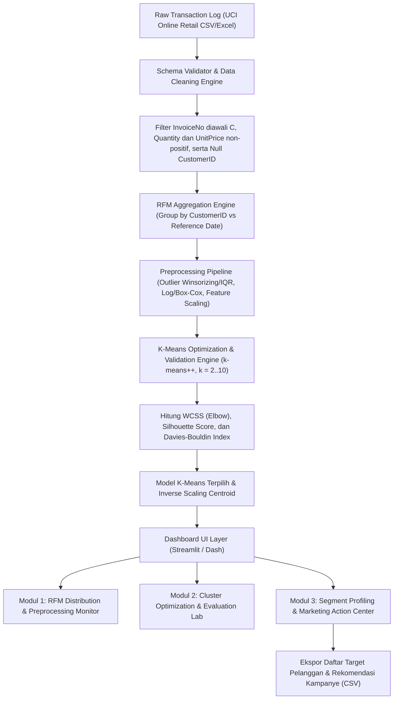
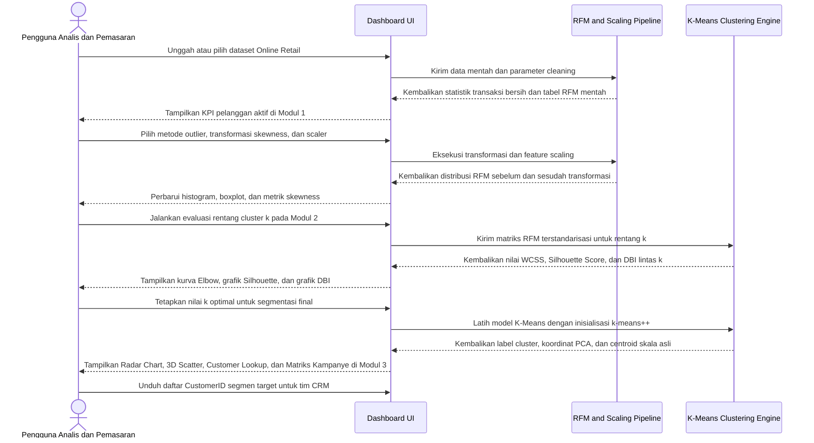
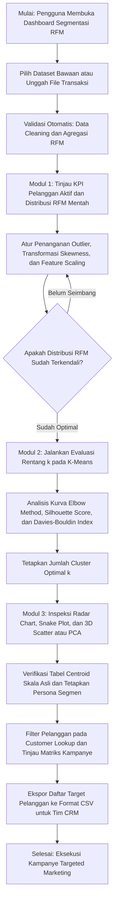

# Kajian Komprehensif Kandidat 2: Customer Segmentation Menggunakan RFM dan K-Means Clustering pada Dataset Online Retail

Dokumen ini menyusun kajian bisnis, tinjauan literatur ilmiah, rancangan metodologi CRISP-DM dan pemetaan KDD, formulasi matematis metrik evaluasi, serta arsitektur konseptual Interactive Dashboard untuk proyek Data Mining **Kandidat 2: Customer Segmentation Berbasis RFM dan Algoritma K-Means Clustering**. Kajian ini dirancang agar realistis diimplementasikan dalam *timeline* pengerjaan 2 hingga 3 minggu menggunakan ekosistem Python.

---

## 1. Identifikasi Masalah dan Konteks Bisnis

### 1.1 Tantangan Retensi Pelanggan di Industri E-Commerce

Perusahaan ritel daring (*e-commerce*) berhadapan dengan dinamika persaingan yang sangat ketat serta biaya akuisisi pelanggan (*customer acquisition cost*) yang terus meningkat. Dalam praktiknya, mempertahankan pelanggan lama jauh lebih efisien secara ekonomi dibandingkan mengakuisisi pelanggan baru. Namun, sebagian besar bisnis ritel daring mengalami tantangan struktural berikut:

1. **Ketidakseimbangan Kontribusi Pendapatan (Efek Pareto):** Sebagian kecil pelanggan berulang (*repeat buyers*) atau pembeli grosir (*wholesalers*) umumnya menyumbang porsi pendapatan yang sangat besar, sementara mayoritas pelanggan lainnya hanya melakukan satu atau sedikit transaksi dengan nilai belanja kecil.
2. **Fenomena Churn Senyap (*Silent Churn*):** Berbeda dengan model bisnis berbasis langganan (*subscription*) di mana pembatalan tercatat secara eksplisit, pelanggan ritel daring berhenti berbelanja secara diam-diam tanpa pemberitahuan. Tanpa sistem pemantauan perilaku historis, perusahaan baru menyadari kehilangan pelanggan ketika pendapatan agregat sudah menurun.
3. **Keterbatasan Pendekatan Pemasaran Seragam (*Mass Marketing*):** Mengirimkan promosi, diskon, atau kampanye *email marketing* yang identik kepada seluruh basis pelanggan mengakibatkan pemborosan anggaran promosi, menurunkan margin keuntungan pada pelanggan yang sebenarnya bersedia membayar penuh (*high-value loyalists*), serta gagal mengaktifkan kembali pelanggan yang mulai tidak aktif (*at-risk*).

### 1.2 Ketiadaan Label Segmen pada Data Transaksi Mentah

Data transaksi penjualan ritel daring (seperti catatan faktur pada sistem POS atau basis data pesanan *e-commerce*) pada dasarnya bersifat transaksional (*line-item transaction logs*), bukan berorientasi pelanggan (*customer-centric*). Di dalam data mentah:

- Setiap baris merekam satu item produk dalam suatu faktur pembelian, bukan ringkasan profil satu pelanggan.
- Tidak tersedia kolom label atau kategori kelas (seperti `Loyal`, `Potential`, atau `At-Risk`) sehingga permasalahan ini merupakan kasus **unsupervised learning**, bukan *supervised classification*.
- Pelabelan manual berdasarkan aturan statis (*rule-based thresholds* yang bersifat subjektif) tidak mampu beradaptasi dengan perubahan skala bisnis dan keragaman distribusi nilai transaksi antar periode.

Oleh karena itu, dibutuhkan proses **feature engineering** berbasis kerangka **RFM (*Recency, Frequency, Monetary*)** untuk mengubah jutaan baris transaksi mentah menjadi representasi perilaku pelanggan yang ringkas, lalu menerapkan algoritma **K-Means clustering** untuk menemukan kelompok pelanggan yang homogen secara objektif berdasarkan kemiripan pola belanjanya.

### 1.3 Kebutuhan Targeted Marketing Berbasis Perilaku Transaksi

Dengan memetakan pelanggan ke dalam segmen berbasis perilaku transaksi aktual (*behavioral segmentation*), tim manajemen dan pemasaran dapat merancang strategi **targeted marketing** yang terukur:

- **Retensi VIP dan Loyalitas:** Mengidentifikasi pelanggan terbaik (*Champions* / *Loyal Customers*) untuk diberikan program loyalitas eksklusif, akses awal produk baru, dan layanan prioritas tanpa menggerus margin dengan diskon agresif.
- **Konversi dan Ekspansi Nilai:** Mengarahkan pelanggan potensial (*Potential Loyalists*) melalui strategi *cross-selling*, *upselling*, dan *product bundling* agar frekuensi serta nilai keranjang belanja meningkat.
- **Intervensi Dini (*Win-Back Campaign*):** Mendeteksi pelanggan yang menunjukkan perlambatan transaksi (*At-Risk Customers*) sebelum beralih sepenuhnya menjadi pelanggan tidak aktif (*Hibernating* / *Lost Customers*) melalui insentif reaktivasi yang terarah.

### 1.4 Konteks Dataset: UCI Online Retail vs Online Retail II

Kajian literatur dan proyek ini merujuk pada dua dataset transaksi ritel daring publik yang bersumber dari **UCI Machine Learning Repository** (berasal dari perusahaan ritel hadiah non-store terdaftar di Inggris yang melayani pelanggan ritel maupun grosir):

1. **UCI Online Retail (Versi Pertama):** Mencakup **541.909 baris** transaksi dengan **8 atribut** pada periode **1 Desember 2010 hingga 9 Desember 2011** (rentang 1 tahun).
2. **UCI Online Retail II (Versi Lanjutan):** Mencakup **1.067.371 baris** transaksi dengan **8 atribut** yang sama pada periode **1 Desember 2009 hingga 9 Desember 2011** (rentang 2 tahun).

Kedua dataset memiliki struktur skema yang seragam, yakni `InvoiceNo` (atau `Invoice`), `StockCode`, `Description`, `Quantity`, `InvoiceDate`, `UnitPrice` (atau `Price`), `CustomerID` (atau `Customer ID`), dan `Country`. Untuk implementasi proyek berdurasi **2 hingga 3 minggu**, penggunaan **UCI Online Retail (541.909 baris)** direkomendasikan sebagai *baseline* eksperimen utama karena beban komputasinya lebih ringkas saat iterasi *preprocessing* dan uji coba *Interactive Dashboard*, sementara arsitektur *pipeline* tetap kompatibel penuh jika diuji skalabilitasnya pada **Online Retail II (1.067.371 baris)**.

---

## 2. Bedah Paper Utama dan Paper Pendukung

Bagian ini membedah secara mendalam dua referensi utama yang dirujuk pada ringkasan proyek serta tiga penelitian pendukung terbaru (2023–2026) yang membahas penerapan **RFM** dan **K-Means clustering** pada data transaksi ritel daring.

### 2.1 Bedah Paper Utama 1: Chen, Sain, & Guo (2012)

- **Sitasi:** Chen, D., Sain, S. L., & Guo, K. (2012). *Data mining for the online retail industry: A case study of RFM model-based customer segmentation using data mining*. Journal of Database Marketing & Customer Strategy Management, Vol. 19, No. 3, pp. 197–208. DOI: `10.1057/dbm.2012.17`.
- **Masalah yang Diangkat:** Banyak perusahaan ritel daring skala kecil hingga menengah serta pendatang baru di industri *e-commerce* ingin menerapkan pemasaran berbasis kecerdasan pelanggan (*customer-centric business intelligence*), tetapi menghadapi kendala ketiadaan kerangka kerja praktis dan keahlian teknis *data mining* untuk menerjemahkan log transaksi mentah menjadi segmen pelanggan yang dapat ditindaklanjuti.
- **Dataset:** Data transaksi historis dari perusahaan ritel hadiah daring non-store di Inggris (yang menjadi dasar dataset *UCI Online Retail*). Pada kajian paper tahun 2012 ini, analisis difokuskan pada data transaksi hingga September 2011 (sekitar 22.190 transaksi valid yang mencakup 4.381 *postcodes* atau identitas pelanggan awal, dan setelah penyaringan subset pelanggan di Inggris untuk tahap *clustering*, tersisa **3.726 pelanggan**).
- **Metode dan Tahapan:**
  1. Ekstraksi variabel **Recency (R)**, **Frequency (F)**, dan **Monetary (M)** dilakukan pada level pelanggan menggunakan SAS Enterprise Guide.
  2. Tahap *clustering* dijalankan menggunakan algoritma **K-Means** di dalam SAS Enterprise Miner untuk mempartisi basis pelanggan ke dalam $k = 5$ cluster yang homogen.
  3. Untuk menjembatani interpretasi bisnis dari *black-box cluster*, penulis menggabungkan hasil *K-Means* dengan **Decision Tree induction** guna mengekstrak aturan logika (*profiling rules*) yang mendefinisikan batas nilai R, F, dan M setiap cluster.
- **Temuan Utama:** Model menghasilkan **5 cluster pelanggan** pada 3.726 pelanggan UK:
  - **Cluster 1** (527 pelanggan; 14,14%): Pelanggan berpotensi nilai terendah / tidak aktif (*Recency* tinggi, *Frequency* dan *Monetary* rendah).
  - **Cluster 2** (636 pelanggan; 17,07%): Pelanggan bernilai rendah hingga menengah.
  - **Cluster 3** (1.748 pelanggan; 46,91%): Kelompok pelanggan umum / standar yang membentuk porsi terbesar populasi.
  - **Cluster 4** (627 pelanggan; 16,83%): Pelanggan loyal bernilai tinggi (*Recency* rendah, *Frequency* dan *Monetary* tinggi).
  - **Cluster 5** (188 pelanggan; 5,05%): Pelanggan VIP / *Champions* atau pembelanja ekstrem bernilai sangat tinggi.
  Studi ini menjadi rujukan fundamental yang membuktikan bahwa integrasi RFM, K-Means, dan *profiling* segmen mampu mengungkap ketimpangan kontribusi pendapatan antar kelompok pelanggan secara presisi.

### 2.2 Bedah Paper Utama 2: Suoth, Almalik, & Ramadhani (2026)

- **Sitasi:** Suoth, R., Almalik, V., & Ramadhani, R. (2026). *Penerapan Algoritma K-Means Clustering untuk Segmentasi Pelanggan Berdasarkan Model RFM pada Dataset Online Retail II*. Journal of Information Systems and Business Technology (JISBT), Vol. 2, No. 3 (25 Juni 2026), hlm. 974–982. *(Catatan verifikasi faktual: pada `readme.md` proyek ini, paper dirujuk secara deskriptif sebagai "Penerapan Teknik Clustering Menggunakan Algoritma K-Means Berbasis RFM untuk Segmentasi Pelanggan pada Dataset Online Retail II (2026)". Penelusuran literatur pada portal PT Jurnal Cendekia Indonesia mengonfirmasi publikasi resmi oleh Rendi Suoth, Veto Almalik, dan Rendi Ramadhani pada JISBT Vol. 2 No. 3 tahun 2026).*
- **Masalah yang Diangkat:** Skala transaksi ritel daring lintas tahun yang sangat besar menyulitkan manajemen dalam memisahkan pelanggan loyal, pelanggan reguler, dan pelanggan yang berisiko berhenti bertransaksi (*churn*), sekaligus ketiadaan perangkat visual interaktif bagi pengambil keputusan pemasaran.
- **Dataset:** Dataset **Online Retail II** dari UCI Machine Learning Repository (1.067.371 baris transaksi periode Desember 2009 hingga Desember 2011 dengan 8 atribut transaksi).
- **Metode dan Tahapan:**
  1. Mengikuti kerangka metodologi *data mining* terstruktur yang mencakup pemahaman bisnis, pemahaman data, dan pembersihan data (*data cleaning*) untuk menyingkirkan *missing values* (terutama `CustomerID` kosong), transaksi tidak sah/pembatalan, serta baris duplikat.
  2. Melakukan *feature engineering* agregasi metrik **R**, **F**, dan **M** untuk setiap pelanggan unik, disertai penanganan distribusi dan *feature scaling* sebelum pemodelan jarak.
  3. Menentukan jumlah cluster optimal ($k$) menggunakan **Elbow Method** dan menjalankan **K-Means clustering**.
- **Temuan Utama:** Pengujian *Elbow Method* menghasilkan jumlah cluster optimal sebesar **$k = 3$** yang terbagi menjadi:
  1. **Konsumen Setia (*Loyal Customers*):** Ditandai nilai *Recency* rendah serta *Frequency* dan *Monetary* sangat tinggi.
  2. **Konsumen Umum (*Regular Customers*):** Kelompok pelanggan dengan intensitas belanja moderat.
  3. **Konsumen Tidak Aktif (*At-Risk / Inactive Customers*):** Ditandai *Recency* tinggi serta *Frequency* dan *Monetary* rendah.
  Sebagai kontribusi *deployment*, penelitian ini juga merancang prototipe **Customer Intelligence Dashboard** untuk memantau sebaran segmen, mendeteksi potensi *churn*, merekomendasikan paket produk, serta memperkirakan nilai transaksi pelanggan.

### 2.3 Bedah Paper Pendukung 1: Ramadhansyah, Uswah, Aulia, & Sajiah (2026)

- **Sitasi:** Ramadhansyah, A. F., Uswah, W. O. C. N., Aulia, R., & Sajiah, A. M. (2026). *Analisis Perbandingan Algoritma K-Means, DBSCAN, dan Hierarchical Clustering untuk Segmentasi Pelanggan E-Commerce Berbasis RFM*. Jurnal Komputer Teknologi Informasi Sistem Komputer (JUKTISI), Vol. 5, No. 2 (September 2026).
- **Masalah yang Diangkat:** Data RFM pada ritel daring memiliki tingkat kemencengan (*skewness*) dan *outlier* ekstrem yang sering mengganggu kinerja algoritma *clustering*. Penulis mengevaluasi apakah algoritma partisi (**K-Means**), berbasis kepadatan (**DBSCAN**), atau hierarkis (**Hierarchical Clustering**) menghasilkan pemisahan segmen paling optimal dan dapat diinterpretasikan untuk CRM.
- **Dataset:** *Online Retail Dataset* (periode Desember 2010 – Desember 2011, 541.909 baris mentah). Setelah tahap *data cleaning*, diperoleh **397.884 baris transaksi bersih** yang teragregasi menjadi **4.338 pelanggan unik**.
- **Metode dan Tahapan:**
  1. Transformasi logaritmik natural ($\ln(1 + x)$) untuk meredam *skewness* ekstrem pada metrik R, F, dan M.
  2. Penanganan *outlier* menggunakan **Winsorizing pada batas $3 \times \text{IQR}$** (*Interquartile Range*) agar nilai ekstrem pelanggan grosir tidak merusak posisi *centroid* tanpa membuang entitas pelanggan tersebut dari analisis.
  3. Standarisasi fitur menggunakan **StandardScaler** (Z-score).
  4. Evaluasi komparatif lintas tiga algoritma menggunakan tiga metrik validasi internal sekaligus: **Silhouette Score (SS)**, **Davies-Bouldin Index (DBI)**, dan **Calinski-Harabasz Index (CHI)**.
- **Temuan Utama:** **K-Means dengan $k = 3$** terbukti menjadi metode paling unggul pada seluruh metrik validasi dengan capaian **SS = 0,337**, **DBI = 1,048**, dan **CHI = 3.632**, mengungguli *Hierarchical Clustering* (SS = 0,320; DBI = 1,105; CHI = 3.275) serta *DBSCAN* (SS = 0,294; CHI = 2.395). Meskipun DBSCAN unggul dalam mengisolasi anomali VIP sebagai *noise*, K-Means menghasilkan segmen yang jauh lebih seimbang dan operasional untuk strategi bisnis: *Champions* (**17,77%**), *Regular Customers* (**39,07%**), dan *Lost Customers* (**43,15%**).

### 2.4 Bedah Paper Pendukung 2: Triantara, Raharja, & Sarasvananda (2025)

- **Sitasi:** Triantara, I K. Y., Raharja, M. A., & Sarasvananda, I B. G. (2025). *Segmentasi Pelanggan Berbasis RFMT Menggunakan K-Means dan Hierarchical Clustering*. Jurnal Nasional Teknologi Informasi dan Aplikasinya (JNATIA), Vol. 3, No. 4 (Agustus 2025), Universitas Udayana.
- **Masalah yang Diangkat:** Model RFM konvensional memiliki keterbatasan dalam menangkap dinamika temporal siklus belanja pelanggan. Dua pelanggan dengan *Recency* dan *Frequency* yang sama dapat memiliki ritme jeda belanja yang sangat berbeda (misalnya belanja rutin mingguan versus belanja musiman acak).
- **Dataset:** Dataset transaksi ritel daring (*online retail dataset*) publik.
- **Metode dan Tahapan:**
  1. Memperluas fitur RFM menjadi **RFM-T** dengan menambahkan variabel **T (*Interpurchase Time* / IPT)** guna merepresentasikan rata-rata jarak waktu antar pembelian pelanggan.
  2. Menerapkan pendekatan *dual-clustering*: **K-Means clustering** digunakan pada tahap awal untuk membentuk segmentasi makro secara efisien, lalu dilanjutkan dengan **Hierarchical Clustering** untuk menggali sub-segmen mendalam pada kelompok pelanggan bernilai tinggi (*high-value groups*).
  3. Validasi kualitas cluster diukur menggunakan **Silhouette Score**, **Davies-Bouldin Index (DBI)**, dan **Calinski-Harabasz Index (CHI)**.
- **Temuan Utama:** Pendekatan *dual-clustering* berbasis RFM-T mencapai skor validasi yang kuat dengan **Silhouette Score = 0,410**, **Davies-Bouldin Index = 0,720**, dan **Calinski-Harabasz Index = 1.365,14**. Penambahan fitur IPT terbukti mempertajam pemisahan segmen *Consistent Loyalists* dari pembeli bernilai tinggi yang hanya bertransaksi secara sporadis.

### 2.5 Bedah Paper Pendukung 3: Nikmah, Harahap, Utami, & Razzaq (2023)

- **Sitasi:** Nikmah, T. L., Harahap, N. H. S., Utami, G. C., & Razzaq, M. M. (2023). *Customer Segmentation Based on Loyalty Level Using K-Means and LRFM Feature Selection in Retail Online Store*. Jurnal ELTIKOM, Vol. 7, No. 1 (Juni 2023).
- **Masalah yang Diangkat:** Atribut *Recency*, *Frequency*, dan *Monetary* saja sering kali belum membedakan antara pelanggan baru yang berbelanja dalam jumlah besar dengan pelanggan lama yang telah membangun hubungan jangka panjang dengan platform ritel daring.
- **Dataset:** Dataset transaksi toko ritel daring tahun 2011 sebanyak **379.980 baris transaksi** dengan **8 atribut**.
- **Metode dan Tahapan:**
  1. Melakukan seleksi fitur berbasis model **LRFM** (*Length, Recency, Frequency, Monetary*), di mana *Length* mengukur durasi rentang waktu antara transaksi pertama dan transaksi terakhir pelanggan.
  2. Menjalankan *preprocessing* pembersihan data transaksi dan *feature scaling* sebelum mengaplikasikan algoritma **K-Means clustering** dengan pembagian **$k = 4$** cluster loyalitas.
  3. Mengukur kohesi dan keterpisahan cluster menggunakan **Silhouette Score Index**.
- **Temuan Utama:** Model LRFM + K-Means menghasilkan empat segmen tingkat loyalitas yang sangat terpisah secara geometris dengan nilai **Silhouette Score = 0,943898**, terdiri dari: *Premium Loyalty*, *Inertia Loyalty*, *Latent Loyalty*, dan *No Loyalty*. Temuan ini menegaskan bahwa kualitas fitur dan *feature scaling* secara langsung memengaruhi tingkat kekompakan cluster pada data ritel daring.

### 2.6 Tabel Matriks Komparasi Paper

| Sitasi | Masalah | Dataset | Teknik Outlier Handling & Scaling | Penentuan Jumlah Cluster k | Metrik Evaluasi | Segmen yang Dihasilkan & Benchmark Skor |
| :--- | :--- | :--- | :--- | :--- | :--- | :--- |
| Chen, Sain, & Guo (2012), *J. Database Marketing & Customer Strategy Management* | Ketiadaan panduan praktis *data mining* untuk segmentasi perilaku pelanggan bagi UKM ritel daring | Transaksi ritel daring UK (basis *UCI Online Retail*, hingga Sep 2011; ~22.190 transaksi valid; 4.381 entitas awal; **3.726 pelanggan UK** terfilter) | Filtering subset wilayah UK, agregasi RFM pada SAS Enterprise Guide, standarisasi internal node Cluster SAS Enterprise Miner | **$k = 5$** (eksplorasi segmen perilaku + validasi aturan Decision Tree) | Evaluasi profil centroid RFM dan akurasi aturan *Decision Tree induction* (SS/DBI tidak dilaporkan pada publikasi) | 5 cluster: Cluster 1 Inactive (14,14%), Cluster 2 Low-Medium (17,07%), Cluster 3 Standard (46,91%), Cluster 4 Loyal (16,83%), Cluster 5 VIP/Champions (5,05%) |
| Suoth, Almalik, & Ramadhani (2026), *JISBT* Vol. 2 No. 3 | Kesulitan memetakan loyalitas pelanggan dan risiko *churn* pada log transaksi masif lintas tahun | **Online Retail II** (UCI ML Repository; **1.067.371 baris**, 8 atribut, periode Des 2009 – Des 2011) | Pembersihan *missing `CustomerID`*, transaksi batal, dan duplikat; penanganan distribusi/outlier dan *feature scaling* pra-clustering | **$k = 3$** berdasarkan titik siku pada kurva **Elbow Method** | **Elbow Method** (Sum of Squared Errors / WCSS) & perancangan *Customer Intelligence Dashboard* (SS/DBI tidak dirinci dalam abstrak/ringkasan indeks) | 3 segmen: **Konsumen Setia**, **Konsumen Umum**, dan **Konsumen Tidak Aktif** (*at-risk churn*) |
| Ramadhansyah, Uswah, Aulia, & Sajiah (2026), *JUKTISI* Vol. 5 No. 2 | Komparasi sensitivitas algoritma partisi, kepadatan, dan hierarkis pada data RFM e-commerce yang sangat *skewed* | *Online Retail Dataset* (Des 2010 – Des 2011; 541.909 baris mentah; **397.884 baris bersih**; **4.338 pelanggan unik**) | **Log transformation** ($\ln(1+x)$), **Winsorizing ($3 \times \text{IQR}$)**, dan **StandardScaler** | **$k = 3$** untuk K-Means (dibandingkan dengan DBSCAN dan Hierarchical) | **Silhouette Score (SS)**, **Davies-Bouldin Index (DBI)**, **Calinski-Harabasz Index (CHI)** | **K-Means unggul**: **SS = 0,337**, **DBI = 1,048**, **CHI = 3.632** (vs Hierarchical SS = 0,320; DBSCAN SS = 0,294). Segmen: *Champions* (17,77%), *Regular Customers* (39,07%), *Lost Customers* (43,15%) |
| Triantara, Raharja, & Sarasvananda (2025), *JNATIA* Vol. 3 No. 4 | RFM konvensional gagal membedakan ritme jeda antar-transaksi (*Interpurchase Time*) pelanggan | Dataset transaksi *Online Retail* publik | Ekstensi fitur **RFM-T** (*Interpurchase Time*), transformasi dan standarisasi fitur pra-clustering | Pendekatan *dual-clustering* (**K-Means** makro dilanjutkan **Hierarchical Clustering** sub-segmen) | **Silhouette Score (SS)**, **Davies-Bouldin Index (DBI)**, **Calinski-Harabasz Index (CHI)** | **SS = 0,410**, **DBI = 0,720**, **CHI = 1.365,14**; berhasil mengisolasi sub-segmen *Consistent Loyalists* secara lebih tajam |
| Nikmah, Harahap, Utami, & Razzaq (2023), *Jurnal ELTIKOM* Vol. 7 No. 1 | RFM standar mengabaikan usia hubungan pelanggan (*Length*) dalam mengukur tingkat loyalitas sejati | Dataset transaksi ritel daring 2011 (**379.980 baris**, 8 atribut) | Seleksi fitur **LRFM** (*Length, Recency, Frequency, Monetary*) disertai pembersihan transaksi dan *feature scaling* | **$k = 4$** cluster tingkat loyalitas | **Silhouette Score Index** | **SS = 0,943898**; 4 segmen loyalitas: *Premium Loyalty*, *Inertia Loyalty*, *Latent Loyalty*, dan *No Loyalty* |

**Sintesis dan Posisi Desain Proyek Kandidat 2:**
Dari komparasi lima literatur di atas, terlihat jelas bahwa performa K-Means pada dataset *Online Retail* sangat bergantung pada dua faktor krusial: (1) **transformasi skewness dan pengendalian outlier** (seperti kombinasi $\ln(1+x)$, *Winsorizing* IQR, dan *StandardScaler* yang dibuktikan oleh Ramadhansyah et al., 2026), serta (2) **validasi multi-metrik** untuk menghindari subjektivitas penentuan nilai $k$ (menggabungkan *Elbow Method*, *Silhouette Score*, dan *Davies-Bouldin Index*). Oleh karena itu, rancangan proyek Kandidat 2 mengadopsi standar terbaik ini ke dalam *pipeline* yang transparan dan dapat dieksplorasi secara interaktif melalui aplikasi *dashboard*.

---

## 3. Metodologi CRISP-DM dan Pemetaan KDD

Proyek ini menggunakan kerangka standar industri **CRISP-DM (*Cross-Industry Standard Process for Data Mining*)** yang terdiri dari 6 fase iteratif, serta dipetakan ekuivalensinya ke dalam **5 tahapan KDD (*Knowledge Discovery in Databases*)** agar memenuhi kaidah akademik maupun implementasi rekayasa data.

### 3.1 Tabel Ekuivalensi 6 Fase CRISP-DM vs 5 Tahapan KDD

| Fase CRISP-DM (6 Fase) | Tahapan KDD (5 Tahapan) | Aktivitas Spesifik untuk Kasus RFM + K-Means | Output Utama Fase |
| :--- | :--- | :--- | :--- |
| **1. Business Understanding** | *(Pra-KDD: Domain Understanding & Goal Definition yang mengarahkan tahap Data Selection)* | Menetapkan objektif bisnis (retensi pelanggan, deteksi *at-risk*, personalisasi kampanye CRM), mendefinisikan *unsupervised clustering* tanpa label, serta menetapkan kriteria keberhasilan bisnis dan metrik evaluasi (*Silhouette Score* dan *DBI*). | Dokumen rumusan masalah, sasaran segmentasi, dan parameter proyek. |
| **2. Data Understanding** | **1. Data Selection** | Mengakuisisi dataset *UCI Online Retail* (541.909 baris) / *Online Retail II* (1.067.371 baris), memetakan 8 atribut asli, mengaudit anomali (`CustomerID` kosong, transaksi `'C'`, nilai negatif/nol, item *postage*), dan memeriksa statistik deskriptif awal. | Laporan audit kualitas data, *target dataset* terpilih, dan profil anomali. |
| **3a. Data Preparation (Pembersihan Data)** | **2. Preprocessing** | Menghapus atau menandai baris dengan `InvoiceNo` diawali `'C'`, `Quantity <= 0`, `UnitPrice <= 0`, `CustomerID` bernilai *null*, duplikat transaksi, serta catatan biaya non-produk (seperti ongkos kirim). | *Clean transaction log* yang valid pada level baris produk. |
| **3b. Data Preparation (Rekayasa & Transformasi Fitur)** | **3. Transformation** | Melakukan agregasi per `CustomerID` menjadi tabel **RFM** (`Recency`, `Frequency`, `Monetary`), menangani *skewness* via *Log Transformation* / *Box-Cox*, menangani *outlier* via *IQR* / *Winsorizing*, serta melakukan *feature scaling* (*StandardScaler* / *MinMaxScaler*). | Matriks fitur **RFM terstandarisasi** (*clustering-ready feature matrix*). |
| **4. Modeling** | **4. Data Mining** | Menjalankan eksperimen **K-Means clustering** dengan inisialisasi `k-means++` pada rentang nilai kandidat $k \in [2, 10]$, menghitung *centroid* setiap cluster secara iteratif hingga konvergen, dan menetapkan label cluster ke setiap pelanggan. | Model K-Means terlatih, koordinat *centroid*, dan penugasan cluster per `CustomerID`. |
| **5. Evaluation** | **5. Interpretation / Evaluation** | Mengevaluasi kualitas geometris cluster menggunakan *Elbow Method (WCSS)*, *Silhouette Score*, dan *Davies-Bouldin Index*; melakukan *back-transformation* *centroid* ke skala asli; serta menyusun **Cluster Profiling** dan penamaan persona bisnis segmen. | Nilai $k$ optimal tervalidasi, profil persona segmen, dan matriks strategi pemasaran. |
| **6. Deployment** | *(Pemanfaatan Pengetahuan / Knowledge Integration dari tahap Interpretation/Evaluation)* | Mengintegrasikan *pipeline* prapemrosesan, model K-Means, dan hasil profil segmen ke dalam **Python Interactive Dashboard** (Streamlit/Dash) dilengkapi fitur *Customer Lookup*, visualisasi distribusi, dan ekspor target kampanye. | Aplikasi *Interactive Dashboard* siap pakai dan dokumentasi rekomendasi CRM. |

---

### 3.2 Penjelasan Rinci Tiap Tahap Metodologi

#### Tahap 1: Business Understanding
Pada fase ini, fokus utama adalah menyelaraskan kebutuhan tim pemasaran dengan kapabilitas algoritma *clustering*. Target proyek adalah mempartisi basis pelanggan ritel daring menjadi segmen-segmen yang memiliki perbedaan perilaku nyata dalam hal kedekatan waktu belanja terakhir, intensitas transaksi berulang, dan nilai kontribusi pendapatan. Kriteria keberhasilan tidak hanya diukur dari skor validasi matematis (*Silhouette Score* yang memadai dan *DBI* yang rendah), tetapi juga keterbacaan bisnis (*actionability*) setiap segmen untuk kampanye retensi dalam rentang waktu pengerjaan 2–3 minggu.

#### Tahap 2: Data Understanding (Data Selection)
Dataset *UCI Online Retail* terdiri dari 8 kolom dengan peran spesifik:
- `InvoiceNo`: Nomor faktur transaksi 6 digit. Jika diawali huruf `'C'` (*Cancellation*), faktur menandakan pembatalan atau pengembalian barang (*refund/return*).
- `StockCode` & `Description`: Kode unik dan nama deskripsi produk. Beberapa entri merupakan biaya administratif atau pengiriman (misal `POST`, `D`, `M`, `BANK CHARGES`), bukan pembelian barang fisik.
- `Quantity`: Jumlah unit barang per baris transaksi.
- `InvoiceDate`: Stempel tanggal dan waktu (*timestamp*) terjadinya transaksi.
- `UnitPrice`: Harga satuan barang dalam mata uang Pound Sterling (GBP).
- `CustomerID`: Identitas unik pelanggan 5 digit; sering ditemukan bernilai kosong (*missing values*) akibat transaksi tamu (*guest checkout*) atau pencatatan internal toko.
- `Country`: Negara asal pelanggan (didominasi oleh *United Kingdom*).

#### Tahap 3: Data Preparation (Preprocessing & Transformation)
Fase ini merupakan penentu kualitas terbesar dalam pipeline **RFM + K-Means** dan terdiri atas empat sub-langkah teknis berurutan:

##### A. Pembersihan Transaksi (Data Cleaning)
Sebelum menghitung metrik pelanggan, seluruh baris transaksi yang merusak validitas ekonomi harus disaring dengan aturan ketat:
1. **Missing `CustomerID`:** Baris tanpa identitas pelanggan wajib dihapus karena agregasi RFM dilakukan pada tingkat entitas pelanggan unik; transaksi anonim tidak dapat ditargetkan dalam kampanye retensi CRM.
2. **Transaksi Batal (`InvoiceNo` diawali `'C'`):** Baris faktur berawalan `'C'` merepresentasikan retur atau pembatalan pesanan yang umumnya berpasangan dengan nilai `Quantity` negatif. Mengikutsertakan baris ini akan menurunkan nilai *Monetary* secara artifisial atau mengacaukan hitungan *Frequency* pembelian berhasil.
3. **Anomali Kuantitas dan Harga (`Quantity <= 0` dan `UnitPrice <= 0`):** Baris dengan kuantitas nol/negatif (penyesuaian stok/rusak) atau harga satuan nol/negatif (barang promosi gratis, penghapusan piutang, atau kesalahan input) disaring keluar agar total belanja mencerminkan nilai transaksi komersial riil.
4. **Duplikat dan Biaya Non-Produk:** Baris duplikat identik dihapus untuk mencegah penggandaan nilai *Monetary*, sedangkan kode non-produk seperti biaya pos atau komisi bank dapat difilter agar fokus analisis tetap pada pembelian produk ritel.

##### B. Feature Engineering: Agregasi Metrik RFM
Seluruh transaksi bersih kemudian diagregasi per `CustomerID` relatif terhadap sebuah **reference date** (atau *snapshot date* $T_{\text{ref}}$), yang umumnya ditetapkan sebagai satu hari setelah tanggal transaksi paling akhir dalam dataset ($T_{\text{ref}} = \max(\text{InvoiceDate}) + 1\text{ hari}$) agar nilai *Recency* minimum bernilai $\ge 1$ hari:

- **Recency ($R_i$):** Selisih hari antara *reference date* dan tanggal transaksi terakhir yang dilakukan pelanggan $i$:
  $$R_i = T_{\text{ref}} - \max(\text{InvoiceDate}_i) \quad (\text{dalam satuan hari})$$
  *Makna bisnis:* Semakin **kecil** nilai $R_i$, semakin **baru** pelanggan tersebut berbelanja (indikasi keterlibatan aktif yang tinggi).
- **Frequency ($F_i$):** Jumlah faktur pembelian unik (*unique `InvoiceNo`*) yang dilakukan pelanggan $i$ selama periode pengamatan:
  $$F_i = \left| \{ \text{InvoiceNo}_{i} \} \right|$$
  Menggunakan hitungan *unique invoice* jauh lebih akurat dibandingkan menghitung jumlah baris item, karena satu keranjang belanja berisi 20 jenis produk tetap dihitung sebagai 1 kali kunjungan transaksi, bukan 20 kali kunjungan.
- **Monetary ($M_i$):** Total akumulasi pengeluaran belanja pelanggan $i$ selama periode pengamatan, diperoleh dari penjumlahan hasil kali kuantitas dan harga satuan tiap baris:
  $$M_i = \sum_{t \in \text{Transaksi}_i} \left( \text{Quantity}_t \times \text{UnitPrice}_t \right)$$

##### C. Penanganan Skewness dan Outliers
Variabel $R$, $F$, dan terutama $M$ pada ritel daring hampir selalu berdistribusi sangat miring ke kanan (*positively right-skewed*) karena keberadaan segelintir pelanggan grosir dengan ratusan faktur dan nilai transaksi puluhan ribu GBP, sedangkan mayoritas pelanggan bertransaksi dalam nominal kecil. Algoritma K-Means mengasumsikan cluster berbentuk sferis dengan varians relatif seragam dan menghitung pusat massa (*mean centroid*), sehingga *skewness* serta *outlier* akan menarik *centroid* jauh dari populasi mayoritas dan menghasilkan satu cluster raksasa yang bercampur dengan satu-dua cluster berisi segelintir *outlier*.

Untuk mengatasi masalah ini secara sistematis:
1. **Transformasi Skewness:**
   - **Log Transformation ($\ln(1 + x)$):** Menekan rentang nilai ekstrem pada distribusi miring positif (terutama pada $F$ dan $M$, serta $R$ bila diperlukan) menjadi skala logaritmik yang jauh lebih simetris dan mendekati distribusi normal, sekaligus aman untuk nilai nol.
   - **Box-Cox Transformation:** Alternatif transformasi parametrik berbasis pangkat optimal $\lambda$ untuk data bernilai positif ($x > 0$) guna memaksimalkan normalitas distribusi secara otomatis apabila *Log Transformation* standar masih menyisakan *skewness* moderat.
2. **Penanganan Outliers (IQR vs Winsorizing):**
   - **IQR Filtering:** Menghitung rentang kuartil $\text{IQR} = Q_3 - Q_1$, lalu membuang data di luar batas $[Q_1 - 1,5 \times \text{IQR},\; Q_3 + 1,5 \times \text{IQR}]$ (atau pengali $3 \times \text{IQR}$ untuk batas ekstrem). Kelemahan pembuangan (*dropping*) adalah hilangnya pelanggan VIP / grosir asli dari hasil segmentasi.
   - **Winsorizing (Capping):** Pendekatan yang lebih disarankan pada kasus bisnis CRM adalah membatasi (*capping*) nilai ekstrem pada persentil tertentu (misal persentil ke-1 dan ke-99) atau pada batas atas $Q_3 + c \times \text{IQR}$ (misalnya $1,5 \times \text{IQR}$ atau $3 \times \text{IQR}$ seperti diterapkan pada Ramadhansyah et al., 2026). Dengan *Winsorizing*, pelanggan berbelanja sangat besar tetap dipertahankan dalam populasi sehingga mereka tetap dikelompokkan ke segmen *Champions*, namun bobot ekstremnya tidak mendistorsi geometri ruang cluster.

##### D. Feature Scaling
Karena *Recency* berskala puluhan hingga ratusan hari, *Frequency* berskala satuan hingga puluhan faktur, sedangkan *Monetary* dapat mencapai ribuan hingga puluhan ribu GBP, variabel berangka besar akan mendominasi perhitungan *Euclidean distance* jika tidak disamakan skalanya. Dua metode utama yang dipertimbangkan:
- **StandardScaler (Z-score Standardization):** Mengubah setiap fitur $x$ sehingga memiliki rata-rata $\mu = 0$ dan simpangan baku $\sigma = 1$ melalui rumus $z = \frac{x - \mu}{\sigma}$. Metode ini sangat direkomendasikan setelah *Log Transformation* / *Winsorizing* karena mempertahankan sebaran relatif di sekitar pusat data dan tidak terkompresi oleh sisa nilai ekstrem.
- **MinMaxScaler:** Memetakan nilai fitur secara linear ke rentang tetap $[0, 1]$ melalui $x' = \frac{x - x_{\min}}{x_{\max} - x_{\min}}$. Metode ini intuitif untuk visualisasi *Radar Chart*, namun lebih rentan memampatkan mayoritas pelanggan ke rentang sempit (misal $[0,0;\; 0,05]$) apabila masih terdapat nilai maksimum ekstrem yang belum di-*winsorize*.

#### Tahap 4: Modeling (Algoritma K-Means dan Inisialisasi k-means++)
Algoritma **K-Means** mengelompokkan $N$ vektor pelanggan $x_i = (R'_i, F'_i, M'_i) \in \mathbb{R}^3$ (setelah transformasi dan *feature scaling*) ke dalam $k$ himpunan cluster saling lepas $\{C_1, C_2, \dots, C_k\}$ untuk meminimalkan variasi intra-cluster berbasis **Euclidean distance**.

1. **Inisialisasi `k-means++`:** Pada K-Means standar (*random initialization*), pemilihan titik awal *centroid* secara acak sering menjebak algoritma pada konvergensi lokal yang buruk (*local optima*) dan menghasilkan cluster yang berubah-ubah tiap kali dijalankan. Metode **`k-means++`** mengatasi hal tersebut secara deterministik-probabilistik:
   - Memilih *centroid* pertama $\mu_1$ secara acak seragam dari titik data.
   - Untuk setiap titik data $x_i$, menghitung kuadrat jarak terdekat ke *centroid* yang sudah terpilih, $D(x_i)^2$.
   - Memilih *centroid* berikutnya secara probabilistik dengan peluang sebanding dengan $D(x_i)^2 / \sum_m D(x_m)^2$. Dengan demikian, *centroid* awal tersebar berjauhan secara optimal di ruang fitur RFM, mempercepat konvergensi dan menstabilkan hasil cluster.
2. **Iterasi Centroid (Assignment & Update):**
   - *Assignment Step:* Setiap pelanggan $x_i$ dimasukkan ke cluster $C_j$ dengan *centroid* $\mu_j$ terdekat berdasarkan jarak Euclidean terkecil: $\arg\min_j \| x_i - \mu_j \|_2^2$.
   - *Update Step:* Posisi setiap *centroid* diperbarui menjadi vektor rata-rata seluruh pelanggan yang tergabung di dalam cluster tersebut: $\mu_j = \frac{1}{|C_j|} \sum_{x_i \in C_j} x_i$.
   - Kedua langkah diulang secara iteratif hingga keanggotaan cluster tidak lagi berubah atau pergeseran posisi *centroid* lebih kecil dari ambang toleransi konvergensi ($\epsilon$).

#### Tahap 5: Evaluation (Interpretation / Evaluation)
Penilaian kualitas hasil *clustering* dijalankan dalam dua lapisan:
- **Validasi Internal Kuantitatif:** Menguji rentang kandidat $k \in \{2, 3, \dots, 10\}$ menggunakan **Elbow Method (WCSS)**, **Silhouette Score**, dan **Davies-Bouldin Index** untuk memilih jumlah segmen paling optimal secara matematis.
- **Validasi Interpretasi Bisnis:** Melakukan *inverse transformation* nilai pusat cluster kembali ke skala R (hari), F (jumlah transaksi), dan M (GBP) yang sebenarnya, membandingkan rasio antar-cluster, serta memverifikasi bahwa tiap segmen memiliki persona perilaku yang jelas dan ukuran populasi yang masuk akal untuk dieksekusi oleh tim pemasaran.

#### Tahap 6: Deployment
Seluruh rangkaian *data cleaning*, agregasi RFM, parameter *Winsorizing*, *transformer* logaritmik, objek *StandardScaler*, dan model K-Means terbaik disatukan menjadi sebuah alur *pipeline* terpadu yang diintegrasikan ke dalam antarmuka **Interactive Dashboard** (berbasis Streamlit atau Dash) agar tim non-teknis dapat mengeksplorasi segmen dan mengunduh daftar target kampanye secara mandiri.

---

## 4. Metrik Evaluasi dan Formulasi Matematis

Karena K-Means termasuk *unsupervised learning* tanpa label kebenaran dasar (*ground truth*), kualitas cluster dievaluasi melalui metrik validasi internal yang mengukur **kohesi (*compactness*)** di dalam cluster serta **separasi (*separation*)** antar cluster.

### 4.1 Within-Cluster Sum of Squares (WCSS) / Inertia (Elbow Method)

**Formulasi Matematis:**

$$WCSS(k) = \sum_{j=1}^{k} \sum_{x_i \in C_j} \| x_i - \mu_j \|_2^2$$

di mana:
- $k$ adalah jumlah cluster yang diuji.
- $C_j$ adalah himpunan titik data pelanggan yang termasuk dalam cluster ke-$j$.
- $x_i \in \mathbb{R}^3$ adalah vektor fitur RFM terstandarisasi milik pelanggan ke-$i$.
- $\mu_j \in \mathbb{R}^3$ adalah posisi vektor *centroid* dari cluster $C_j$.
- $\| x_i - \mu_j \|_2^2$ adalah kuadrat jarak Euclidean antara pelanggan $x_i$ dan *centroid* cluster tempatnya bernaung.

**Interpretasi dan Penentuan Nilai $k$ (Elbow Method):**
Nilai $WCSS$ (disebut juga *Inertia*) mengukur total varians internal di dalam seluruh cluster; semakin kecil nilainya, semakin rapat anggota cluster berkumpul di sekitar *centroid*-nya. Namun, nilai $WCSS$ selalu turun secara monoton seiring bertambahnya $k$ (hingga mencapai $0$ saat $k = N$). Oleh karena itu, grafik $WCSS$ terhadap $k$ dianalisis menggunakan **Elbow Method**, yakni memilih nilai $k$ tepat pada titik siku (*elbow point*) di mana laju penurunan $WCSS$ berubah drastis dari curam menjadi melandai. Penambahan $k$ setelah titik siku hanya memberikan perbaikan kohesi marjinal dengan risiko *over-segmentation* yang menyulitkan eksekusi kampanye pemasaran.

---

### 4.2 Silhouette Coefficient dan Silhouette Score

**Formulasi Matematis:**

Untuk setiap titik data pelanggan $i$ yang tergabung dalam cluster $C_I$, nilai *Silhouette Coefficient* $s(i)$ didefinisikan sebagai:

$$s(i) = \frac{b(i) - a(i)}{\max\big(a(i),\; b(i)\big)}$$

dengan komponen jarak rata-rata intra-cluster $a(i)$ dan jarak rata-rata cluster tetangga terdekat $b(i)$:

$$a(i) = \frac{1}{|C_I| - 1} \sum_{j \in C_I,\; j \neq i} d(x_i, x_j)$$

$$b(i) = \min_{J \neq I} \left( \frac{1}{|C_J|} \sum_{j \in C_J} d(x_i, x_j) \right)$$

Sedangkan **Silhouette Score** global untuk seluruh dataset berisi $N$ pelanggan adalah nilai rata-rata dari seluruh $s(i)$:

$$S = \frac{1}{N} \sum_{i=1}^{N} s(i)$$

di mana:
- $a(i)$ merepresentasikan tingkat kohesi (*intra-cluster distance*), yakni rata-rata jarak Euclidean titik $x_i$ ke seluruh titik lain di cluster yang sama ($C_I$). Semakin kecil $a(i)$, semakin kompak cluster tersebut.
- $b(i)$ merepresentasikan tingkat separasi (*nearest-cluster distance*), yakni rata-rata jarak terkecil dari titik $x_i$ ke semua anggota di cluster tetangga terdekat ($C_J \neq C_I$). Semakin besar $b(i)$, semakin terpisah cluster tersebut dari cluster lain.

**Interpretasi:**
Nilai $s(i)$ dan $S$ berada pada rentang **$[-1, +1]$**:
- **$S \to +1$:** Pelanggan sangat cocok berada di cluster-nya sendiri dan terpisah tegas dari cluster tetangga.
- **$S \approx 0$:** Titik berada tepat di wilayah perbatasan (*overlapping boundary*) antara dua cluster.
- **$S < 0$:** Pelanggan kemungkinan besar salah ditempatkan (*misclassified*) dan lebih dekat dengan anggota cluster lain.
Nilai $k$ optimal dipilih pada titik yang memaksimalkan *Silhouette Score* global sekaligus memiliki distribusi $s(i)$ individu yang konsisten positif di setiap segmen (dianalisis melalui *Silhouette Plot*).

---

### 4.3 Davies-Bouldin Index (DBI)

**Formulasi Matematis:**

$$DBI = \frac{1}{k} \sum_{i=1}^{k} \max_{j \neq i} \left( \frac{\sigma_i + \sigma_j}{d(\mu_i, \mu_j)} \right)$$

dengan dispersi rata-rata cluster $\sigma_i$ dan jarak antar *centroid* $d(\mu_i, \mu_j)$:

$$\sigma_i = \frac{1}{|C_i|} \sum_{x \in C_i} \| x - \mu_i \|_2, \qquad d(\mu_i, \mu_j) = \| \mu_i - \mu_j \|_2$$

di mana:
- $\sigma_i$ adalah rata-rata jarak seluruh anggota cluster $C_i$ terhadap *centroid*-nya $\mu_i$ (mengukur sebaran internal atau radius efektif cluster ke-$i$).
- $d(\mu_i, \mu_j)$ adalah jarak Euclidean antara *centroid* cluster ke-$i$ dan *centroid* cluster ke-$j$.
- Rasio $R_{ij} = \frac{\sigma_i + \sigma_j}{d(\mu_i, \mu_j)}$ mengukur tingkat kemiripan (*similarity*) antara pasangan cluster $i$ dan $j$.

**Interpretasi:**
Nilai $DBI$ berada pada rentang **$[0, \infty)$**. Berbeda dengan *Silhouette Score* yang mencari nilai maksimal, **semakin kecil nilai DBI (mendekati 0), semakin baik kualitas clustering**. Hal ini terjadi karena DBI akan bernilai kecil apabila sebaran internal masing-masing cluster sangat rapat ($\sigma_i + \sigma_j$ kecil) dan jarak antar pusat cluster berjauhan ($d(\mu_i, \mu_j)$ besar).

---

### 4.4 Metodologi Cluster Profiling dan Penetapan Persona Segmen

Setelah nilai $k$ terbaik dipilih melalui konsensus *Elbow Method*, *Silhouette Score*, dan *DBI*, hasil label cluster (seperti `Cluster 0`, `Cluster 1`, `Cluster 2`, `Cluster 3`) masih bersifat indeks numerik netral. **Penamaan segmen pelanggan harus ditetapkan secara induktif berdasarkan analisis profil centroid aktual hasil clustering, bukan ditetapkan secara sembarangan sebelum pemodelan.**

Prosedur sistematis *Cluster Profiling* meliputi:
1. **Back-Transformation ke Skala Asli:** Nilai R, F, dan M dikembalikan dari ruang terstandarisasi ke satuan bisnis asli (hari untuk Recency, jumlah faktur untuk Frequency, dan GBP untuk Monetary) guna menghitung rata-rata (*mean*) serta median per cluster. Nilai median sangat membantu melengkapi rata-rata jika terdapat variasi internal dalam satu segmen.
2. **Analisis Relatif Terhadap Rata-Rata Populasi (*Relative Importance*):** Menghitung rasio perbandingan antara *centroid* tiap cluster terhadap rata-rata keseluruhan populasi pelanggan ($R_{\text{cluster}} / R_{\text{pop}}$, $F_{\text{cluster}} / F_{\text{pop}}$, $M_{\text{cluster}} / M_{\text{pop}}$). Hal ini memudahkan identifikasi dimensi mana yang paling menonjol pada setiap cluster.
3. **Visualisasi Profil Lintas Dimensi:** Memetakan nilai terstandarisasi R, F, dan M pada **Snake Plot** atau **Radar Chart** agar perbedaan polaritas antar segmen terbaca secara instan. Perlu dicatat bahwa pada *Recency*, **nilai hari yang rendah** berarti **perilaku baik (baru bertransaksi)**, sedangkan pada *Frequency* dan *Monetary*, **nilai yang tinggi** berarti **perilaku baik**.

| Persona Segmen Bisnis | Karakteristik Centroid Recency (R) | Karakteristik Centroid Frequency (F) | Karakteristik Centroid Monetary (M) | Interpretasi Perilaku & Strategi Pemasaran Utama |
| :--- | :--- | :--- | :--- | :--- |
| **Champions / Loyal Customers** | Sangat Rendah (baru saja bertransaksi) | Tinggi hingga Sangat Tinggi | Tinggi hingga Sangat Tinggi | Pelanggan inti yang aktif berulang dan menyumbang pendapatan terbesar. Fokus pada *retention*: program VIP, akses awal produk baru, *loyalty rewards*, dan program rujukan tanpa obral diskon besar. |
| **Potential Loyalists / Potential Customers** | Rendah hingga Sedang (cukup baru bertransaksi) | Sedang (mulai melakukan pembelian berulang) | Sedang hingga Meningkat | Pelanggan yang memiliki momentum pertumbuhan tinggi menuju status loyal. Fokus pada *expansion*: rekomendasi produk (*cross-selling*), *bundling*, penawaran keanggotaan, dan kupon pembelian berikutnya. |
| **At-Risk Customers** | Tinggi (sudah cukup lama tidak kembali bertransaksi) | Sedang hingga Tinggi secara historis | Sedang hingga Tinggi secara historis | Pelanggan bernilai historis bagus yang frekuensi belanjanya mulai meredup dan berisiko *churn*. Fokus pada *reactivation*: kampanye *win-back* personal, survei umpan balik, dan penawaran diskon terbatas waktu. |
| **Hibernating / Lost Customers** | Sangat Tinggi (sangat lama tidak bertransaksi) | Rendah (umumnya hanya 1–2 transaksi) | Rendah | Pelanggan pasif atau telah berhenti bertransaksi dengan kontribusi historis kecil. Fokus pada *cost efficiency*: hindari biaya kampanye mahal; cukup libatkan dalam kampanye massal otomatis berbiaya rendah atau bersihkan dari daftar promosi berbayar. |

*(Catatan: Apabila hasil evaluasi metrik menghasilkan jumlah cluster optimal $k = 3$ seperti pada Suoth et al., 2026 dan Ramadhansyah et al., 2026, segmen **Potential Loyalists** dan **Regular** lazim menyatu ke dalam kategori **Regular / General Customers**; sedangkan pada $k = 4$ atau $k = 5$, segmen dapat terpecah lebih granular menjadi kelompok *Champions*, *Loyal*, *Potential*, *At-Risk*, dan *Hibernating* sesuai pola centroid yang terbentuk).*

---

## 5. Cara Pembangunan Desain Aplikasi dan Dashboard

### 5.1 Pendekatan Python Interactive Dashboard (Timeline 2–3 Minggu)

Untuk mengoperasionalkan model *clustering* ke dalam prototipe sistem yang dapat didemonstrasikan secara interaktif dalam **batas waktu 2 hingga 3 minggu**, pendekatan **Python Interactive Dashboard** menggunakan **Streamlit** (atau **Plotly Dash** sebagai alternatif) merupakan pilihan paling realistis dan efisien:

- **Integrasi Satu Bahasa (*Unified Python Stack*):** Seluruh alur kerja *data preprocessing* (Pandas, NumPy), transformasi & *clustering* (Scikit-learn), serta visualisasi interaktif (Plotly) berjalan langsung dalam satu lingkungan Python tanpa perlu membangun *REST API backend* terpisah maupun *frontend framework* seperti React/Angular.
- **Kecepatan Pengembangan Tinggi dengan Streamlit:** Komponen antarmuka seperti *sidebar parameter controls*, *file uploader*, tab modular, *metric cards*, dan tabel interaktif dapat dibangun secara cepat sehingga fokus waktu tim tetap terjaga pada kualitas eksperimen *data mining* dan analisis *Cluster Profiling*.
- **Dukungan Caching Komputasi:** Untuk dataset berukuran ratusan ribu baris (*UCI Online Retail* 541.909 baris maupun *Online Retail II* 1.067.371 baris), mekanisme *caching* data bersih dan matriks RFM memastikan pengguna dapat menggeser nilai $k$ atau mengganti metode *scaling* secara responsif tanpa harus mengulang proses agregasi transaksi dari awal.
- **Pertimbangan Alternatif (Dash):** Jika tim menghendaki kontrol tata letak grid yang lebih presisi dan arsitektur *callback* tingkat lanjut untuk skala produksi perusahaan, Plotly Dash dapat menjadi alternatif, namun untuk konteks proyek 2–3 minggu, Streamlit memberikan rasio kecepatan-terhadap-kualitas paling optimal.

---

### 5.2 Arsitektur Sistem End-to-End

Arsitektur aplikasi dirancang secara modular ke dalam empat lapisan utama yang memisahkan logika pemrosesan data dari lapisan presentasi antarmuka:

1. **Data Ingestion & Cleaning Layer:** Menerima berkas transaksi mentah (CSV/Excel) berformat *Online Retail*, melakukan validasi skema kolom wajib (`InvoiceNo`, `Quantity`, `InvoiceDate`, `UnitPrice`, `CustomerID`), serta menjalankan penyaringan baris batal (`'C'`), kuantitas/harga non-positif, dan `CustomerID` kosong.
2. **RFM Aggregation & Preprocessing Pipeline Layer:** Mengagregasi transaksi bersih menjadi fitur R, F, M per pelanggan berdasarkan *reference date* terpilih, lalu menerapkan *outlier handling* (*IQR* / *Winsorizing*), transformasi *skewness* (*Log Transformation* / *Box-Cox*), dan *feature scaling* (*StandardScaler* / *MinMaxScaler*) dengan menyimpan objek parameter transformasi untuk kebutuhan *inverse scaling*.
3. **K-Means Clustering & Validation Engine:** Menjalankan *batch evaluation* pada rentang $k \in [2, 10]$ untuk menghitung kurva *WCSS*, *Silhouette Score*, dan *Davies-Bouldin Index*, kemudian melatih model K-Means final (`k-means++`) pada nilai $k$ terpilih untuk menghasilkan label segmen dan *centroid* skala asli.
4. **Interactive Dashboard UI & Action Layer:** Menyajikan tiga modul analitik terpadu (Modul 1: Monitor Distribusi & Preprocessing, Modul 2: Lab Optimasi & Evaluasi Cluster, Modul 3: Profil Segmen & Pusat Aksi Pemasaran) serta fitur ekspor CSV pelanggan tersegmentasi.

#### Diagram Alur Arsitektur Sistem End-to-End (`flowchart TD`)

#### Diagram Sekuens Interaksi Sistem (`sequenceDiagram`)

---

### 5.3 Spesifikasi Halaman dan Komponen UI/UX Konseptual

Aplikasi dibagi ke dalam satu panel navigasi samping (*Sidebar Control Center*) untuk pengaturan global dataset dan parameter eksperimen, serta **tiga modul halaman utama** yang mencerminkan alur kerja CRISP-DM dari pemahaman data hingga pengambilan keputusan bisnis.

#### Modul 1: RFM Distribution & Preprocessing Monitor
Modul ini bertujuan memverifikasi keabsahan proses *data cleaning* serta menunjukkan secara visual mengapa tahap transformasi *skewness* dan *feature scaling* mutlak diperlukan sebelum menjalankan K-Means.

- **Baris Kartu KPI Ringkasan Pelanggan Aktif (*KPI Summary Cards*):**
  - *Total Raw Rows vs Clean Transactions:* Persentase retensi data pasca penyaringan faktur batal dan `CustomerID` kosong.
  - *Total Unique Active Customers:* Jumlah pelanggan valid yang masuk ke pemodelan (misal ~4.338 pelanggan pada *UCI Online Retail*).
  - *Reference Date & Period Span:* Tanggal acuan perhitungan *Recency* dan rentang durasi transaksi.
  - *Median / Mean Baseline R, F, M:* Ringkasan rata-rata hari sejak pembelian terakhir, frekuensi transaksi, dan nilai pengeluaran pelanggan.
- **Panel Kontrol Prapemrosesan Interaktif:**
  - *Dropdown / Radio Selector* untuk penanganan *outlier* (Tanpa Penanganan, *IQR Filtering*, atau *Winsorizing* batas persentil / kelipatan IQR).
  - *Selector* transformasi *skewness* (*None*, *Log Transformation*, atau *Box-Cox*).
  - *Selector* metode *feature scaling* (*StandardScaler* atau *MinMaxScaler*).
- **Komponen Visualisasi Komparatif (Sebelum vs Sesudah Transformasi):**
  - *Side-by-Side Histogram & Density Plot* untuk variabel `Recency`, `Frequency`, dan `Monetary` sebelum dan sesudah transformasi, dilengkapi lencana nilai koefisien **skewness** numerik (menunjukkan penurunan *skewness* menuju nol).
  - *Comparative Boxplot Grid* untuk memperlihatkan posisi dan pengurangan dampak *outlier* ekstrem sebelum vs sesudah *Winsorizing* dan *feature scaling*.

#### Modul 2: Cluster Optimization & Evaluation Lab
Modul ini berfungsi sebagai laboratorium interaktif bagi analis atau evaluator untuk membenarkan pemilihan jumlah cluster $k$ secara objektif dan ilmiah, bukan berdasarkan tebakan.

- **Panel Pengaturan Pencarian $k$:**
  - *Range Slider* rentang evaluasi nilai $k$ (misal $k_{\min} = 2$ hingga $k_{\max} = 10$).
  - Pengaturan tetap inisialisasi `k-means++` dan *random state* untuk menjamin reproduktifitas eksperimen (*reproducibility*).
- **Grafik Evaluasi Multi-Metrik Lintas Nilai $k$:**
  - **Elbow Method Chart (WCSS vs $k$):** Grafik garis interaktif dengan anotasi nilai *Inertia* pada tiap $k$ serta penanda kandidat titik siku (*knee/elbow inflection*).
  - **Silhouette Score & Davies-Bouldin Index Comparison Chart:** Visualisasi berdampingan atau grafik *dual-axis* yang memetakan **Silhouette Score** (sumbu optimasi maksimal) dan **Davies-Bouldin Index** (sumbu optimasi minimal) di seluruh rentang $k$, sehingga pengguna dapat langsung mengidentifikasi titik konsensus terbaik.
- **Panel Seleksi Final & Kesehatan Cluster:**
  - *Numeric Selector / Slider* untuk mengunci nilai $k$ optimal terpilih (misal $k = 3$ atau $k = 4$).
  - Tabel ringkasan skor komparatif per nilai $k$ (kolom: $k$, WCSS, Silhouette Score, DBI).
  - *Horizontal Bar Chart* distribusi proporsi anggota tiap cluster (*cluster size balance*) untuk memastikan tidak ada cluster semu berisi hanya segelintir *outlier*.

#### Modul 3: Segment Profiling & Marketing Action Center
Modul ini merupakan pusat pengambilan keputusan bagi tim pemasaran dan manajemen CRM untuk menerjemahkan hasil matematis K-Means ke dalam aksi bisnis konkret.

- **Visualisasi Karakteristik R-F-M Tiap Cluster:**
  - **Snake Plot / Radar Chart:** Membandingkan profil rata-rata nilai R, F, dan M yang telah distandarisasi lintas seluruh cluster dalam satu bidang grafis yang sama, sehingga karakter relatif setiap segmen langsung terlihat (misal puncak pada F & M dengan lembah pada R menandakan segmen *Champions*).
  - **3D Scatter Plot & 2D PCA Projection:** Tampilan sebaran titik pelanggan di ruang 3 dimensi $(R, F, M)$ yang dapat diputar secara interaktif dengan pewarnaan per cluster, dilengkapi opsi proyeksi *Principal Component Analysis* (PCA 2D) beserta posisi bintang penanda *centroid* untuk memverifikasi batas keterpisahan spasial antar segmen.
- **Tabel Profil Centroid & Penetapan Persona Segmen:**
  - Tabel agregasi nilai asli (*unscaled*) menampilkan rata-rata & median *Recency* (hari), *Frequency* (transaksi), *Monetary* (GBP), jumlah pelanggan, serta persentase kontribusi terhadap total pendapatan (*Revenue Share %*) per cluster.
  - Fitur penamaan/pemetaan label persona bisnis per cluster (*Champions / Loyal Customers*, *Potential Loyalists*, *At-Risk Customers*, *Hibernating*) berdasarkan aturan profil *centroid*.
- **Customer Lookup & Target Export Table:**
  - Tabel pencarian interaktif pada tingkat pelanggan individual (`CustomerID`, `Country`, nilai asli `Recency`, `Frequency`, `Monetary`, indeks cluster, dan label persona segmen).
  - Filter cepat berdasarkan segmen, negara, maupun rentang nilai belanja, disertai tombol unduh berkas daftar target pelanggan per segmen (format CSV) untuk integrasi ke sistem pengiriman kampanye *email* atau CRM.
- **Matriks Rekomendasi Strategi Kampanye Pemasaran:**
  - Kartu atau tabel matriks strategis dinamis yang menampilkan rekomendasi aksi spesifik untuk setiap segmen terpilih: objektif bisnis, pesan promosi yang sesuai, jenis insentif (eksklusivitas vs diskon reaktivasi), saluran komunikasi prioritas, serta alokasi intensitas anggaran pemasaran.

---

### 5.4 User Flow Lengkap Aplikasi

Alur interaksi pengguna dirancang mengikuti tahapan logis mulai dari penyiapan data hingga eksekusi kampanye pemasaran:

1. **Inisialisasi Data:** Pengguna membuka aplikasi, memilih dataset bawaan (*UCI Online Retail* / *Online Retail II*) atau mengunggah log transaksi baru, lalu meninjau ringkasan pembersihan data pada layar utama.
2. **Validasi Prapemrosesan (Modul 1):** Pengguna meninjau distribusi R, F, M mentah, mengaktifkan *Winsorizing* / *Log Transformation* / *StandardScaler* pada *sidebar*, dan memastikan nilai *skewness* telah turun secara signifikan.
3. **Penentuan Cluster Optimal (Modul 2):** Pengguna menjalankan evaluasi rentang $k$, mengamati titik siku *Elbow Method*, membandingkan puncak *Silhouette Score* dan lembah *Davies-Bouldin Index*, lalu menetapkan nilai $k$ final.
4. **Interpretasi & Aksi Pemasaran (Modul 3):** Pengguna menginspeksi *Radar Chart* / *Snake Plot* dan *3D Scatter Plot*, memvalidasi tabel profil *centroid* skala asli untuk menyematkan label persona segmen, menelaah matriks rekomendasi kampanye pemasaran, dan memfilter serta mengekspor daftar `CustomerID` target pada tabel *Customer Lookup*.

#### Diagram Alur Pengguna (`flowchart TD`)

---

### 5.5 Rencana Eksekusi Implementasi (Timeline 2–3 Minggu)

Untuk memastikan kelayakan pengerjaan kelompok dalam tenggat waktu 2 hingga 3 minggu, eksekusi proyek dibagi ke dalam tiga tonggak kerja terstruktur:

1. **Minggu 1 — Data Understanding, Cleaning, & RFM Feature Engineering:** Pengunduhan dataset *UCI Online Retail*, audit kualitas data, penyusunan *pipeline* pembersihan transaksi batal dan nilai anomali, agregasi metrik R, F, M, serta eksperimen komparatif metode transformasi *skewness* dan *scaling*.
2. **Minggu 2 — K-Means Modeling, Evaluasi Multi-Metrik, & Cluster Profiling:** Implementasi *batch testing* K-Means (`k-means++`) untuk $k \in [2, 10]$, pencatatan skor *WCSS*, *Silhouette Score*, dan *Davies-Bouldin Index*, penetapan nilai $k$ optimal, serta analisis *centroid* skala asli untuk menyusun profil persona dan matriks rekomendasi strategi pemasaran.
3. **Minggu 3 — Pembangunan Dashboard Interaktif & Validasi Akhir:** Konstruksi antarmuka Streamlit/Dash untuk Modul 1, Modul 2, dan Modul 3 beserta seluruh grafik interaktif, integrasi *caching* dan fitur ekspor CSV *Customer Lookup*, pengujian fungsional *end-to-end*, serta penyusunan laporan akhir dan materi presentasi.
