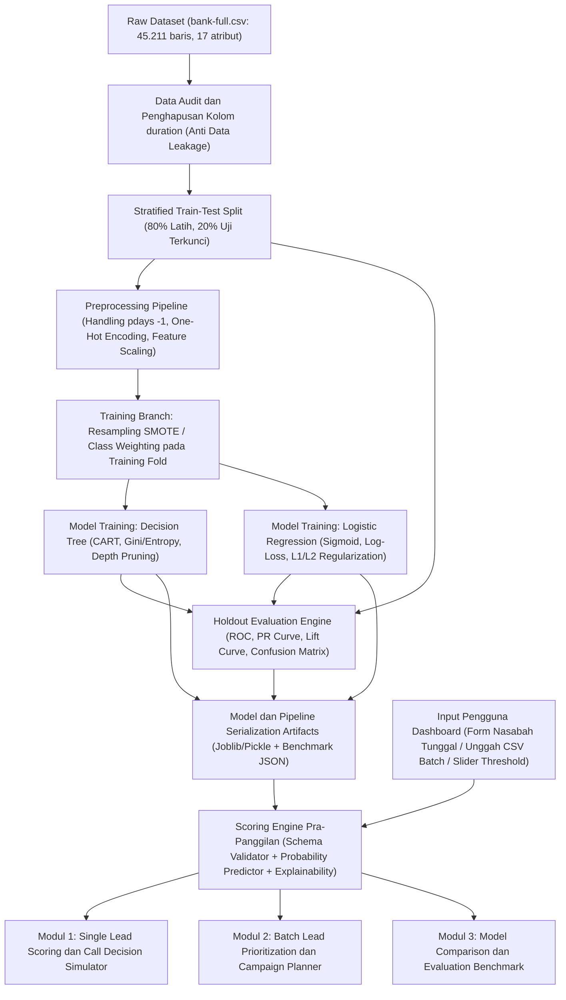
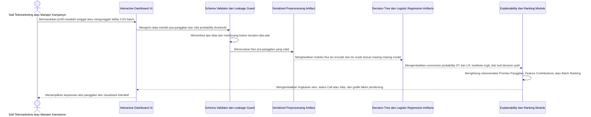
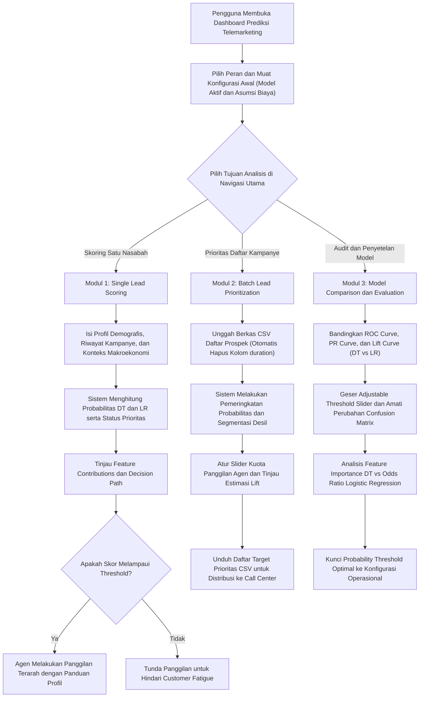

# Kajian Literatur, Metodologi, dan Desain Arsitektur Sistem: Prediksi Keberhasilan Kampanye Telemarketing Bank Menggunakan Decision Tree dan Logistic Regression

Dokumen ini menyusun landasan ilmiah, spesifikasi metodologis berbasis CRISP-DM dan KDD, formulasi matematis metrik evaluasi pada kondisi `class imbalance`, serta cetak biru arsitektur aplikasi *predictive lead scoring* untuk proyek data mining **Kandidat 3: Perbandingan Algoritma Decision Tree dan Logistic Regression untuk Prediksi Keberhasilan Kampanye Telemarketing Bank**. Seluruh spesifikasi dirancang agar realistis diimplementasikan dalam rentang waktu pengerjaan proyek 2 hingga 3 minggu menggunakan ekosistem Python interactive dashboard tanpa mengorbankan ketelitian metodologis, khususnya pencegahan `data leakage`.

---

## 1. Identifikasi Masalah dan Konteks Bisnis

### 1.1 Rendahnya Conversion Rate pada Kampanye Telemarketing Deposito Berjangka
Perbankan ritel secara rutin menjalankan kampanye pemasaran langsung (*direct marketing*) melalui saluran telepon keluar (*outbound telemarketing*) untuk menawarkan produk simpanan berjangka (*term deposit*). Berbeda dengan penawaran produk melalui iklan massal, telemarketing melibatkan interaksi langsung antara agen *call center* dan calon nasabah sehingga membutuhkan biaya tenaga kerja, waktu, dan infrastruktur komunikasi yang signifikan.

Realitas empiris menunjukkan bahwa tingkat keberhasilan (*conversion rate*) kampanye telemarketing perbankan tergolong sangat rendah. Pada dataset tolok ukur **UCI Bank Marketing** (`bank-full.csv`) yang merekam 45.211 kontak kampanye sebuah institusi perbankan Portugal, hanya **5.289 nasabah (sekitar 11,7%)** yang akhirnya berlangganan deposito berjangka (`y = yes`), sedangkan **39.922 nasabah (sekitar 88,3%)** menolak penawaran (`y = no`). Pola distribusi serupa juga terlihat pada varian `bank-additional-full.csv` (41.188 data) dengan proporsi kelas positif sebesar **11,27% (4.640 konversi)**. Ketimpangan ini berarti hampir sembilan dari sepuluh panggilan yang dilakukan secara acak atau tanpa penyaringan prediktif berujung pada penolakan.

### 1.2 Biaya Operasional Panggilan Keluar dan Inefisiensi Sumber Daya
Ketika bank melakukan pendekatan penargetan massal (*blanket calling*) terhadap seluruh basis data nasabah, sebagian besar jam kerja agen *call center* dan biaya telekomunikasi terserap untuk menghubungi nasabah dengan probabilitas konversi mendekati nol. Masalah ini diperburuk ketika kapasitas agen harian terbatas, misalnya hanya mampu melayani kuota panggilan tertentu per minggu atau per bulan. Tanpa mekanisme pemeringkatan prospek (*lead prioritization*), peluang pendapatan dari nasabah berpotensi tinggi sering kali terlewatkan atau terlambat dihubungi karena antrean panggilan bercampur dengan segmen berpeluang rendah.

### 1.3 Risiko Customer Fatigue dan Erosi Hubungan Nasabah
Selain biaya finansial langsung, panggilan telemarketing yang tidak relevan dan berulang memicu **customer fatigue** (kelelahan dan kejenuhan nasabah). Nasabah yang terus-menerus menerima penawaran produk yang tidak sesuai dengan profil finansial maupun momentum kebutuhannya cenderung merasa terganggu, menolak panggilan berikutnya secara permanen, atau bahkan mengalami penurunan kepuasan dan loyalitas terhadap bank. Fenomena ini terlihat langsung pada atribut riwayat kontak dalam dataset, di mana peningkatan frekuensi panggilan dalam satu kampanye tidak berbanding lurus dengan peluang konversi apabila profil dasarnya memang tidak tertarik.

### 1.4 Kebutuhan Predictive Lead Scoring Pra-Panggilan yang Terinterpretasi
Untuk mengatasi tiga persoalan bisnis tersebut, bank membutuhkan sistem **predictive lead scoring** yang beroperasi **sebelum panggilan dilakukan** (*pre-call scoring*). Sistem harus mampu menghitung skor `conversion probability` setiap calon nasabah berdasarkan profil demografis, kondisi finansial, riwayat kampanye terdahulu, dan konteks waktu/ekonomi, lalu menyusun daftar prioritas panggilan.

Dalam konteks pengambilan keputusan bisnis perbankan dan kesiapan implementasi proyek 2–3 minggu, perbandingan dua algoritma klasifikasi klasik yang saling melengkapi menjadi sangat strategis:
1. **Logistic Regression**: Menghasilkan estimasi probabilitas kontinu yang terkalibrasi secara halus (*well-calibrated probability*) dan mudah diaudit melalui koefisien serta `odds ratio` untuk memahami arah pengaruh setiap variabel.
2. **Decision Tree**: Mampu menangkap hubungan non-linear dan interaksi antarfitur tanpa asumsi linearitas maupun keharusan `feature scaling`, sekaligus menghasilkan aturan keputusan (*decision rules*) berbentuk hierarki yang intuitif bagi manajemen pemasaran.

---

## 2. Bedah Paper Utama dan Paper Pendukung

Bagian ini membedah secara mendalam satu penelitian fondasional (*anchor paper*) dan tiga penelitian pendukung terkini dari literatur ilmiah yang terverifikasi, guna memetakan praktik terbaik terkait perlakuan terhadap `duration`, penanganan `class imbalance`, pemilihan fitur, dan komparasi performa **Decision Tree** serta **Logistic Regression**.

### 2.1 Bedah Paper Utama

**Sitasi:** Moro, S., Cortez, P., & Rita, P. (2014). *A Data-Driven Approach to Predict the Success of Bank Telemarketing*. Decision Support Systems (Elsevier), Volume 62, pp. 22–31. DOI: `10.1016/j.dss.2014.03.001`. *(Catatan konteks historis: studi ini memperluas kerangka kerja CRISP-DM perbankan yang sebelumnya diperkenalkan oleh Moro, Laureano, & Cortez (2011) pada Proceedings of the European Simulation and Modelling Conference / ESM'2011, pp. 117–121, yang menjadi cikal bakal publikasi dataset UCI Bank Marketing).*

1. **Identifikasi Masalah:**
   Industri perbankan menghadapi penurunan efektivitas kampanye pemasaran massal akibat persaingan ketat dan respons nasabah yang rendah terhadap penawaran deposito berjangka. Pengambilan keputusan penargetan yang hanya mengandalkan intuisi manajer kampanye sering kali menghasilkan pemborosan biaya dan rendahnya efisiensi penjangkauan prospek potensial. Penelitian ini merancang **Decision Support System (DSS)** berbasis data untuk memprediksi keberhasilan panggilan telemarketing sebelum panggilan dieksekusi.
2. **Dataset dan Lingkup Fitur:**
   Penelitian menggunakan data riil kampanye telemarketing sebuah bank ritel di Portugal yang dikumpulkan pada rentang Mei 2008 hingga Juni 2013 (mencakup periode krisis keuangan Eropa), dengan total **52.944 kontak telepon**. Penulis awalnya mengekstraksi kumpulan kandidat yang sangat luas sebanyak **150 atribut** mencakup profil demografis nasabah, informasi produk/transaksi, riwayat kampanye, serta indikator sosial-ekonomi (seperti suku bunga Euribor).
3. **Metodologi dan Mitigasi Data Leakage:**
   Melalui proses *semi-automatic feature selection* yang dipadukan dengan pengetahuan pakar domain perbankan, ruang fitur awal sebanyak 150 atribut dipangkas menjadi **22 fitur prediktor** yang seluruhnya tersedia **sebelum panggilan telepon dilakukan**. Atribut pasca-panggilan seperti `duration` (lama panggilan berlangsung) **secara eksplisit dikeluarkan/dibuang** dari fitur model prediktif agar tidak menimbulkan *target leakage* yang merusak validitas sistem operasional.
   Empat algoritma klasifikasi dibandingkan dengan skema validasi *out-of-sample rolling window* untuk meniru kondisi waktu nyata: **Logistic Regression (LR)**, **Decision Trees (DT)**, **Support Vector Machines (SVM)**, dan **Artificial Neural Networks (NN)**. Performa dievaluasi menggunakan dua metrik utama yang tahan terhadap `class imbalance`: **ROC-AUC** dan **ALIFT** (*Area of the Cumulative Lift Curve*).
4. **Temuan Utama:**
   - **Neural Network (NN)** meraih performa terbaik dengan **ROC-AUC sekitar 0,80** dan **ALIFT sekitar 0,70** (berada pada rentang 0,67–0,70 dalam evaluasi *rolling window*).
   - Analisis `Lift Curve` membuktikan nilai bisnis nyata: dengan hanya menghubungi **50% nasabah teratas** berdasarkan peringkat probabilitas model, bank berhasil menjangkau **79% dari seluruh nasabah yang benar-benar berlangganan deposito berjangka**.
   - Ekstraksi pengetahuan melalui *sensitivity analysis* dan struktur `Decision Tree` mengonfirmasi bahwa faktor makroekonomi (terutama suku bunga Euribor), atribut kontak kampanye, serta pengalaman agen merupakan determinan penting keberhasilan konversi.

### 2.2 Bedah Paper Pendukung 1: Dampak Ketersediaan Atribut `duration` terhadap Kebocoran Data

**Sitasi:** Ananthakrishnan, A., Sreya, S., & Anand, G. P. (2026). *Evaluating Call Duration Availability in Bank Marketing Prediction*. International Journal of Research Publication and Reviews (IJRPR), Vol. 7, Issue 11, pp. 1749–1756 (November 2026).

1. **Identifikasi Masalah:**
   Banyak studi dan proyek *machine learning* pada dataset UCI Bank Marketing melaporkan skor performa sangat tinggi karena menyertakan atribut `duration` (durasi panggilan terakhir dalam detik). Padahal, dalam praktik operasional, durasi panggilan baru diketahui setelah percakapan selesai sehingga penggunaannya untuk memprediksi target sebelum panggilan merupakan kasus klasik `data leakage`. Studi ini mengkuantifikasi secara ketat seberapa besar penurunan performa model ketika `duration` dihapus demi membangun model pra-panggilan yang realistis.
2. **Dataset dan Skema Partisi:**
   Penelitian menggunakan dataset resmi `bank-full.csv` sebanyak **45.211 baris** (16 prediktor + 1 target `y`), dengan rasio konversi minoritas sekitar 11,7% dan baseline mayoritas `no` sebesar 88,30%. Seluruh data dipartisi menggunakan indeks *stratified* yang seragam menjadi **28.934 data latih (*fitting*)**, **7.234 data validasi**, dan **9.043 data uji (*test*)** (dengan total *development pool* sebesar 36.168 data).
3. **Metodologi:**
   Empat model klasifikasi—**Logistic Regression**, **Decision Tree**, **Random Forest**, dan **K-Nearest Neighbors (KNN)**—dilatih dan dievaluasi pada dua kondisi berpasangan (*matched comparison*): (a) menggunakan seluruh 16 prediktor termasuk `duration`, dan (b) mengeluarkan `duration` sehingga hanya menyisakan 15 prediktor pra-panggilan. Untuk menyikapi ketimpangan kelas, studi ini menerapkan *class weighting*, optimasi *probability threshold*, serta metrik **F1-score**, **ROC-AUC**, **Average Precision (PR-AUC)**, **Precision**, dan **Recall**.
4. **Temuan Utama:**
   - Pada skenario *with duration* (retrospektif), performa model melambung secara artifisial dengan **ROC-AUC > 0,90** (contohnya Random Forest mencapai ROC-AUC **0,9240** dan F1-score **0,5862**).
   - Pada skenario *without duration* (pra-panggilan realistis), skor **F1-score validasi** keempat model turun menjadi: **Random Forest = 0,4607**, **Decision Tree = 0,4483**, **Logistic Regression = 0,3764**, dan **KNN = 0,2870**; sementara **ROC-AUC** berada pada kisaran realistis **0,75–0,81** (pengujian Random Forest pada *test set* menghasilkan ROC-AUC **0,7971** sebelum refit dan **0,8001** setelah refit pada 36.168 data, dengan F1-score **0,4549**, Average Precision **0,4470**, Precision **0,3725**, dan Recall **0,5841**).
   - **Perbandingan spesifik DT vs LR tanpa `duration`:** Decision Tree mencatat F1-score validasi lebih unggul (`0,4483` vs `0,3764`) karena mampu menangkap batas pemisahan non-linear secara lebih presisi; sebaliknya, Logistic Regression cenderung menghasilkan terlalu banyak *false positive* (lebih dari 1.800 FP pada split validasi) yang menekan `precision`-nya.
   - Studi juga menegaskan jebakan `accuracy`: model trivial yang selalu menebak `no` meraih akurasi mentah **88,30%** namun dengan **Recall = 0%**.

### 2.3 Bedah Paper Pendukung 2: Pendekatan Risk-Sensitive Learning, SMOTE, dan SHAP pada Data Tidak Seimbang

**Sitasi:** Dong, B., Zhang, X., Liu, Y., Zhang, T., Liu, X., Hou, L., Meng, L., Guo, Z., & Mulati, A. (2026). *Risk-Sensitive Machine Learning for Financial Decision Modeling Under Imbalanced Data: Evidence from Bank Telemarketing*. Entropy (MDPI), Vol. 28, Issue 3, Article 354 (`e28030354`). DOI: `10.3390/e28030354`.

1. **Identifikasi Masalah:**
   Pelatihan model dengan fungsi objektif *standard cross-entropy loss* pada dataset keuangan yang tidak seimbang memperlakukan kesalahan prediksi kelas minoritas dan mayoritas secara simetris, sehingga model bias menebak nasabah tidak tertarik. Dalam pemasaran finansial, kegagalan mendeteksi calon nasabah potensial (*false negative*) menimbulkan biaya peluang (*opportunity cost*) yang berbeda dibanding panggilan tidak berkonversi (*false positive*).
2. **Dataset:**
   Penelitian menggunakan dataset **Portuguese Bank Marketing** varian **41.188 data** (`bank-additional-full.csv`) yang memiliki tingkat respons positif sebesar **11,3%** serta mencakup atribut demografis, riwayat kampanye, dan indikator makroekonomi.
3. **Metodologi:**
   Penulis membangun kerangka kerja terpadu yang memadukan **SMOTE** (*Synthetic Minority Over-sampling Technique*) dan strategi **cost-sensitive / risk-sensitive learning** dalam *unified preprocessing pipeline* dengan **5-fold stratified cross-validation**. Sebanyak delapan algoritma dibandingkan secara langsung, termasuk model klasik **Logistic Regression** dan **Decision Tree**, bersama **Random Forest** dan metode *gradient boosting* (**XGBoost**, **LightGBM**, **CatBoost**). Interpretabilitas lokal dan global ditelaah menggunakan **SHAP (SHapley Additive exPlanations)**.
4. **Temuan Utama:**
   - Evaluasi dengan metrik **F1-score**, **Recall kelas minoritas**, dan **ROC-AUC** menunjukkan bahwa metode ensemble berbasis penalti biaya dan penyeimbangan data unggul dibandingkan model baseline tunggal (Logistic Regression dan Decision Tree standar), dengan performa terbaik mencapai **F1-score = 0,540**, **Recall kelas minoritas = 0,812**, dan **ROC-AUC = 0,908**.
   - Analisis SHAP mengonfirmasi bahwa **durasi kampanye (`duration`)**, **hasil kontak kampanye sebelumnya (`poutcome`)**, dan **indikator makroekonomi** merupakan prediktor paling berpengaruh dalam mendeteksi kelas minoritas—yang sekaligus menggarisbawahi pentingnya pemisahan fitur pasca-panggilan (`duration`) apabila sistem diterapkan sebelum panggilan berlangsung.

### 2.4 Bedah Paper Pendukung 3: Optimasi Logistic Regression + RFE + SMOTE vs Decision Tree pada Data Tidak Seimbang

**Sitasi:** Sutarman, Siringoringo, R., Arisandi, D., Kurniawan, E., & Nababan, E. B. (2024). *Model Klasifikasi dengan Logistic Regression dan Recursive Feature Elimination pada Data Tidak Seimbang*. Jurnal Teknologi Informasi dan Ilmu Komputer (JTIIK), Vol. 11, No. 4, Agustus 2024, hlm. 735–742. DOI: `10.25126/jtiik.1148198`.

1. **Identifikasi Masalah:**
   Model klasifikasi pada dataset riil seperti perbankan kerap dihadapkan pada dua kendala secara bersamaan: tingginya dimensi fitur setelah *encoding* yang memicu beban komputasi serta risiko *overfitting*, dan ketidakseimbangan distribusi target kelas (`class imbalance`) yang menurunkan sensitivitas terhadap kelas minoritas.
2. **Dataset:**
   Penelitian menguji metode pada tiga dataset dari UCI Machine Learning Repository dengan karakteristik beragam, salah satunya adalah dataset **Bank Marketing** (bersama dataset *Glass* dan *Musk II*).
3. **Metodologi:**
   Penulis merancang alur prapemrosesan bertingkat sebelum pemodelan: (a) **Recursive Feature Elimination (RFE)** untuk menyeleksi subset fitur yang paling diskriminatif dan membuang fitur redundan, (b) **SMOTE** untuk menyeimbangkan distribusi kelas pada data latih, serta (c) penerapan **Logistic Regression** dengan regularisasi **Ridge Regression ($L_2$-regularization)** guna menekan varians koefisien dan mencegah *overfitting*. Performa model usulan (**LR + RFE + SMOTE**) dibandingkan terhadap empat model lain: **Decision Tree**, **Naïve Bayes**, **K-Nearest Neighbors (K-NN)**, dan **Random Forest**.
4. **Temuan Utama:**
   - Berdasarkan pengujian *confusion matrix* dan kurva ROC, pipeline **LR + RFE + SMOTE** berhasil memperoleh nilai **ROC-AUC sebesar 93% (0,93)** dan mengungguli model pembanding termasuk Decision Tree dan Random Forest pada eksperimen dataset UCI tersebut.
   - Temuan ini membuktikan bahwa performa Logistic Regression—yang secara bawaan sering tertinggal oleh model pohon pada data tidak seimbang dan berdimensi tinggi—dapat ditingkatkan secara dramatis apabila didukung seleksi fitur (RFE), regularisasi $L_2$, dan penyeimbangan kelas pada data latih (SMOTE). *(Catatan kritis: pada eksperimen yang mempertahankan fitur penuh dataset standar termasuk `duration`, nilai ROC-AUC di atas 0,90 merefleksikan skenario retrospektif/benchmark penuh; untuk aplikasi pra-panggilan, prinsip RFE + SMOTE + L2 tetap relevan namun dievaluasi tanpa `duration`).*

### 2.5 Tabel Matriks Komparasi Paper

| Sitasi | Masalah Utama | Varian Dataset Bank Marketing | Perlakuan terhadap `duration` dan `Class Imbalance` | Algoritma dan Konfigurasi / Hyperparameter | Metrik Evaluasi | Hasil Benchmark Utama |
| :--- | :--- | :--- | :--- | :--- | :--- | :--- |
| **Moro, Cortez, & Rita (2014)**, *Decision Support Systems*, 62, 22–31 | Penargetan telemarketing konvensional mahal dan *conversion rate* rendah; butuh DSS pra-panggilan | Data bank ritel Portugal (2008–2013): **52.944 kontak**, 150 atribut awal diseleksi menjadi **22 fitur** (induk varian UCI) | `duration` **dieksklusi/dibuang** (anti *data leakage*); evaluasi out-of-sample *rolling window* untuk validasi temporal | **LR, DT, SVM, NN**; seleksi semi-otomatis + pengetahuan domain menjadi 22 fitur (detail tuning spesifik tiap model mengikuti eksperimen DSS 2014) | **ROC-AUC** dan **ALIFT** (*Area of Cumulative Lift Curve*) | **NN terbaik:** ROC-AUC sekitar **0,80**, ALIFT sekitar **0,70** (0,67–0,70); **50% teratas prospek menangkap 79% subscriber** |
| **Ananthakrishnan, Sreya, & Anand (2026)**, *IJRPR*, 7(11), 1749–1756 | Bias evaluasi dan *target leakage* jika `duration` dipakai pada model pra-panggilan | UCI `bank-full.csv`: **45.211 baris**, 16 prediktor + target `y` (~11,7% `yes`), split *stratified* 28.934 / 7.234 / 9.043 | Uji berpasangan **dengan vs tanpa `duration`**; penanganan imbalance via *class weighting* dan *threshold tuning* | **LR, DT, RF, KNN**; skema kontrol seleksi kandidat berbasis validation F1 dengan split *stratified* seragam | Accuracy, Precision, Recall, **F1-score**, **ROC-AUC**, Average Precision | Tanpa `duration`, validasi F1: **RF 0,4607**, **DT 0,4483**, **LR 0,3764**, KNN 0,2870; Test RF turun dari AUC **0,9240** (dengan `duration`) ke **0,7971–0,8001** (tanpa `duration`); baseline *always-no* Acc 0,8830 (Recall 0) |
| **Dong et al. (2026)**, *Entropy* (MDPI), 28(3), 354 | Bias model pada *cross-entropy* standar akibat `class imbalance` (11,3%) dan risiko finansial asimetris | UCI `bank-additional-full.csv`: **41.188 baris**, 20 prediktor + target `y` (11,3% positif) | `duration` dikaji via **SHAP** (teridentifikasi sangat dominan bersama makroekonomi); imbalance ditangani dengan **SMOTE + cost-sensitive learning** | **LR, DT, RF, CatBoost, XGBoost, LightGBM** (8 model); validasi **5-fold stratified cross-validation** | **F1-score**, **Minority Recall**, **ROC-AUC**, interpretasi **SHAP** | Ensemble terbaik (*risk-sensitive*): **F1-score = 0,540**, **Recall minoritas = 0,812**, **ROC-AUC = 0,908**; unggul atas baseline LR dan DT |
| **Sutarman et al. (2024)**, *JTIIK*, 11(4), 735–742 | Dimensi fitur tinggi pasca-transformasi dan `class imbalance` menurunkan akurasi minoritas | **UCI Bank Marketing** (bersama dataset UCI *Glass* dan *Musk II*) | Tidak membuang `duration` secara eksplisit (benchmark klasifikasi UCI standar); imbalance ditangani dengan **SMOTE** hanya pada data latih | **LR + RFE + SMOTE** dengan **Ridge ($L_2$) regularization**; dibandingkan dengan **DT, Naïve Bayes, K-NN, RF** | *Confusion Matrix* dan **ROC-AUC** | **LR + RFE + SMOTE** meraih **ROC-AUC = 93% (0,93)**, melampaui Decision Tree, Naïve Bayes, K-NN, dan Random Forest pada pengujian |

---

## 3. Metodologi CRISP-DM dan Pemetaan ke Tahapan KDD

Proyek ini mengadopsi standar industri **CRISP-DM (*Cross-Industry Standard Process for Data Mining*)** yang secara historis juga menjadi metodologi inti pada penelitian perintis Moro, Laureano, & Cortez (2011) untuk domain telemarketing bank. Agar selaras dengan kerangka akademik penemuan pengetahuan dalam basis data, keenam fase CRISP-DM dipetakan secara eksplisit ke dalam lima tahapan **KDD (*Knowledge Discovery in Databases*)**.

### 3.1 Tabel Ekuivalensi 6 Fase CRISP-DM vs 5 Tahapan KDD

| No. | Fase CRISP-DM (6 Fase) | Tahapan KDD yang Ekuivalen (5 Tahapan) | Aktivitas Spesifik untuk Kasus Klasifikasi Telemarketing Bank |
| :--- | :--- | :--- | :--- |
| 1 | **Business Understanding** | Pra-KDD / Penetapan Tujuan Domain (terintegrasi awal menuju **Data Selection**) | Merumuskan masalah rendahnya `conversion rate` (11,7%), biaya panggilan keluar, risiko `customer fatigue`, menetapkan skenario ketat prediksi **pra-panggilan**, serta menentukan metrik prioritas bisnis (Recall, F1-score, PR-AUC, dan Lift Curve). |
| 2 | **Data Understanding** | **Data Selection** (dan Eksplorasi Awal Data) | Memuat dataset `bank-full.csv` (45.211 baris, 17 atribut) atau varian makroekonomi `bank-additional-full.csv` (41.188 baris, 21 atribut), memverifikasi tipe data, mengecek proporsi `class imbalance` (88,3% `no` vs 11,7% `yes`), mengidentifikasi nilai sentinel (`pdays = -1`) serta kategori `unknown`, dan menandai `duration` sebagai kandidat penghapusan wajib. |
| 3 | **Data Preparation** | **Preprocessing** dan **Transformation** | **Preprocessing:** Menghapus `duration` (mitigasi `data leakage`), memeriksa duplikasi baris, menangani nilai sentinel `pdays = -1` menjadi fitur indikator kontak sebelumnya, dan mempartisi data via `Stratified Train-Test Split`. **Transformation:** Menerapkan `One-Hot Encoding` / `Ordinal Encoding`, `feature scaling` untuk Logistic Regression, serta `SMOTE` atau `Class Weighting` khusus di dalam *training fold*. |
| 4 | **Modeling** | **Data Mining** | Melatih model **Decision Tree (CART)** dan **Logistic Regression** dengan `Stratified K-Fold Cross-Validation`, melakukan penyetelan *hyperparameter* (`max_depth`, `min_samples_leaf`, `criterion`, penalti $L_1/L_2$, parameter $C$, dan `class_weight`), serta kalibrasi probabilitas bila diperlukan. |
| 5 | **Evaluation** | **Interpretation / Evaluation** | Mengevaluasi model pada *holdout test set* menggunakan `Confusion Matrix`, `Precision`, `Recall`, `F1-score`, `ROC-AUC`, `PR-AUC`, dan `Lift Curve`; mengoptimalkan `probability threshold` sesuai kuota panggilan; serta menelaah *Feature Importance* dan *Odds Ratio* untuk validasi logika bisnis. |
| 6 | **Deployment** | Pasca-KDD / Operasionalisasi Sistem Pengetahuan | Melakukan `serialization` pipeline preprocessing dan model terlatih menjadi `artifact`, membangun *scoring engine* pra-panggilan tanpa atribut `duration`, serta merilis **Interactive Decision Support Dashboard** (Modul 1–3) bagi tim telemarketing dan manajer kampanye. |

### 3.2 Analisis Struktur Atribut Dataset UCI Bank Marketing (`bank-full.csv`)

Dataset utama proyek ini adalah `bank-full.csv` yang berisikan **45.211 observasi** dan **17 atribut** (16 atribut masukan dan 1 variabel target `y`), dengan distribusi kelas target **5.289 baris `yes` (11,70%)** dan **39.922 baris `no` (88,30%)**. Berikut rincian lengkap ke-17 atribut dan perannya dalam pipeline pra-panggilan:

1. **Profil Demografis dan Finansial Nasabah (8 Atribut):**
   - `age` *(Numerik)*: Usia nasabah dalam tahun. Nasabah pensiunan maupun usia produktif mapan sering memiliki pola konversi berbeda.
   - `job` *(Kategorikal nominal, 12 kategori)*: Jenis pekerjaan (`admin.`, `blue-collar`, `entrepreneur`, `housemaid`, `management`, `retired`, `self-employed`, `services`, `student`, `technician`, `unemployed`, `unknown`).
   - `marital` *(Kategorikal nominal, 3 kategori)*: Status pernikahan (`married`, `divorced` termasuk janda/duda, `single`).
   - `education` *(Kategorikal ordinal, 4 kategori)*: Tingkat pendidikan (`primary`, `secondary`, `tertiary`, `unknown`).
   - `default` *(Kategorikal biner)*: Apakah nasabah memiliki riwayat gagal bayar kredit (`yes`, `no`).
   - `balance` *(Numerik)*: Rata-rata saldo tabungan tahunan dalam satuan Euro (memiliki distribusi sangat miring/*skewed* dan rentang nilai dari negatif hingga ratusan ribu).
   - `housing` *(Kategorikal biner)*: Apakah memiliki pinjaman kredit kepemilikan rumah (`yes`, `no`).
   - `loan` *(Kategorikal biner)*: Apakah memiliki pinjaman pribadi (`yes`, `no`).

2. **Informasi Kontak Terakhir Kampanye Berjalan (4 Atribut):**
   - `contact` *(Kategorikal nominal)*: Jenis saluran komunikasi (`cellular`, `telephone`, `unknown`).
   - `day` *(Numerik)*: Tanggal kontak terakhir dalam satu bulan (1–31).
   - `month` *(Kategorikal siklikal/nominal)*: Bulan kontak terakhir dalam satu tahun (`jan` hingga `dec`).
   - `duration` *(Numerik — **WAJIB DIHAPUS**)*: Lama durasi panggilan terakhir dalam detik.

3. **Riwayat Kampanye Pemasaran (4 Atribut):**
   - `campaign` *(Numerik)*: Jumlah kontak yang sudah dilakukan kepada nasabah selama kampanye saat ini (termasuk kontak terakhir).
   - `pdays` *(Numerik dengan nilai sentinel)*: Jumlah hari yang berlalu sejak nasabah terakhir kali dihubungi pada kampanye sebelumnya; nilai **`-1`** menandakan nasabah belum pernah dihubungi sebelumnya.
   - `previous` *(Numerik)*: Jumlah kontak yang dilakukan sebelum kampanye saat ini.
   - `poutcome` *(Kategorikal nominal)*: Hasil kampanye pemasaran sebelumnya (`success`, `failure`, `other`, `unknown`).

4. **Variabel Target (1 Atribut):**
   - `y` *(Kategorikal biner)*: Apakah nasabah berlangganan deposito berjangka (`yes` dikodekan sebagai `1`, `no` dikodekan sebagai `0`).

**Catatan Kompatibilitas Varian `bank-additional-full.csv` (21 Atribut):**
Sebagai perluasan arsitektural, versi lanjutan dataset UCI (`bank-additional-full.csv`, 41.188 baris, 11,27% `yes`) menambahkan 5 indikator makroekonomi eksternal saat panggilan dilakukan: `emp.var.rate` (laju variasi ketenagakerjaan kuartalan), `cons.price.idx` (indeks harga konsumen bulanan), `cons.conf.idx` (indeks kepercayaan konsumen bulanan), `euribor3m` (suku bunga Euribor 3 bulan harian), dan `nr.employed` (jumlah tenaga kerja kuartalan)—sementara menghapus atribut `balance` dan `day` serta menggantinya dengan `day_of_week`. Untuk proyek Kandidat 3 yang berfokus pada `bank-full.csv` (17 atribut), model inti menggunakan 15 fitur aktif tanpa `duration`. Namun pada desain antarmuka *Single Lead Scoring* (Bagian 5), skema aplikasi dirancang modular agar dapat menampilkan parameter konteks makroekonomi (baik sebagai input aktif apabila pipeline dilatih memakai `bank-additional-full.csv`, maupun sebagai panel konteks asumsi ekonomi bank saat simulasi).

### 3.3 Mitigasi Data Leakage: Mengapa Atribut `duration` Wajib Dihapus

Dalam *supervised learning*, `data leakage` terjadi ketika informasi dari masa depan atau informasi yang secara langsung menyandikan jawaban target ikut masuk ke dalam variabel prediktor pada saat pelatihan maupun inferensi. Pada `bank-full.csv`, atribut `duration` memiliki korelasi statistik paling tinggi terhadap `y`: panggilan yang berlangsung singkat (misalnya 0–30 detik) hampir pasti berakhir dengan penolakan (`duration = 0` pasti berarti `y = no`), sedangkan panggilan berdurasi ratusan hingga ribuan detik umumnya mencerminkan nasabah yang berminat dan sedang menjalani proses persetujuan pembukaan rekening deposito.

Namun dalam konteks operasional **pre-call lead scoring**:
1. **Ketidaktersediaan Informasi (*Post-Event Variable*):** Sebelum agen *call center* menekan nomor nasabah, panjang percakapan di masa depan sama sekali **belum eksis dan tidak dapat diketahui**.
2. **Ilusi Performa Evaluasi:** Sebagaimana dibuktikan secara empiris dalam Ananthakrishnan et al. (2026), menyertakan `duration` melambungkan `ROC-AUC` ke kisaran >0,92 dan menyesatkan tim pengembang seolah-olah model sangat akurat, padahal model tidak belajar mengenali profil nasabah—ia hanya menebak hasil panggilan berdasarkan panjang percakapan yang sudah selesai.
3. **Kegagalan Saat Deployment:** Ketika sistem dioperasikan pada calon nasabah baru, kolom `duration` tidak memiliki nilai input yang sah. Mengisi nilai rata-rata atau angka sembarang akan menghasilkan prediksi yang kacau. Oleh karena itu, **menghapus atribut `duration` sejak awal Data Preparation** (sesuai rekomendasi resmi UCI Repository dan Moro et al., 2014) merupakan syarat mutlak agar model valid untuk prediksi pra-panggilan.

Selain `duration`, perhatian khusus juga diberikan pada:
- **Pencegahan Leakage saat Preprocessing dan Resampling:** Perhitungan parameter *scaling* (mean dan standar deviasi), daftar kategori *encoding*, maupun pembangkitan sampel sintetis `SMOTE` hanya boleh dipelajari (*fit*) dari **data latih (*training set*)** atau di dalam masing-masing *fold* validasi silang, dan tidak pernah menyentuh *validation/test set*.
- **Penanganan Nilai Sentinel `pdays = -1`:** Nilai `-1` tidak bermakna "minus satu hari sebelum kampanye" secara kontinu. Jika dibiarkan mentah dalam **Logistic Regression**, jarak matematis antara `-1` dan `180` akan mengganggu perhitungan koefisien linear. Solusinya adalah mengekstraksi fitur biner baru `never_contacted_before` (bernilai `1` jika `pdays == -1`, selain itu `0`) dan mengonversi nilai `-1` menjadi nilai pengganti yang netral atau melakukan *binning* jarak hari (`< 90 hari`, `90–180 hari`, `> 180 hari`, `tidak pernah`).

### 3.4 Encoding Variabel Kategorikal dan Penanganan Kategori `unknown`

Algoritma **Logistic Regression** dan implementasi standar **Decision Tree** pada pustaka pemodelan numerik memerlukan seluruh input dalam bentuk angka. Pemilihan teknik `encoding` harus mempertimbangkan sifat variabel serta mekanisme algoritma:

1. **One-Hot Encoding (untuk Fitur Nominal):**
   Diterapkan pada variabel kategorikal tanpa urutan alami seperti `job`, `marital`, `contact`, `poutcome`, serta variabel biner (`default`, `housing`, `loan`). Setiap kategori diubah menjadi kolom indikator biner (`0` atau `1`).
   - *Pertimbangan khusus Logistic Regression:* Wajib mengaktifkan penghapusan satu kategori referensi (*drop first / reference category*) atau menggunakan regularisasi agar tidak muncul **dummy variable trap** (kolinearitas sempurna di mana satu kolom merupakan kombinasi linear dari kolom lainnya sehingga matriks Hessian tidak stabil).
   - *Penanganan fitur siklikal `month` (dan `day`):* Dapat menggunakan `One-Hot Encoding` untuk menangkap efek musiman spesifik (misalnya bulan Maret, September, Oktober, atau Desember yang secara historis memiliki tingkat konversi lebih tinggi pada dataset Portugal), atau transformasi trigonometri sinus-kosinus untuk merepresentasikan kedekatan siklus bulan Desember–Januari.
2. **Ordinal Encoding (untuk Fitur Berjenjang):**
   Cocok untuk atribut `education` apabila diasumsikan memiliki tingkatan hierarkis (`primary = 1`, `secondary = 2`, `tertiary = 3`). Namun karena terdapat nilai `unknown`, pendekatan yang lebih aman tanpa memaksakan posisi `unknown` di antara tingkat pendidikan adalah tetap memakai `One-Hot Encoding` atau memisahkan indikator `education_unknown` secara eksplisit.
3. **Strategi Kategori `unknown`:**
   Pada `bank-full.csv`, nilai `unknown` muncul cukup masif terutama pada `poutcome` (~81,7% baris karena mayoritas nasabah adalah prospek baru) dan `contact` (~28,8% baris). Menghapus seluruh baris berlabel `unknown` akan membuang lebih dari empat perlima dataset dan merusak distribusi populasi. Oleh sebab itu, `unknown` harus dipertahankan sebagai kategori valid tersendiri karena ketidaktahuan saluran kontak atau ketiadaan riwayat kampanye terdahulu justru menyimpan sinyal prediktif yang kuat.

### 3.5 Feature Scaling untuk Logistic Regression vs Scale-Invariance pada Decision Tree

Perbedaan mendasar antar-kedua algoritma muncul pada kebutuhan penskalaan fitur numerik (`age`, `balance`, `day`, `campaign`, `pdays`, `previous`):
- **Logistic Regression (Wajib Feature Scaling):** Pada `bank-full.csv`, rentang nilai `balance` membentang dari sekitar `-8.019` hingga `102.127` Euro, sementara `previous` atau `campaign` umumnya berada pada rentang satuan hingga puluhan. Tanpa `feature scaling`, fungsi optimasi berbasis gradien (*L-BFGS* atau *SAGA*) lambat mencapai konvergensi. Terlebih lagi, ketika regularisasi $L_1$ atau $L_2$ diterapkan, penalti koefisien $\beta_j$ akan menghukum fitur berskala kecil secara tidak proporsional dibanding fitur berskala besar. Menggunakan standardisasi (*Z-score / StandardScaler*) atau *RobustScaler* (yang berbasis median dan *interquartile range* sehingga lebih tahan terhadap *outlier* ekstrem pada `balance`) memastikan seluruh fitur berada pada skala yang sebanding dan membuat magnitudo koefisien $|\beta_j|$ dapat dibandingkan secara bermakna.
- **Decision Tree (Tidak Membutuhkan Feature Scaling):** Pohon keputusan mempartisi ruang fitur melalui uji ketidaksamaan ambang batas tunggal per atribut (misalnya apakah `balance > 1250`). Transformasi linear monotonik seperti standardisasi tidak mengubah urutan peringkat nilai fitur maupun titik potong optimal berbasis `Gini Impurity` atau `Entropy`. Membiarkan fitur numerik tetap pada satuan aslinya (Euro, tahun, hari) justru mempermudah pembacaan aturan bisnis di setiap simpul pohon. *(Catatan arsitektural: pada pipeline aplikasi, scaling dapat dibungkus khusus hanya pada cabang pipeline Logistic Regression melalui ColumnTransformer yang terpisah dari cabang Decision Tree).*

### 3.6 Penanganan Class Imbalance: Class Weighting vs SMOTE pada Training Set

Ketidakseimbangan target sebesar **11,7% (`yes`) vs 88,3% (`no`)** membuat algoritma standar cenderung mengejar *overall accuracy* dengan mengabaikan kelas minoritas. Terdapat dua strategi utama yang dibandingkan pada proyek ini:

1. **Class Weighting (Pendekatan Tingkat Algoritma / Cost-Sensitive):**
   Menetapkan bobot kesalahan yang lebih tinggi bagi kelas minoritas secara proporsional terbalik terhadap frekuensinya:
   $$w_c = \frac{N}{2 \cdot N_c}$$
   di mana $N$ adalah total sampel latih dan $N_c$ adalah jumlah sampel pada kelas $c$. Dengan bobot sekitar $w_1 \approx 4,27$ untuk kelas `yes` dan $w_0 \approx 0,57$ untuk kelas `no` pada `bank-full.csv`, kesalahan memprediksi calon nasabah potensial sebagai tidak tertarik diberi penalti sekitar 7,5 kali lebih besar di dalam fungsi `log-loss` Logistic Regression maupun dalam perhitungan proporsi terbobot `Gini Impurity` / `Entropy` Decision Tree. Kelebihan utamanya: tidak menambah ukuran data latih, tidak menciptakan titik data sintetis yang berisiko artifisial, dan sangat cepat dieksekusi.
2. **SMOTE (*Synthetic Minority Over-sampling Technique* — Pendekatan Tingkat Data):**
   Bekerja dengan mencari $k$-tetangga terdekat (*k-nearest neighbors*) dari setiap sampel kelas minoritas (`yes`) di ruang fitur numerik yang sudah di-*encode* dan di-*scale*, lalu menginterpolasi sampel sintetis baru di sepanjang segmen garis antar-tetangga tersebut hingga proporsi kelas menjadi seimbang (misalnya rasio 1:1 atau rasio terkalibrasi seperti 1:2).
   - **Aturan Wajib Anti-Leakage:** `SMOTE` **HANYA boleh diterapkan pada data latih (*training set*)**, dan apabila menggunakan validasi silang, `SMOTE` harus dijalankan di dalam setiap iterasi *training fold* (via *imbalanced-learn pipeline*), **BUKAN sebelum Stratified Train-Test Split atau K-Fold**. Jika `SMOTE` dijalankan sebelum pemisahan data, sampel sintetis hasil interpolasi dari sampel uji akan bocor ke data latih dan mendistorsi metrik validasi secara palsu.
   - *Catatan Kalibrasi Probabilitas:* Baik *class weighting* maupun `SMOTE` menggeser distribusi prior kelas dari 11,7% menjadi ~50%. Akibatnya, probabilitas mentah yang dihasilkan model pasca-SMOTE atau *balanced class weight* mengalami pergeseran ke atas (*probability shift*). Untuk penentuan `probability threshold` atau estimasi `conversion rate` riil di dashboard, skor probabilitas dapat dikalibrasi ulang menggunakan *Platt Scaling* atau *Isotonic Regression* berbasis data validasi asli yang tidak di-resample, atau digunakan sebagai skor peringkat (*ranking score*) pada `Lift Curve`.

### 3.7 Stratified Train-Test Split dan Stratified K-Fold Cross-Validation

Untuk menjaga validitas evaluasi pada data tidak seimbang, pembagian dataset tidak boleh dilakukan secara acak seragam biasa (*simple random split*) melainkan secara **stratified**:
- **Stratified Train-Test Split (misalnya 80% data latih / 36.168 baris dan 20% data uji / 9.043 baris):** Memastikan baik *training set* maupun *holdout test set* sama-sama mempertahankan rasio kelas positif tepat di angka ~11,70% dan kelas negatif ~88,30%. Data uji sebesar 20% disimpan terkunci (*unseen test set*) hanya untuk evaluasi akhir.
- **Stratified K-Fold Cross-Validation (misalnya $k = 5$ atau $k = 10$ pada 80% data latih):** Membagi data latih menjadi $k$ lipatan (*folds*) berproporsi kelas identik. Pada setiap iterasi, $k-1$ lipatan dipakai untuk menjalankan preprocessing + resampling (`SMOTE` jika diaktifkan) + pelatihan model, sedangkan 1 lipatan validasi murni tanpa `SMOTE` digunakan untuk mengukur skor `ROC-AUC`, `PR-AUC`, dan `F1-score`. Pendekatan ini menjamin pemilihan *hyperparameter* terbaik tidak bergantung pada satu partisi keberuntungan semata.

### 3.8 Komparasi Mekanisme Algoritma: Decision Tree vs Logistic Regression

Pemilihan kedua model dalam Kandidat 3 didasarkan pada kontras karakteristik matematis dan fungsional keduanya:

#### A. Decision Tree (Algoritma CART)
Algoritma *Classification and Regression Trees* (CART) membangun struktur pohon biner melalui partisi rekursif ruang fitur (*recursive binary splitting*) untuk memaksimalkan kemurnian kelas pada simpul anak (*child nodes*). Dua kriteria pemisahan (*splitting criteria*) utama adalah:
- **Gini Impurity:** Mengukur peluang suatu elemen yang dipilih secara acak di dalam simpul $D$ salah diklasifikasikan apabila diberi label secara acak sesuai distribusi kelas pada simpul tersebut:
  $$G(D) = 1 - \sum_{c \in \{0,1\}} p_c^2$$
  Nilai $G(D) = 0$ menunjukkan simpul murni sempurna (seluruh nasabah dalam simpul berlabel seragam), sedangkan nilai maksimum $0,5$ pada kasus biner terjadi saat komposisi kelas 50:50.
- **Entropy (Shannon Entropy) & Information Gain:** Mengukur tingkat ketidakpastian informasi di dalam simpul $D$:
  $$H(D) = -\sum_{c \in \{0,1\}} p_c \log_2(p_c)$$
  Atribut dan titik potong terbaik dipilih yang memaksimalkan penurunan ketidakpastian (*Information Gain* atau *Gini Gain*):
  $$\Delta I(D, A) = I(D) - \left( \frac{|D_{\text{kiri}}|}{|D|} I(D_{\text{kiri}}) + \frac{|D_{\text{kanan}}|}{|D|} I(D_{\text{kanan}}) \right)$$
  di mana $I(\cdot)$ adalah $G(\cdot)$ atau $H(\cdot)$.
- **Pengendalian Overfitting dan Hyperparameter Kunci:** Tanpa pembatasan, pohon keputusan akan tumbuh hingga setiap daun hanya berisi satu sampel dan menghafal *noise* data latih. Oleh karena itu dilakukan *pre-pruning* melalui `max_depth` (kedalaman maksimum pohon, mis. rentang 4–10 agar aturan tetap mudah dibaca dan tergeneralisasi), `min_samples_split` (jumlah minimum sampel untuk memecah simpul internal), `min_samples_leaf` (jumlah minimum sampel di daun akhir agar probabilitas daun stabil), serta *post-pruning* melalui `ccp_alpha` (*cost-complexity pruning*).

#### B. Logistic Regression
Berbeda dengan pemisahan berbasis aturan persegi panjang pada pohon keputusan, Logistic Regression memodelkan hubungan antara kombinasi linear fitur $\mathbf{x} \in \mathbb{R}^d$ dengan peluang logaritmik (*log-odds* atau *logit*) kelas positif:
$$z = \beta_0 + \sum_{j=1}^{d} \beta_j x_j = \beta_0 + \mathbf{\beta}^\top \mathbf{x}$$
Nilai linear $z \in (-\infty, +\infty)$ dipetakan menjadi probabilitas konversi $P(y=1 \mid \mathbf{x}) \in (0, 1)$ menggunakan fungsi **sigmoid**:
$$\hat{p} = \sigma(z) = \frac{1}{1 + e^{-z}} = \frac{1}{1 + e^{-(\beta_0 + \mathbf{\beta}^\top \mathbf{x})}}$$
- **Fungsi Objektif Log-Loss (*Binary Cross-Entropy*) dengan Regularisasi:** Parameter bobot $\mathbf{\beta}$ diestimasi dengan meminimalkan fungsi kerugian `log-loss` terbobot ditambah penalti regularisasi untuk mencegah bobot meledak pada fitur yang berkorelasi tinggi atau berdimensi besar pasca `One-Hot Encoding`:
  $$\mathcal{L}(\mathbf{\beta}) = -\frac{1}{N} \sum_{i=1}^{N} \left[ w_1 y_i \log(\hat{p}_i) + w_0 (1 - y_i) \log(1 - \hat{p}_i) \right] + \lambda R(\mathbf{\beta})$$
  dengan pilihan regularisasi:
  - **Regularisasi $L_1$ (Lasso):** $R(\mathbf{\beta}) = \sum_{j=1}^{d} |\beta_j|$, cenderung mendorong koefisien fitur yang tidak relevan menjadi tepat nol (*sparse feature selection* otomatis).
  - **Regularisasi $L_2$ (Ridge):** $R(\mathbf{\beta}) = \frac{1}{2} \sum_{j=1}^{d} \beta_j^2$, menyusutkan magnitudo koefisien secara merata dan efektif menstabilkan multikolinearitas (seperti pada studi Sutarman et al., 2024). Kekuatan regularisasi dikendalikan oleh hyperparameter invers $C = \frac{1}{\lambda}$ (nilai $C$ lebih kecil berarti regularisasi lebih kuat).
- **Interpretabilitas melalui Odds Ratio:** Setiap koefisien $\beta_j$ memiliki interpretasi bisnis langsung melalui **odds ratio**:
  $$\text{OR}_j = e^{\beta_j}$$
  Apabila $\beta_j > 0$ ($\text{OR}_j > 1$), kenaikan satu satuan standar fitur $x_j$ (atau aktifnya kategori tertentu seperti `poutcome_success`) melipatgandakan peluang (*odds*) konversi nasabah sebesar $\text{OR}_j$ kali dengan asumsi variabel lain konstan (*ceteris paribus*).

#### C. Ringkasan Perbandingan Konseptual

| Aspek Perbandingan | Decision Tree (CART) | Logistic Regression |
| :--- | :--- | :--- |
| **Bentuk Batas Keputusan** | Non-linear, partisi ortogonal sejajar sumbu fitur | Linear pada ruang fitur (kecuali dilakukan rekayasa polinomial/interaksi) |
| **Kebutuhan Feature Scaling** | Tidak perlu (*scale-invariant*) | Wajib (`StandardScaler` atau `RobustScaler`) |
| **Penanganan Interaksi Fitur** | Otomatis menangkap interaksi bertingkat antarfitur di sepanjang cabang pohon | Membutuhkan pembuatan fitur interaksi secara eksplisit |
| **Kualitas Output Probabilitas** | Diskrit/terkuantisasi sesuai proporsi kelas di tiap *leaf node* | Kontinu, halus, dan terkalibrasi baik sepanjang rentang $0$ hingga $1$ |
| **Risiko Utama** | Mudah *overfitting* dan tidak stabil terhadap perubahan kecil data latih | *Underfitting* apabila pola hubungan sangat non-linear; sensitif terhadap *outlier* |
| **Bentuk Explainability** | Aturan *if-then* yang mudah dipahami staf bisnis dan penurunan impuritas fitur | Koefisien terstandarisasi $\beta_j$ dan `Odds Ratio` ($e^{\beta_j}$) |

---

## 4. Metrik Evaluasi dan Formulasi Matematis

### 4.1 Mengapa Accuracy Menyesatkan pada Imbalanced Dataset

Pada dataset `bank-full.csv`, distribusi kelas adalah 39.922 sampel `no` (88,30%) dan 5.289 sampel `yes` (11,70%). Jika sebuah model bodoh (*trivial majority classifier*) hanya memprediksi semua nasabah sebagai `no` tanpa mempelajari pola apapun, maka nilai **Accuracy** yang diperoleh adalah:
$$\text{Accuracy} = \frac{TP + TN}{TP + TN + FP + FN} = \frac{0 + 39.922}{45.211} \approx 88,30\%$$
Secara sekilas angka 88,30% tampak impresif, tetapi secara bisnis model tersebut gagal total karena menghasilkan **0 konversi** (`Recall = 0%`). Sebaliknya, pada kondisi tanpa `duration`, sebuah model pra-panggilan yang berguna bagi bisnis mungkin hanya memiliki akurasi sekitar 75%–82% karena sengaja melebarkan jaring prediksi positif untuk menjaring mayoritas calon nasabah yang tertarik. Oleh sebab itu, evaluasi klasifikasi telemarketing **tidak boleh bertumpu pada Accuracy**, melainkan wajib berbasis matriks konfusi kelas minoritas dan pemeringkatan probabilitas.

### 4.2 Confusion Matrix dan Pemaknaan Biaya Bisnis

Untuk `probability threshold` $\tau \in (0, 1)$, prediksi kelas $\hat{y}_i = 1$ apabila $\hat{p}_i \ge \tau$, dan $\hat{y}_i = 0$ apabila $\hat{p}_i < \tau$. Hasil klasifikasi dirangkum dalam **Confusion Matrix** 2x2:
- **True Positive ($TP$):** Nasabah diprediksi berlangganan ($\hat{y}=1$) dan aktualnya benar berlangganan ($y=1$). Menghasilkan pendapatan margin bunga/dana pihak ketiga bagi bank.
- **False Positive ($FP$ / Type I Error):** Nasabah diprediksi berlangganan ($\hat{y}=1$), namun aktualnya menolak ($y=0$). Mengakibatkan **pemborosan biaya panggilan** (waktu agen + pulsa) dan risiko **customer fatigue**.
- **True Negative ($TN$):** Nasabah diprediksi menolak ($\hat{y}=0$) dan aktualnya memang menolak ($y=0$). Menghasilkan penghematan biaya operasional karena tidak perlu dihubungi.
- **False Negative ($FN$ / Type II Error):** Nasabah diprediksi menolak ($\hat{y}=0$), padahal aktualnya bersedia berlangganan ($y=1$). Mengakibatkan **kehilangan peluang pendapatan deposito (*opportunity cost*)**.

### 4.3 Formulasi Matematis Metrik Klasifikasi Berbasis Threshold

1. **Precision (Positive Predictive Value):** Mengukur ketepatan daftar target panggilan—dari seluruh nasabah yang direkomendasikan model untuk ditelepon, berapa persen yang benar-benar menghasilkan konversi?
   $$\text{Precision} = \frac{TP}{TP + FP}$$
   *Implikasi bisnis:* Precision tinggi menekan pemborosan biaya agen dan mencegah gangguan ke nasabah yang tidak tertarik.

2. **Recall / Sensitivity / True Positive Rate ($TPR$):** Mengukur daya jangkau model terhadap seluruh prospek potensial yang sebenarnya ada di basis data:
   $$\text{Recall} = \text{TPR} = \frac{TP}{TP + FN}$$
   *Implikasi bisnis:* Recall tinggi memastikan nasabah potensial yang berniat membuka deposito tidak terlewat (*minimizing missed revenue*).

3. **Specificity / True Negative Rate ($TNR$) dan False Positive Rate ($FPR$):** Mengukur kemampuan model menyaring nasabah yang memang tidak berminat agar tidak dihubungi:
   $$\text{Specificity} = \text{TNR} = \frac{TN}{TN + FP}$$
   $$\text{FPR} = 1 - \text{Specificity} = \frac{FP}{TN + FP}$$
   *Implikasi bisnis:* Menjaga `Specificity` tetap memadai sangat krusial untuk mengendalikan volume `FP` dan melindungi reputasi bank dari *customer fatigue*.

4. **F1-Score (dan $F_\beta$-Score):** Rata-rata harmonik antara `Precision` dan `Recall` yang menghukum model apabila salah satu metrik bernilai sangat rendah:
   $$F_1 = \frac{2 \cdot \text{Precision} \cdot \text{Recall}}{\text{Precision} + \text{Recall}} = \frac{2TP}{2TP + FP + FN}$$
   Apabila manajemen kampanye menilai bahwa biaya kehilangan satu nasabah deposito ($FN$) jauh lebih mahal daripada biaya satu panggilan sia-sia ($FP$), dapat digunakan generalisasi **$F_\beta$-Score** (misalnya $\beta = 2$ untuk membobot `Recall` dua kali lebih penting dari `Precision`):
   $$F_\beta = (1 + \beta^2) \cdot \frac{\text{Precision} \cdot \text{Recall}}{(\beta^2 \cdot \text{Precision}) + \text{Recall}}$$

### 4.4 Formulasi Matematis Metrik Bebas Threshold dan Peringkat

5. **ROC-AUC (*Area Under the Receiver Operating Characteristic Curve*):** Kurva ROC memplot `TPR` (sumbu vertikal) terhadap `FPR` (sumbu horizontal) pada seluruh rentang variasi `probability threshold` $\tau \in [0, 1]$:
   $$\text{ROC-AUC} = \int_{0}^{1} \text{TPR}\big(\text{FPR}^{-1}(u)\big) \, du$$
   Secara probabilistik, `ROC-AUC` menyatakan peluang bahwa skor probabilitas yang diberikan model kepada satu nasabah `yes` acak lebih tinggi daripada skor kepada satu nasabah `no` acak. Nilai $0,5$ setara tebakan acak dan $1,0$ adalah pemeringkatan sempurna.

6. **Precision-Recall AUC (PR-AUC / Average Precision):** Pada dataset dengan 88,3% kelas negatif, nilai `FPR` bisa tampak kecil meskipun jumlah absolut `FP` sangat besar (karena penyebut $TN + FP$ sangat besar). Oleh sebab itu, kurva Precision-Recall yang memplot `Precision` terhadap `Recall` jauh lebih jujur mengevaluasi kinerja pada kelas minoritas. Nilai *Average Precision* dirumuskan secara diskrit di setiap titik perubahan `Recall` ke-$n$ sebagai:
   $$\text{AP} = \sum_{n} (R_n - R_{n-1}) P_n$$
   Berbeda dengan `ROC-AUC` yang garis dasarnya selalu $0,5$, garis dasar acak (*no-skill baseline*) pada `PR-AUC` sama dengan prevalensi kelas positif (yakni **$\approx 0,117$** pada `bank-full.csv`).

7. **Cumulative Gain Chart dan Lift Curve (serta ALIFT):** Dalam operasional *call center*, manajemen jarang mengambil keputusan hanya lewat batas probabilitas kaku $\tau = 0,50$; mereka bekerja berdasarkan **kuota kapasitas panggilan** (misalnya hanya sanggup menelepon $k = 20\%$ atau $30\%$ prospek teratas).
   Misalkan seluruh $N$ nasabah diurutkan menurun berdasarkan skor probabilitas prediksi $\hat{p}_i$, lalu diambil $N_k = k \cdot N$ nasabah teratas (dengan proporsi populasi $k \in (0, 1]$). Jika jumlah konversi aktual di dalam kelompok $N_k$ tersebut adalah $TP_k$, dan tingkat konversi keseluruhan dataset adalah $\pi = \frac{TP + FN}{N}$ (sekitar $0,117$), maka:
   - **Cumulative Gain** pada fraksi populasi teratas $k$ mengukur persentase total subscriber aktual yang berhasil ditangkap:
     $$\text{Gain}(k) = \frac{TP_k}{TP + FN}$$
   - **Cumulative Lift** pada fraksi $k$ mengukur seberapa banyak peningkatan rasio konversi yang dicapai model dibandingkan pemilihan acak (*random calling*):
     $$\text{Lift}(k) = \frac{TP_k / N_k}{\pi} = \frac{\text{Gain}(k)}{k}$$
     Contoh interpretasi bisnis: jika pada $20\%$ nasabah skor tertinggi ($k = 0,20$) model mampu menangkap $56\%$ dari seluruh calon nasabah yang berminat ($\text{Gain}(0,20) = 0,56$), maka nilai $\text{Lift} = \frac{0,56}{0,20} = 2,8\times$. Artinya, daftar panggilan berbasis model 2,8 kali lebih efektif daripada menelepon secara acak.
   - **ALIFT (*Area of the Cumulative Lift Curve*):** Sebagaimana digunakan oleh Moro et al. (2014), luas area di bawah kurva Cumulative Gain/Lift (atau versi ternormalisasi antara kurva acak dan kurva ideal) merangkum efektivitas prioritas kampanye di seluruh tingkat kuota panggilan ke dalam satu metrik ringkas.

### 4.5 Strategi Penentuan Probability Threshold Optimal

Penetapan `probability threshold` $\tau^*$ tidak menggunakan nilai bawaan $0,50$, melainkan ditentukan melalui dua pendekatan operasional yang saling melengkapi:
1. **Optimalisasi Berbasis Profit/Biaya (*Cost-Benefit Thresholding*):** Jika keuntungan bersih per deposito yang sukses adalah $V_{\text{profit}}$ dan biaya per panggilan keluar adalah $C_{\text{call}}$, secara teoritis suatu panggilan bernilai ekonomi positif apabila nilai harapan keuntungan melebihi nol:
   $$\hat{p}_i \cdot V_{\text{profit}} - C_{\text{call}} > 0 \implies \tau^* = \frac{C_{\text{call}}}{V_{\text{profit}}}$$
2. **Optimalisasi Berbasis Kapasitas Tim Telemarketing (*Capacity-Constrained Cutoff*):** Apabila tim *call center* hanya memiliki kapasitas $M$ panggilan dalam satu siklus kampanye, maka skor probabilitas diurutkan menurun dan $\tau^*$ secara dinamis ditetapkan tepat pada nilai probabilitas nasabah peringkat ke-$M$, atau dengan menggeser slider $\tau$ pada kurva `Precision-Recall` hingga volume prediksi positif ($TP + FP$) sesuai dengan kapasitas agen yang tersedia.

---

## 5. Cara Pembangunan Desain Aplikasi dan Dashboard (Konseptual & Arsitektur)

### 5.1 Pendekatan Python Interactive Dashboard yang Realistis (Timeline 2–3 Minggu)

Untuk memenuhi tenggat proyek **2 hingga 3 minggu** secara realistis dan andal, arsitektur aplikasi dirancang sebagai **Python Interactive Decision Support Dashboard** berbasis kerangka kerja web analitik seperti **Streamlit** atau **Dash**. Pilihan ini tepat karena menyatukan ekosistem pemrosesan tabular, pemodelan *machine learning* (*scikit-learn* dan *imbalanced-learn*), visualisasi interaktif (*Plotly*), dan antarmuka pengguna web dalam satu basis kode terpadu tanpa memerlukan pengembangan terpisah untuk *frontend* dan *REST API microservice* yang kompleks.

Pembagian jadwal eksekusi yang realistis dalam 3 minggu:
- **Minggu 1 (Fondasi Data & Pipeline Pelatihan):** Akuisisi `bank-full.csv`, analisis data eksploratif (EDA), penghapusan kolom `duration`, perancangan skema validasi `Stratified Train-Test Split` + `5-Fold Stratified CV`, penyusunan pipeline `ColumnTransformer` (penanganan `pdays = -1`, `One-Hot Encoding`, `StandardScaler`/`RobustScaler`), serta eksperimen awal penanganan `class imbalance` (`Class Weighting` vs `SMOTE` di dalam fold latih).
- **Minggu 2 (Pemodelan, Evaluasi, & Serialisasi Artifact):** Penyetelan *hyperparameter* Decision Tree dan Logistic Regression, komparasi metrik (`ROC-AUC`, `PR-AUC`, `F1-score`, `Lift Curve`), penguncian model final terbaik dari kedua algoritma, ekstraksi data benchmark evaluasi dan nilai feature importance/odds ratio, lalu proses `serialization` model dan transformer menjadi `artifact` siap pakai.
- **Minggu 3 (Pembangunan Dashboard & Uji Pengguna):** Konstruksi tiga modul UI/UX interaktif (Modul 1 Single Lead Scoring, Modul 2 Batch Lead Prioritization, Modul 3 Model Comparison & Threshold Simulator), integrasi validasi input anti-`duration`, pengujian skenario ujung-ke-ujung dengan data contoh, serta penyusunan materi presentasi hasil.

### 5.2 Arsitektur Sistem End-to-End

Arsitektur memisahkan secara tegas antara **Offline Training Pipeline** (yang dijalankan satu kali atau secara berkala saat pembaruan model) dan **Online Scoring & Decision Support Runtime** (yang diakses pengguna secara instan di dashboard tanpa harus melatih ulang model setiap kali tombol diklik).

Penjelasan alur komponen arsitektur:
1. **Offline Training & Serialization Artifact:** Pipeline prapemrosesan dan kedua estimator terlatih disimpan sebagai berkas `artifact` terpisah beserta metadata kurva evaluasi `holdout test set` dan daftar urutan kolom fitur. Hal ini menjamin transformasi input nasabah baru saat inferensi di dashboard 100% identik dengan transformasi saat pelatihan (*training-serving consistency*).
2. **Scoring Engine (Lapisan Logika Inferensi):** Bertindak sebagai jembatan antara antarmuka dashboard dan `artifact`. Lapisan ini memvalidasi kelengkapan skema input, secara otomatis menolak atau mengabaikan kolom `duration` apabila pengguna mengunggah CSV historis yang masih memuat kolom tersebut, menghitung probabilitas konversi dari kedua model secara paralel, serta mengekstrak faktor kontribusi keputusan.
3. **Interactive Decision Support Dashboard:** Menyajikan hasil komputasi dari Scoring Engine ke dalam tiga modul antarmuka yang fokus pada keputusan bisnis telemarketing.

### 5.3 Alur Interaksi Runtime (Sequence Diagram)

Diagram sekuens berikut menggambarkan bagaimana permintaan pengguna diproses dari antarmuka dashboard hingga menghasilkan skor probabilitas, rekomendasi keputusan panggilan, serta penjelasan faktor pendorong (*explainability*):

### 5.4 Spesifikasi Halaman dan Komponen UI/UX Secara Konseptual

Dashboard terdiri dari navigasi utama tiga modul fungsional yang dilengkapi panel kontrol global di sisi samping (*sidebar*) untuk memilih model utama aktif, mengatur asumsi bisnis (biaya per panggilan dan estimasi nilai keuntungan per pembukaan deposito), serta memilih `probability threshold` acuan.

#### Modul 1: Single Lead Scoring & Call Decision Simulator
Modul ini dirancang untuk **agen telemarketing atau supervisor layanan nasabah** saat meninjau profil calon nasabah individual sebelum melakukan panggilan, maupun untuk simulasi skenario *what-if*.
- **Panel Input Profil Nasabah (Terorganisasi dalam 3 Kelompok Accordion/Tab):**
  1. *Profil Demografis & Finansial:* Input angka/slider untuk `age` dan `balance`, dropdown untuk `job`, `marital`, `education`, serta sakelar biner (*toggle/radio*) untuk `default`, `housing`, dan `loan`.
  2. *Riwayat Kampanye & Rencana Kontak:* Pilihan saluran `contact`, target bulan `month` dan tanggal `day`, input `campaign` (urutan panggilan ke berapa), status apakah pernah dihubungi sebelumnya (mengelola `pdays` dan `previous` secara ramah pengguna sehingga agen cukup mencentang "Belum pernah dihubungi" daripada mengetik `-1`), serta dropdown `poutcome`.
  3. *Indikator Makroekonomi Kontekstual:* Input parameter `euribor3m`, `emp.var.rate`, `cons.price.idx`, `cons.conf.idx`, dan `nr.employed`. Secara desain konseptual, apabila pipeline inti dilatih memakai `bank-full.csv` (yang tidak memiliki kolom makroekonomi), panel ini tetap dapat dihadirkan dalam mode *read-only context / benchmark scenario* atau diaktifkan penuh sebagai fitur prediktor apabila sistem dijalankan dengan skema model `bank-additional-full.csv`.
- **Panel Output Keputusan & Skor Probabilitas:**
  - Dua kartu *gauge* / meteran probabilitas berdampingan: **Conversion Probability (Decision Tree)** dan **Conversion Probability (Logistic Regression)** dalam persen (0%–100%).
  - **Badge Rekomendasi Prioritas Panggilan:** Otomatis mengklasifikasikan nasabah ke dalam tiga tingkat aksi berdasarkan perbandingan skor terhadap `probability threshold` aktif—misalnya *High Priority (Hubungi Segera)*, *Medium Priority (Antrean Sekunder)*, atau *Low Priority (Tunda / Hindari Customer Fatigue)*.
- **Panel Explainability & Feature Contribution:**
  - *Untuk Logistic Regression:* Grafik batang horizontal (*waterfall / diverging bar chart*) yang menampilkan 5 faktor pendorong positif terbesar dan 5 faktor penghambat terbesar bagi nasabah spesifik tersebut, dihitung dari kontribusi log-odds lokal ($\beta_j \cdot x_{i,j}$). Contoh narasi otomatis: "Riwayat sukses kampanye sebelumnya (`poutcome = success`) mendorong peluang naik signifikan, namun tingginya frekuensi panggilan ulang (`campaign = 5`) menurunkan skor konversi."
  - *Untuk Decision Tree:* Penjelasan jalur aturan keputusan (*decision path trace*) dari *root node* hingga *leaf node* tempat nasabah berakhir, lengkap dengan informasi berapa proporsi nasabah historis di *leaf* tersebut yang berlangganan deposito.

#### Modul 2: Batch Lead Prioritization & Campaign Planner
Modul ini dirancang untuk **Manajer Kampanye Pemasaran** guna menyusun daftar kerja harian/mingguan bagi seluruh tim telemarketing dari basis data prospek dalam jumlah besar.
- **Komponen Unggah & Validasi Berkas:** Area *drag-and-drop* CSV daftar calon nasabah. Secara otomatis sistem menampilkan ringkasan validasi kualitas data (jumlah baris terbaca, deteksi nilai kosong, serta notifikasi pengamanan bahwa kolom `duration`—jika kebetulan ikut terunggah—telah diabaikan untuk menjaga keaslian prediksi pra-panggilan). Tersedia pula tombol muat sampel data uji bawaan agar demo dashboard langsung berjalan tanpa harus menyiapkan berkas eksternal.
- **Automated Lead Ranking & Segmen Desil:** Tabel interaktif berisi daftar nasabah yang sudah diurutkan dari skor `conversion probability` tertinggi ke terendah, dilengkapi kolom kategori desil (`Top 10%`, `Top 20%`, dst.) dan label rekomendasi aksi. Pengguna dapat mengunduh daftar prioritas panggilan tersebut dalam format CSV siap distribusi ke sistem *call center*.
- **Simulator Kuota Panggilan & Dampak Kampanye:**
  - *Kontrol Slider Kuota Panggilan:* Pengguna menggeser batas kapasitas panggilan tim (misalnya 500 hingga 5.000 panggilan, atau 10% hingga 100% dari daftar unggahan).
  - *Kartu KPI Simulasi Real-Time:* Memperlihatkan estimasi jumlah konversi yang tertangkap, proyeksi *conversion rate* pada kelompok terpilih, nilai `Lift` dibanding pemanggilan acak, serta estimasi penghematan panggilan yang tidak produktif (berapa panggilan ditolak yang berhasil dihindari).
  - *Grafik Cumulative Gain Interaktif:* Memperlihatkan posisi titik kuota panggilan pilihan manajer pada kurva Gain sehingga manajer dapat melihat secara visual titik jenuh efisiensi kampanye.

#### Modul 3: Model Comparison & Evaluation Benchmark
Modul ini ditujukan bagi **Data Analyst, Tim Pengembang, dan Pemangku Kepentingan Teknis** untuk mengaudit kelayakan statistik dan membandingkan perilaku Decision Tree vs Logistic Regression secara transparan.
- **Tabel Ringkasan Benchmark Side-by-Side:** Menyajikan perbandingan skor evaluasi pada *holdout test set* untuk skema model (misalnya Logistic Regression + Scaling + Class Weight/SMOTE vs Decision Tree + Pruning + Class Weight/SMOTE) meliputi `ROC-AUC`, `PR-AUC`, `F1-Score`, `Precision`, `Recall`, `Specificity`, dan `ALIFT`.
- **Interactive Threshold Tuning Playground:**
  - Sebuah **adjustable decision threshold slider** (rentang `0,05` hingga `0,95` dengan kenaikan `0,01`).
  - Saat slider digeser, dua **Confusion Matrix Heatmap** (kiri: Decision Tree, kanan: Logistic Regression) beserta metrik `Precision`, `Recall`, `F1-score`, `Specificity`, dan persentase volume nasabah yang harus ditelepon diperbarui secara seketika. Komponen ini sangat efektif untuk mendemonstrasikan *trade-off* antara menjaring lebih banyak konversi vs menjaga efisiensi biaya panggilan.
- **Kurva Evaluasi Komparatif:**
  - Plot **ROC Curve** gabungan (Decision Tree vs Logistic Regression vs garis acak).
  - Plot **Precision-Recall Curve** gabungan (disertai garis horizontal prevalensi baseline 11,7% agar pembaca dapat melihat seberapa jauh kedua model melampaui tebakan acak).
  - Plot **Lift Curve** per desil (Desil 1 sampai Desil 10) untuk membandingkan konsistensi pemeringkatan prospek teratas antara kedua model.
- **Visualisasi Penentu Keputusan Global (Interpretabilitas Model):**
  - Grafik **Feature Importance** dari Decision Tree (berbasis akumulasi penurunan `Gini Impurity` atau `Entropy` di seluruh simpul pemisah).
  - Grafik **Top Positive & Negative Coefficients / Odds Ratios** dari Logistic Regression yang memperlihatkan secara simetris fitur mana yang memperbesar peluang konversi (mis. `poutcome_success`, bulan `mar`/`oct`/`sep`, nasabah `student`/`retired`) dan fitur mana yang menekan peluang konversi (mis. kepemilikan `housing` loan atau tingginya frekuensi `campaign`).

### 5.5 User Flow Lengkap Pengguna Dashboard

Diagram berikut memetakan perjalanan lengkap pengguna dari titik masuk aplikasi menuju masing-masing skenario penggunaan operasional maupun audit model:

---

## 6. Ringkasan Rekomendasi Teknis untuk Implementasi Proyek

1. **Integritas Pra-Panggilan Wajib Dijaga:** Seluruh pelatihan, validasi, dan komponen *scoring* pada `bank-full.csv` wajib mengecualikan kolom `duration` sejak tahap awal `Data Preparation` agar hasil benchmark (`ROC-AUC` realistis pada kisaran 0,75–0,81 dan `F1-score` positif sekitar 0,38–0,46 untuk model tunggal pra-panggilan sesuai literatur) mencerminkan kemampuan prediksi sejati di dunia nyata.
2. **Isolasi Resampling dan Scaling:** `SMOTE` (atau opsi `Class Weighting`) dan `StandardScaler`/`RobustScaler` harus dienkapsulasi di dalam pipeline terlatih khusus pada data latih agar bebas dari *data leakage* dan menjamin konsistensi antara tahap pelatihan dan tampilan UI dashboard.
3. **Nilai Jual Utama Dashboard pada Threshold & Lift Simulation:** Karena kelas positif hanya 11,7%, kekuatan presentasi akhir Kandidat 3 tidak terletak pada mengejar angka `Accuracy` semu, melainkan pada bagaimana **Modul 1, 2, dan 3** membantu bank mengalihkan kuota panggilan terbatas kepada desil prospek berprobabilitas tinggi untuk memaksimalkan `Lift`, `Recall`, dan efisiensi biaya operasional.
